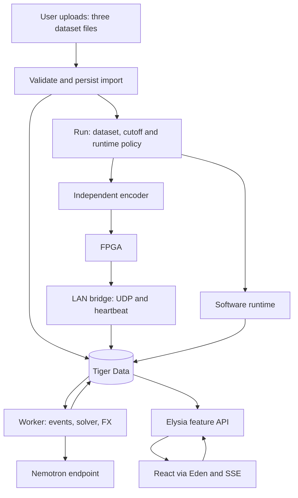

# Agent and backend architecture

## Steps

- [ ] Establish the workspace, Elysia application contract, and vendor compatibility gate.
- [ ] Add Tiger Data persistence, browser uploads and immutable dataset imports.
- [ ] Integrate interchangeable FPGA/software execution and causal replay/recovery.
- [ ] Build incident projections and countdown estimates.
- [ ] Implement and validate system-wide response planning.
- [ ] Add FX operator agents and bounded domain tools.
- [ ] Connect the existing React frontend through Eden and retire its bundled backend paths.
- [ ] Verify upload, dataset/time/runtime selection, fallback and the end-to-end demo.

## Summary

Build a feature-organized Elysia API for the React console, using Eden Treaty for typed HTTP, Tiger Data for PostgreSQL/Timescale storage, and Vercel FX's TypeScript SDK (`libfx`) for operator agents. Accept user-uploaded datasets, support dataset/time selection, and run inference through interchangeable FPGA or software execution with explicit provenance and recoverable fallback. Keep detection, countdowns, simulation, fleet feasibility and cost calculation deterministic; use agents to investigate, compare alternatives and explain validated recommendations.

**Proposal, not implemented behavior.** This owner plan does not change `global_plan.md`, C2–C10, or Lucas's FPGA plan. Jason/Gurneal approve application contracts; Lucas/Mudit approve relevant hardware/model interpretations. The supplied image is role inspiration only.

---

## Problem frame and requirements

The current main checkout contains research and plans. The reviewed `origin/frontend-v1` revision `ae6fea5` adds a Next.js/React application under `frontend/`, including a prototype server-side engine. Preserve that UI/host but do not treat its bundled engine as the core implementation or authoritative backend. The working demonstration must prioritize correct decisions on unseen networks over a large autonomous-agent framework.

- **R1 — Chosen stack:** Elysia API, React frontend, Eden Treaty RPC-like client, feature-based backend organization, Tiger Data persistence; evaluate FX before substituting AI SDK.
- **R2 — Current hardware:** accept v1 RESULT/ALERT/STATS, preserve VALID/HELD/INVALID/DROPPED and reason bits, and send the 1 s heartbeat. The four independent outputs are leak, degradation, failure and observed facility shut-in—not four exclusive actions or faults.
- **R3 — Runtime isolation:** load only the three organizer inputs; no answer key, fixed IDs or future evidence. Default analysis time is telemetry's last timestamp. Recorded observations remain immutable.
- **R4 — Domain correctness:** inspection and null countdown for leaks/degradation; failure countdown and response planning per system, sharing the entire fleet across concurrent failures. Follow organizer repair, timing, load and revenue rules.
- **R5 — Operator experience:** consistent snapshots, prioritized incidents, provenance/evidence, validated plan alternatives, agent progress and recoverable browser updates.
- **R6 — Failure isolation:** ingestion, detection and baseline planning work without an LLM. Explicitly report stale/incomplete evidence, missing model metadata, packet loss, database trouble and unavailable explanations.
- **R7 — Safe agents:** narrowly authorized tools, bounded context/budget, replay-safe writes, and no physical dispatch, actuation, arbitrary SQL/shell, board acknowledgment or autonomous weight deployment.
- **R8 — Delivery:** separate functional replay from throughput benchmarking; demonstrate a fresh dataset without code changes and test restart/reconnect behavior.
- **R9 — User uploads and selection:** users can upload their own `network.json`, `ops.json` and `telemetry.csv`, receive actionable validation feedback, and switch between successfully imported datasets and analysis timestamps without code/config changes. Arbitrary networks and identifiers within supported schemas are required; arbitrary file formats, new sensor semantics and automatic model retraining are not implied.
- **R10 — Interchangeable execution:** support FPGA execution and a software/CPU replacement behind the same backend input/output semantics, including explicit missing-hardware fallback and development without a board. Software must not inherit the board's fixed facility/well limits, though resource quotas and validation still apply. Expose requested mode, effective runtime, capabilities, model/method versions and recovery state; no silent claim of hardware or classifier parity.
- **R11 — Single core implementation:** ingestion, interpretation, incident state, planning, simulation and agents belong to the backend and its shared runtime library. The frontend only uploads, selects, displays and submits operator intents through Eden/API. Retire its local detector/planner and direct model calls at cutover; Next routes may proxy/authenticate, not recompute domain results.

### Scope boundaries

No FPGA redesign, model training, automatic retraining, weight upload orchestration, industrial safety control, Kubernetes, Kafka, Redis, vector database, or six independently deployed agent services. Tiger Data is the operational database, not a reason to add RAG.

### Deferred to follow-up work

- Multi-host FX session durability through Workflow's Postgres World; not required for a single demo host.
- Separately instantiated specialist agents, additional model tiers and parallel delegation, after one coordinator works.
- Full continuous-time fleet scheduling and proof of global optimality; MVP search restrictions must be disclosed.
- Arbitrary-format ingestion and user-defined sensor/schema mapping. MVP uploads use the three challenge schemas.
- Hot state transfer between FPGA and CPU without reconstruction. Switching or seeking backward must rebuild a clean runtime state from causal records or a compatible checkpoint.
- Model registry deployment controls and human-approved weight updates, once C7/O12 ownership is settled.

---

## Context and framework decisions

### Local authority

- `global_plan.md` §2/§5: hard rules and cross-team contracts; C9 proposed and C10 open.
- `docs/plan/lucas/fpga_hardware_plan.md`: current v1 wire format, slots and streaming logistic heads.
- `docs/plan/lucas/review_notes.md`: verified countdown issues and proposed corrections; not adopted protocol changes.
- `docs/plan/jason/nemotron-inference-provisioning.md`: planned authenticated OpenAI-compatible Nemotron endpoint; not evidence it is deployed.
- `docs/research/FPGA_CLASSIFIER_HANDOFF.md`: retained channel/output semantics and observability guidance only. CNN/window fixtures and answer-key-reading research scripts are not runtime components.

No `docs/solutions/` was found. The frontend branch provides an existing presentation layer and useful consumer-contract evidence; its bundled backend is not the runtime fallback to preserve or transplant.

### Stack selection

| Layer | Proposal | Reason |
| --- | --- | --- |
| API | Bun + Elysia | User choice; persistent HTTP/SSE server, not the FPGA packet decoder |
| React client | Eden Treaty, current documented package `@elysia/eden` | Typed existing HTTP routes; no second RPC framework |
| Agent harness | Direct `libfx`, initially the researched 0.0.16 API | TypeScript types, custom host tools, custom OpenAI-compatible providers; no automatic native shell/filesystem tools |
| Model | Authenticated Nemotron/vLLM endpoint | Existing team provisioning direction; validate actual served model/tool parser |
| Storage | Tiger Data PostgreSQL + Timescale hypertables | Relational operational state plus time-series observations |
| SQL access | Bun SQL and versioned SQL migrations | Small dependency surface; parameterized queries and explicit transactions |
| Background work | One worker, PostgreSQL jobs and transactional outbox | Survives API requests without adding a separate queue product |
| Live UI | Elysia typed SSE consumed through Eden | One-way dashboard/progress updates; normal POSTs for commands |
| Inference execution | FPGA adapter or `packages/fpga-sim/` software adapter | Same backend-facing semantics; hardware-specific limits stay at the hardware boundary |

**FX is not missing a TypeScript SDK.** Use `createFxAgent` for conversations and `libfx/durable-local` with an explicit persistent session directory. The older single-conversation API is now `createFxEngine`; do not copy pre-0.0.14 examples unchanged. Create named agent configurations once per worker process, not per request.

Direct `libfx` documents Bun support and custom `{name, baseUrl, models}` providers that send OpenAI Chat Completions requests. This matches the planned Nemotron endpoint. Actual tool calling, native package loading and local session recovery still need a compatibility gate.

The alternative `@ai-sdk/harness-fx` supports custom tools, but its documented design still stores state in a sandbox and its custom vLLM provider path is not established by the adapter docs. It offers no necessary advantage here. Do not interpret `AI_GATEWAY_BASE_URL` as a generic vLLM endpoint.

**Fallback order:** if Bun native FX fails, first consider a Node-based agent worker while keeping Elysia on Bun. If FX/provider integration still fails, replace only the agent runtime with AI SDK `ToolLoopAgent` and `@ai-sdk/openai-compatible`. Do not run two harnesses in production or build a general plugin system. Pin tested versions and retain a lockfile; all FX APIs are experimental.

This agent-harness fallback is separate from the user-selectable **inference execution runtime** (FPGA/software) and from the **dataset/replay timestamp** being analyzed.

---

## High-level technical design

> This illustrates the intended approach and is directional guidance for review, not implementation specification. The implementing agent should treat it as context, not code to reproduce.



### Deployment shape

Use one long-lived board-connected computer for the hardware demo, with separate encoder, bridge, API and worker processes. Share one repository and domain modules, not separate microservices. Keep the existing `frontend/` Next.js/React host; it may proxy to Elysia under the same origin. Its SSR reads and browser Eden client use the same backend authority. A software-only deployment needs no board/UDP process. Tiger Data and Nemotron may be remote services.

The existing direct Ethernet link is local to Lucas's PC. A cloud deployment cannot receive that private UDP stream automatically. If API/worker move remotely, retain a LAN bridge and add authenticated outbound batching; that is a deployment variant, not an assumed capability. Confirm whether the chosen board host is Linux/macOS or Windows: the researched native FX package supports Linux/macOS, so a Windows board host needs a verified remote worker or compatible environment.

Encoder independence is an existing requirement: an API or agent crash must not stop DATA reaching the FPGA. Put heartbeat handling in the bridge, outside model work. Heartbeat policy must represent receiver ability to retain observations, not just process liveness; stop claiming healthy retention if the bounded local spool is exhausted. Board replay is best effort, not an end-to-end delivery acknowledgment.

### Processing and publication

1. Import validates the three allowed files and creates an immutable import identity from file hashes. Preserve source bytes or parsed records and the topology-derived slot map.
2. An analysis run identifies the dataset, mode, active cutoff, calibration and board configuration epoch. Importing a week does not authorize reading future samples at an earlier cutoff.
3. Bridge validates packet sizes/version/source, decodes batches, retains raw values and provenance, and deduplicates inside a known board epoch. Invalid packets are quarantined/counted, not accepted as health.
4. Persist accepted observations and projection work transactionally. A worker assembles coherent system timesteps from expected slots. Missing facilities yield explicit incomplete coverage after a bounded wait, not fabricated samples.
5. Project incident lifecycle and observed shut-in state. Publish the operational snapshot without waiting for an LLM. Recompute deterministic response plans when a system's relevant inputs change. Immediately mark prior recommendations stale; expose their input revision, the current revision, and replacement status (pending, ready, failed or unavailable). Historical advice is not current advice. Only a baseline evaluated against current inputs can be labeled current.
6. Store immutable plans against a system input revision. Unique job keys, leased claims with fencing tokens, and compare-and-publish prevent an old worker or FX turn from replacing a newer recommendation.
7. Agent work is triggered by incident transitions, materially changed validated plans, explicit operator questions or handoff requests—not every RESULT or STATS packet. Coalesce duplicate triggers by run/system/revision/task.
8. Commit projections/publication and outbox entries together. Serialize every publication within a run by locking its publication-counter row before changing published state and allocating its next cursor, holding that lock through commit. All publishers, including API scenario writes, use this boundary. Cursors name a contiguous committed publication prefix, not the largest allocated sequence ID. Read snapshot state and its cursor in one consistent database snapshot. Stream only committed application events; reconnect recovers from a cursor or reloads a snapshot.

Recommendations never reserve trucks in the observed recording. An intervention scenario has its own revision, fleet ledger and trajectories. Accepting or acknowledging advice is not physical execution.

### Upload, replay and runtime contract

**Upload once, analyze repeatedly.** The frontend submits the three named files to the backend, rather than discovering server-local folders. Validate file sizes, schemas, IDs/references, metric names/units, timestamps and numeric values before activation; distinguish fatal schema errors from supported missing/invalid observations. Preserve immutable original input and content hashes. Upload status/progress and validation errors are API resources; a rejected/incomplete import cannot be selected as ready. No runtime answer-key access, arbitrary server paths or implicit archive extraction. Initially use a three-file upload rather than accepting arbitrary archive formats.

**Dataset, analysis time and execution mode are separate selections.** A run pins an import, causal cutoff, model/config version and requested execution policy (`fpga`, `software` or `auto`). `auto` uses a healthy, compatible FPGA when available and otherwise software; explicitly pinned FPGA mode reports unavailable rather than silently substituting. Persist the effective runtime and capabilities. The UI consumes one snapshot/progress contract whichever adapter produced observations; it never contains its own fallback engine.

**One backend-facing runtime boundary, two adapters.** Share logical configuration/record/result/alarm/stats contracts, reset/lifecycle behavior and versioned capabilities. The FPGA adapter owns binary encoding, slot allocation, packet validation, network health and physical control-plane sequencing. The software library consumes equivalent logical inputs and emits equivalent logical results without UDP or fixed-size facility/well arrays. Do not make extended software topology fit by truncating records or silently changing v1. Packed v1 support remains limited to what its field widths can represent, separate from the logical software API.

**Hardware eligibility is per run, not per upload count.** The present board supports at most 32 facilities and 8 wells per facility plus fixed record numeric ranges; it has one active configuration/stream context. A valid larger upload can still run in software, subject to documented memory/concurrency quotas. Report why FPGA execution is unavailable and require arbitration for concurrent hardware runs. The software path has no board-derived fixed topology cap; that does not mean unbounded compute or support for arbitrary schemas.

**Seeking/switching is stateful work.** For a backward seek, dataset change or runtime replacement, create a new execution run linked to its parent and rebuild from the dataset start through the requested cutoff, or restore a checkpoint proven compatible with that runtime/model/config. Reset causal memory and isolate old packets/jobs; never use records beyond the target cutoff. Until the new run reaches the selected time with adequate coverage, expose rebuilding/degraded state and mark previous advice stale. The browser switches its active run/subscription when the backend publishes readiness; no cross-runtime incident/history blending.

**Hardware failure is not a successful inference.** A configured automatic fallback starts a linked software run and replays causal input before publishing current advice. Late FPGA results cannot overwrite the replacement. Model/config parity and thresholds must be validated: software can expose rules/countdown-only capabilities when weights or exact reference semantics are unavailable, but model scores remain unavailable and the UI shows the capability loss. Do not translate absence of the classifier into healthy equipment. Return to hardware through explicit reconfiguration/rebuild, not opportunistic mixing of outputs.

**Model boundary:** arbitrary uploaded networks do not require changing the four output heads or retraining per upload. Generalization still needs validation, and software integer/feature parity depends on the approved reference and weights metadata. Any actual feature, quantization or model-format change remains Mudit/Lucas-owned. Countdowns corrected only on the host remain a distinct method from hardware behavior.

---

## Agent design

Start with **one operator coordinator**, one harness and one Nemotron endpoint. Role-specific prompts organize judgment without requiring a six-agent conversation on every incident.

| Image role | MVP responsibility | Mechanism |
| --- | --- | --- |
| Orchestrator | Investigate questions, assemble cited conclusions, choose useful comparisons | FX coordinator with bounded tool loop |
| Fleet planner | Schedule and compare responses across all ongoing failures in one system | Deterministic solver; agent chooses comparisons and explains trade-offs |
| Well economist | Compute lost revenue, cost of avoided water and scenario costs | Deterministic economics functions used by solver/tools |
| Inspection agent | Draft prioritized inspection rationale for leaks/degradation | Domain rule determines action; coordinator explains evidence |
| Shift handoff | Summarize unresolved incidents, plans, uncertainty and pending work | On-demand prompt over persisted facts and plans |
| Retrainer | Offline evaluation and approved model lifecycle | Deferred; not a runtime autonomous agent |

If delegation later helps, split an evidence investigator and response analyst behind explicit tools with bounded results. They share the same services and revisions, not independent fleet state. Do not let multiple agents each allocate the whole fleet.

### Tool boundaries

- Reads: list systems/incidents, get a system snapshot, get incident evidence, query bounded metric history, read an existing plan/scenario, list permitted capabilities.
- Computation: solve system response, validate a candidate schedule, compare alternatives, simulate a what-if. The host—not the prompt—enforces scope and input limits.
- Writes: create/update an explicit hypothetical scenario and publish an explanation or handoff draft. Match UI capabilities using the same services and authorization; audit scenario changes and reflect them in the UI.
- Completion: finalize a bounded analysis with evidence IDs, input revision, plan IDs and explicit unknowns. The server validates these references before marking the analysis successful. Model prose is never a substitute for a validated plan.

Server context fixes operator identity, authorized run/system/scenario, as-of cutoff and input revision. Model arguments cannot widen that scope. Validate arguments inside execution callbacks; reject unknown IDs, future windows, oversized queries and attempts to cross scenarios. Treat evidence strings as untrusted data, not instructions.

Every FX tool declares `idempotent`; every mutating tool also declares `writes: true`, so FX persists the call before executing its effects. Replay-safe writes use that stable execution ID with a database uniqueness constraint in the same transaction as the mutation. An idempotent tool without the write barrier can execute before journaling and receive a new execution ID after recovery, so database deduplication alone is insufficient. Agent session persistence is separate from application jobs/plans: use the FX session store for conversation continuity, PostgreSQL for authoritative domain state. Record the mapping from job/run/operator to FX session and turn.

Persist sanitized tool calls/results, prompt/model versions, evidence references, duration, token usage and failure status. Do not expose provider credentials, internal prompts or private model reasoning through the live feed. Enforce maximum turns, model deadline, concurrency and tool/query limits. Cancellation and browser disconnection are separate: background analyses may continue after disconnect; explicit cancel stops the turn. Persist failures and offer an explicit retry against current evidence.

---

## Deterministic domain layer

### Incidents and countdowns

Open/continue/resolve faults from documented, versioned host interpretation of RESULT plus causal telemetry. Hardware ALERT is an alarm transition, not the entire incident lifecycle; acknowledging a latched alarm does not repair a pump.

- Store four raw logits, model version, calibration metadata and rule bits separately. `weights_ver=0` and unknown versions have unavailable model scores; never manufacture 0.5 confidence by applying sigmoid to an unloaded model's zeros.
- Dequantization scale, thresholds/persistence and recovery evidence need Mudit/Lucas agreement. VALID/HELD semantics remain visible. INVALID/DROPPED/missing samples cannot clear faults or establish healthy status. If rule input validity cannot be established from v1 fields, report uncertain instead of inventing a per-rule validity mask.
- Leak/degradation can become unobservable while a pump is off; do not resolve them just because their signal disappears. Degradation followed by failure remains two events. Observed shut-in is separate facility state and can coexist with failure.
- Failure countdown proposal: use causal facility-inflow history with failed-pump outflow zero. Check already-at-limit first, returning zero even when inflow is zero. Preserve the board estimate and discrepancy; this is a host correction proposal for O7, not a claimed FPGA fix.
- Decode wire minutes into API hours once. Preserve the ambiguous `0xFFFF` meaning (not filling or beyond representable range). Min/mean/max envelopes are not validated percentiles despite legacy p10/p50/p90 field names. Show method, source, quality and availability.

### Planner contract and MVP decision space

Objective: minimize trip cost plus lost oil/gas revenue across all ongoing pump failures in one system, over each event's **remaining** expected repair horizon. Always compute a do-nothing baseline. All trucks start free when advising at recorded now; hypothetical prior commitments exist only inside a scenario.

Implement a deterministic candidate search and an independent event-driven schedule validator. Initially search immediate truck-job allocations across facilities (including zero), integer trip counts bounded by remaining repair time, well subsets and a shared delayed shut-in time per subset. Candidate shut-in times include a disclosed five-minute grid and horizon boundaries. Use deterministic branch ordering, prune infeasible candidates, and impose a runtime budget. Validate continuous tank evolution at arrivals, shut-ins, repairs and threshold crossings—not only at sampled grid points.

**Guarantee:** best feasible candidate found in that declared policy space, not a global continuous-time optimum. Mixed responses, accepting a trip and doing nothing must all be considered. Partial or timed-out searches return the incumbent, feasibility status, searched policy/version and any valid bound—not an unsupported claim of cheapest possible response. Sequential truck reassignment and independently staggered well shut-ins are follow-up search extensions. This restriction trades global optimality for a correct demo and is a deliberate proposal for team review.

Validator must enforce:

- First arrival = job start + `response_min`; subsequent arrivals add `cycle_min`.
- Full fixed truckloads at arrivals only; reject removal exceeding tank water, including simultaneous trucks. No clipping or continuous drainage.
- Every trip strictly before repair end. Busy until last arrival + `cycle_min`; no mid-job reassignment. Combined occupancy never exceeds the system fleet.
- Instant well shut-in at its specified time, lasting until repair, with oil/gas/water all stopped. Lost revenue uses the supplied per-well rates and prices.
- Automatic tank trip shuts all wells until repair; a later truck cannot retroactively prevent the trip or restart production.
- Repair horizon derives from detected onset and ops duration, never answer-key times. Left-censored onset or overdue ongoing failure yields an explicit uncertain-horizon/partial result; expected repair time alone does not resolve the observed fault.
- Boundary simultaneity, especially arrival exactly at shutdown, needs one documented conservative event ordering; do not credit an unproven prevention at equality.

Scenarios store assumptions and their parent observed revision. Simulated results never update source telemetry, observed shut-in state or actual fleet availability.

---

## Persistence and API shape

### Tiger Data model

Use ordinary PostgreSQL tables for mutable relational/application records; use Timescale hypertables for append-only time series. No Tiger-specific JavaScript SDK is necessary.

| Storage | Records and identity |
| --- | --- |
| Relational | Dataset imports/file hashes, ordered topology/ops, analysis runs, board epochs and model metadata |
| Relational | Upload/validation status and file records; run parentage, requested/effective runtime, capabilities, cutoff and configuration/model identity |
| Hypertable | Telemetry: import + asset + metric + event time; retain original values and validation annotations |
| Hypertable | Inference results: run + board epoch + result number + event time, including raw logits/countdowns/quality |
| Relational / time-series | Hardware alert transitions and STATS; separate alarm replay identity and wall-clock board freshness |
| Relational | Incident revisions, system snapshots and coverage, immutable plan revisions, scenarios and simulated outputs |
| Relational | Jobs/claims/fencing, outbox/cursors, agent analyses/session references, tool audit and operator annotations |

Every hypertable unique key includes its time partition column; use an ordinary receipt table if a global result-number constraint independent of timestamp is required. Conflicting duplicate payloads are quarantined, not silently overwritten. Do not identify an import using only `ops.dataset_id` because snapshots can share it. Keep event time, ingestion time and wall-clock liveness distinct.

Use one bounded TLS-enabled pool per process, parameterized values and versioned migrations. Do not disable certificate verification. Disable automatic time-based retention/columnstore policies for the demo: newly imported October data is already old relative to wall clock. Add service-version-compatible hypertable syntax after checking the actual Tiger instance. Batch ingestion and bound queues; do not write one cloud transaction per UDP record.

### Feature API (C10 proposal)

| Feature | HTTP surface |
| --- | --- |
| Datasets/runs | Upload/validate the three files; list ready imports; select dataset/cutoff/runtime policy; create/start/pause/cancel runs; seek through isolated rebuilds; read progress and eligibility |
| Systems | Read topology, coherent operational snapshot, coverage and observed fleet context |
| Telemetry | Read bounded metric series at or before the run cutoff |
| Incidents | List with required priority ordering; inspect evidence and lifecycle; optional SPEC-shaped export |
| Planning | Request/read system-level plan revisions and deterministic alternatives |
| Scenarios | Create/edit hypothetical actions and simulate; never dispatch |
| Agents | Start/read/cancel an analysis or conversation; request a handoff; read sanitized progress |
| Live/health | Resume committed updates from cursor; report API/DB/board/worker/provider health separately |

All reads and commands have explicit run context, authorization and validated inputs. Mutating commands accept idempotency keys; long operations return job/run identifiers promptly rather than holding an HTTP request until the model finishes. Contract schemas live with the owning feature and carry timestamp units, quality, method/version and nullable/unknown states.

Snapshot responses include run identity, projection revision, analysis cutoff, coverage, recommendation freshness/replacement status and an outbox cursor from the same consistent database snapshot. The subsequent stream replays changes after that cursor, then follows live commits. Filter by authorized run; expired cursors request a fresh snapshot. SSE event envelopes are application-owned tagged unions; do not expose raw FX NDJSON as if Eden automatically types it. Browser consumers apply revisions idempotently and cancel the stream on unmount.

Snapshots also carry requested/effective execution mode, source-specific health, supported capabilities and rebuild/fallback reasons. Unknown scores/countdowns must be typed unavailable states rather than mandatory numbers or a `999` sentinel. The frontend preserves upload/dataset/replay controls but replaces local filesystem-engine reads, `/api/brief` direct model generation and local event-export computation with backend API calls (or thin proxies). Keep `/api/events` download semantics distinct from SSE subscriptions. No domain computation runs in a Next proxy or browser fallback.

Export the Elysia application type from a listener-free app module, use type-only imports in React, and chain feature registration so route inference accumulates. Align Elysia/Eden versions and TypeScript settings. Eden provides typed HTTP, not React query state: a thin client hook/cache layer owns pending/error states and invalidation.

For SPEC export, internal schedules may be richer than `recommended_actions`. Do not flatten a delayed truck job into an immediate dispatch; export only representable actions or explicitly document an agreed extension. Internal API may report confidence unavailable; do not invent a number to satisfy an optional export.

---

## Output structure

Proposed paths; no application files exist yet. Each feature owns route/controller, schema/model, service and persistence modules as needed, not four mandatory empty files. Business services must not depend on Elysia contexts or FX types.

```text
apps/
  api/src/
    app.ts                 # composition and exported App type; no listener
    index.ts               # HTTP bootstrap
    worker.ts              # jobs, solver and agent execution
    bridge.ts              # UDP receiver and heartbeat
    features/
      datasets/            # import + run lifecycle
      systems/             # coherent snapshots, topology
      telemetry/           # observation queries and batch writes
      hardware/            # protocol, epochs, board health
      runtimes/            # mode eligibility, adapter selection, causal rebuilds
      incidents/           # causal event projection and priority
      planning/            # countdown, economics, solver, validator
      scenarios/           # separate hypothetical state
      agents/              # runtime.ts, prompts/, tools/, audit
      live/                # snapshot cursor, typed SSE
    infrastructure/
      database/            # pool + migration boundary
      jobs/                # claims, leases, fencing, outbox
      config.ts
      auth.ts
  encoder/                 # independent host process; reuse agreed converter
frontend/src/              # preserve existing Next.js/React application
  lib/api.ts               # Eden client with type-only App import
  components/console/      # existing UI; upload/runtime/recovery states added
  app/                     # SSR/backend reads; proxy-only API routes if retained
packages/
  domain/                  # pure shared simulation/protocol types only as needed
  fpga-sim/                # software replacement + common logical runtime contract
db/migrations/
tests/integration/
```

Do not create a duplicate root-level controllers/services/repositories taxonomy. Keep generic infrastructure genuinely small. Frontend imports must not pull database, credentials, native FX or server bootstrapping into its runtime bundle.

---

## Implementation units

### U1. Workspace, API composition and compatibility gate

**Goal:** establish the API foundation and test agent compatibility in parallel. **Requirements:** R1, R7. **Dependencies:** none for the foundation; endpoint credentials/provisioning only for the separate live compatibility track.

**Files:** root workspace manifests/lockfile and TypeScript configuration; `apps/api/src/app.ts`, `apps/api/src/index.ts`, `apps/api/src/features/agents/runtime.ts`, `frontend/src/lib/api.ts`; tests `tests/integration/api-contract.test.ts`, `tests/integration/fx-provider.test.ts`.

**Approach:** foundation track defines app/listener separation, feature plugin composition and strict type-only client consumption. Independent compatibility track defines the direct libfx boundary and explicit session directory, then tests one harmless custom read tool against the actual Nemotron endpoint. U2 may start when the foundation is ready; a missing endpoint must not block persistence, hardware, deterministic planning or their React views. U6 requires the compatibility track to pass or select the documented fallback. Follow official Elysia/Eden and libfx docs, not obsolete examples.

**Test scenarios:** an Eden client infers a feature response; importing its type does not execute server code; the served model emits a tool call and consumes the result; unknown tool/invalid arguments fail; absent credentials are rejected/redacted; session survives a worker restart on persistent disk; missing native package gives an actionable compatibility failure. Verify Bun versus Node fallback without changing the API contract.

**Verification:** record tested versions/backend/model ID, streaming/tool-call result and selected runtime; no claim of compatibility based solely on an OpenAI-compatible URL.

### U2. Persistence, import and causal run context

**Goal:** user-uploaded immutable datasets and run-scoped queries. **Requirements:** R1, R3, R9, R10, R11. **Dependencies:** U1 foundation track only, Tiger service connection; no agent endpoint required.

**Files:** `db/migrations/001-observations.sql`, `apps/api/src/infrastructure/database/index.ts`, `apps/api/src/features/datasets/{index,model,service,repository}.ts`, `apps/api/src/features/telemetry/{service,repository}.ts`; tests `tests/integration/dataset-import.test.ts`, `tests/integration/timescale-identity.test.ts`.

**Approach:** implement the browser upload/validation/status contract; allowlist file names, validate schema relationships and source timestamps, preserve topology order, create import/run identities and versioned migrations. Store requested/effective runtime, capabilities and parent/rebuild linkage. Dataset import status remains incomplete until all files validate. Follow organizer schemas rather than offline research-script entrypoints or the frontend's bundled engine.

**Test scenarios:** unfamiliar asset IDs upload/load without code changes; upload progress and validation errors render; oversized/wrong-schema/missing-file submissions reject activation; repeat import is idempotent; same ops ID with different telemetry creates distinct imports; malformed metric/topology rejects activation; files named answer key are never opened; a past cutoff excludes future samples and derived state; larger valid topology remains software-eligible but FPGA-ineligible; hypertable identity includes time; conflicting duplicate values are surfaced; database interruption leaves a retriable incomplete import, not a ready run.

**Verification:** final snapshot uses last telemetry timestamp; October data remains queryable in November without wall-clock retention deleting it.

### U3. Board bridge, epoch handling and bounded delivery

**Goal:** interchangeable software/FPGA execution without blocking independent encoding. **Requirements:** R2, R6, R8–R11. **Dependencies:** U2; software library contract; Lucas agreement on hardware epoch/configuration boundary for the FPGA adapter. Software-only integration need not wait for physical hardware.

**Files:** `packages/fpga-sim/`, `apps/api/src/bridge.ts`, `apps/api/src/features/runtimes/{model,service,fpga-adapter,software-adapter}.ts`, `apps/api/src/features/hardware/{protocol,service,repository}.ts`, `apps/api/src/infrastructure/jobs/outbox.ts`, `db/migrations/002-hardware-jobs.sql`; tests `tests/integration/hardware-ingest.test.ts`, `tests/integration/runtime-switching.test.ts`, `apps/api/src/features/hardware/protocol.test.ts`, library tests under `packages/fpga-sim/`. Encoder implementation remains coordinated with its owner; `apps/encoder/` is the proposed location, not an assumed existing converter.

**Approach:** define one backend-facing logical execution contract and explicit capability checks; integrate software as a normal runtime, not a frontend fallback. Implement exact little-endian v1 parser, expected-source filtering, topology slot lookup, batched persistence/local bounded spool, result receipts and alarm-transition deduplication. Do not change wire fields or force software data into hardware-sized arrays. Refuse ambiguous association after reset/reconfiguration until synchronized. Add isolated rebuild/seek/fallback lifecycle; keep functional run and benchmark sinks distinct.

**Test scenarios:** RESULT/ALERT/STATS fixtures decode exact widths/status/sentinels; bad magic/version/count/length rejects; replayed results do not duplicate incidents/jobs; alerts before their RESULT wait/reconcile; source sequence gaps and counter reset are visible; reused slots from another network cannot attach silently; stalled DB/spool exhaustion changes health; model/API failure does not delay heartbeat; malformed traffic cannot exhaust unbounded buffers; board absent supports explicit software mode and auto fallback; pinned FPGA mode reports unavailable; backward seek and provider switch rebuild only through the cutoff; late old-runtime output is fenced; more than 32 facilities/8 wells works in logical software mode; unsupported classifier capability is visible, not healthy; concurrent physical runs cannot overwrite one board configuration.

**Verification:** replay-safe durable receipt within a known epoch, explicit loss accounting, and a measured heartbeat under representative load. No unmeasured lossless or line-rate persistence claim.

### U4. Incident projection and countdowns

**Goal:** coherent causal operational state independent of the LLM. **Requirements:** R2–R6. **Dependencies:** U2, U3, model metadata/host interpretation agreement.

**Files:** `apps/api/src/features/incidents/{index,model,projector,repository}.ts`, `apps/api/src/features/systems/{model,service}.ts`, `apps/api/src/features/planning/countdown.ts`, `db/migrations/003-incidents.sql`; tests `apps/api/src/features/incidents/projector.test.ts`, `apps/api/src/features/planning/countdown.test.ts`, `tests/integration/system-revisions.test.ts`.

**Approach:** build timesteps with coverage; version interpretation and incident revisions; keep shutdown state separate; preserve raw/host estimate comparison. Follow `global_plan.md` hard rules and explicitly proposed O7 correction.

**Test scenarios:** simultaneous failure/shut-in yields one failure plus observed state; degradation then failure remains separate; zero-weight/unknown-version scores unavailable; bad/held/gapped evidence cannot silently clear faults; leak becoming unobservable stays uncertain; alarm acknowledgment is not resolution; failed-pump prior running flow does not corrupt the host countdown; already-at-limit plus zero inflow returns zero; leak/degradation countdown null; one missing facility produces incomplete coverage; alert order obeys urgency and revenue tie-break.

**Verification:** deterministic reconstruction at a cutoff reproduces the same revisions/estimates without future evidence or an agent.

### U5. System response search, validation and scenarios

**Goal:** trustworthy recommendations and isolated what-ifs. **Requirements:** R3–R6. **Dependencies:** U4.

**Files:** `apps/api/src/features/planning/{index,model,economics,solver,validator,simulation,repository}.ts`, `apps/api/src/features/scenarios/{index,model,service,repository}.ts`, `db/migrations/004-plans-scenarios.sql`; tests `apps/api/src/features/planning/{solver,validator,simulation}.test.ts`, `tests/integration/shared-fleet.test.ts`, `tests/integration/scenario-isolation.test.ts`.

**Approach:** implement the disclosed candidate policy and continuous event validator independently; persist inputs/solver versions and immutable alternatives. Compare baseline, truck, well and mixed candidates; authorize scenario mutations through the same service used by UI/tools. Implement domain constraints test-first against SPEC examples independent of runtime answer-key access.

**Test scenarios:** two failures compete for one truck without double booking; insufficient water rejects a full load; arrival exactly at repair rejects; arrival after trip cannot avoid it; final return occupies the truck; late/partial well shut-in calculates correct revenue and tank trajectory; remaining—not full—repair duration is used; expired/unknown horizon is explicit; zero fleet still yields baseline/well choices; timeout yields only validated incumbent; recommendations do not consume fleet; editing a scenario cannot modify observations; an old input revision cannot publish as current; a new concurrent failure immediately makes prior advice stale while replacement is pending or fails.

**Verification:** every displayed plan passes the independent validator, beats or equals the baseline when claimed, and carries truthful policy/optimality/availability status.

### U6. FX coordinator and shared domain tools

**Goal:** grounded investigation/explanation with safe execution continuity. **Requirements:** R1, R5–R7. **Dependencies:** U1 foundation and successful compatibility/fallback selection, U4, U5.

**Files:** `apps/api/src/worker.ts`, `apps/api/src/features/agents/{index,model,runtime,service,repository}.ts`, `apps/api/src/features/agents/prompts/`, `apps/api/src/features/agents/tools/`, `apps/api/src/infrastructure/jobs/worker.ts`, `db/migrations/005-agent-analysis.sql`; tests `tests/integration/agent-tools.test.ts`, `tests/integration/agent-recovery.test.ts`.

**Approach:** one named coordinator, task-specific prompts, scoped tools and explicit completion validation; job/session linkage, idempotent writes and publication fencing. Services remain independent of harness types. Share UI and agent services; deterministic facts and plans are available before explanations.

**Test scenarios:** coordinator cites actual evidence/plan IDs; leak question requests inspection rather than a fleet plan; malicious evidence cannot grant shell/SQL/actuation; cross-run/future reads fail; repeated tool execution writes once; crash before/after FX journals a mutating call cannot bypass its write barrier or database deduplication; missing citation or stale revision prevents finalization; provider timeout leaves baseline visible; max-turn/cancel transitions are explicit; restart does not create a second analysis; old turn finishes after newer plan but cannot overwrite it; persisted/exposed data contains no credentials or private reasoning.

**Verification:** one complete incident investigation and shift handoff through real FX/Nemotron tools, with visible bounded progress and authoritative deterministic totals.

### U7. Eden routes, React integration and stream recovery

**Goal:** typed, consistent application/API integration with no frontend domain duplication. **Requirements:** R1, R5–R7, R9–R11. **Dependencies:** U4, U5; U6 for agent endpoints.

**Files:** owning feature route/schema files in `apps/api/src/features/`, `apps/api/src/features/live/{index,model,service}.ts`, `apps/api/src/infrastructure/auth.ts`, `frontend/src/lib/api.ts`, existing `frontend/src/app/page.tsx`, `frontend/src/app/api/{brief,events}/route.ts`, `frontend/src/components/console/`, and replacement type imports for `frontend/src/lib/engine/`; tests `tests/integration/api-contract.test.ts`, `tests/integration/live-resume.test.ts`, `tests/integration/api-authorization.test.ts`, `tests/integration/upload-runtime-ui.test.ts`.

**Approach:** approve C10 with Jason/Gurneal; implement upload/status, dataset/cutoff/runtime selection, typed generator SSE, snapshot cursor handoff, idempotent commands and consistent errors. Replace local Next engine and direct model calls with Eden/backend requests, including SSR and export. Retire the old computation paths at cutover rather than keeping a second authority; keep UI formatting/presentation and thin proxies if useful. Same-origin authenticated operator session, explicit allowed origins if split deployment; protect bridge ingest separately if remote. File upload limits and server-selected import locations prevent arbitrary host path access.

**Test scenarios:** snapshot-to-subscription race loses no committed event; an earlier publisher that stalls/rolls back cannot let a later cursor skip its eventual commit; snapshot state and cursor agree during concurrent API/worker publication; duplicate/out-of-order deliveries cannot regress UI; expired cursor forces resync; mixed run events are filtered; stale advice stays visibly stale when replacement fails; disconnect/reconnect resumes sanitized progress; aborted component cleans its stream; unknown state renders unknown rather than healthy; unauthorized run/session/cancel access denied; server secrets/native modules absent from browser runtime bundle; generator flush arrives incrementally rather than buffering until completion.

**Verification:** React consumes the exported App type and stream envelope; initial/reconnected dashboard agrees with the same committed system revision.

**Additional verification:** upload an unfamiliar dataset, select an earlier time, run in software without a board, then exercise hardware loss and source-labeled recovery. No client/Next import of the retired detector, solver, dataset filesystem reader or model-request implementation remains on active paths. Display unavailable confidence/coverage/runtime honestly and keep recommendations distinct from actual dispatch.

### U8. Integrated demo and operational handoff

**Goal:** demonstrate correct, recoverable end-to-end behavior. **Requirements:** R1–R11. **Dependencies:** U1–U7.

**Files:** `tests/integration/end-to-end.test.ts`, `tests/integration/degraded-modes.test.ts`, `docs/plan/jason/backend-demo-runbook.md`; proposed updates to `global_plan.md` only after the required owner approvals.

**Approach:** run mock/fresh datasets, verify local networking/hosting, process restart and persistent directories, record actual performance, and document manual recovery. Offline evaluation may access answer keys in a separate evaluation entrypoint, never through runtime imports.

**Test scenarios:** new network works unchanged; unplug board yields stale hardware plus explicit host-only capabilities, not fake FPGA scores; provider down leaves operational recommendations; DB outage/restart records gaps and reconciles retained batches; worker crash before/after commit does not duplicate publication; benchmark mode cannot create operator incidents or agent work; shutting down API leaves encoder independent; optional SPEC export preserves semantics.

**Verification:** show dataset → board → immutable observations → incidents → shared-fleet plan → cited agent explanation → React; separately show one safe what-if and truthful measured throughput scope. Document unimplemented gaps rather than claiming completion.

---

## System-wide impact, open questions and risks

**Interaction ownership:** encoder/bridge integrate with Lucas and ingest owner; calibration with Mudit; API/state/agent semantics with Jason/Gurneal. Shared services preserve UI/tool parity without giving agents broader permission than operators. Append-only observations intentionally have no edit/delete tool.

**Failure propagation:** packet/parser issues affect coverage and board health; DB issues delay publication and expose retention/loss risk; solver failure leaves baseline/explicit unknown; model failure affects explanation only. API liveness, board freshness, projection lag and agent availability are distinct health states.

**State lifecycle:** immutable imports/runs and scenario namespaces prevent replay contamination; transactions/outbox prevent partial publication; leased jobs and revisions fence late workers. FX local recovery requires persistent storage and a single worker host; adding replicas requires an explicit shared durability design.

### Resolved during planning

- Elysia is the API regardless of agent harness; React uses Eden Treaty.
- FX has a TypeScript SDK and a custom-provider path; direct embedding fits better than its sandbox-oriented AI SDK adapter.
- One FX coordinator plus deterministic specialist tools is the MVP, not six independently deployed agents.
- Tiger Data stores relational domain state and time series; FX session storage is configured separately.
- User uploads and dataset/replay selection are first-class; arbitrary networks in supported schemas do not require code changes.
- The Elysia/backend runtime library is the single core authority. The frontend's bundled engine is superseded at integration, not a second fallback implementation.
- FPGA and software execution are separate from FX/AI SDK harness selection. Hardware-specific topology bounds do not apply to the logical software runtime; switching/seek rebuilds isolated causal state.

### Owner approvals required before corresponding integration

- **Lucas + host consumers:** reset/configuration epoch boundary, delayed-packet rejection, sequence wrap and buffered replay/live reconciliation. v1 has no dataset/boot ID; host bookkeeping cannot disambiguate arbitrary stale UDP packets. Stop/reconfigure/drain/restart only under an agreed procedure, otherwise quarantine ambiguity.
- **Mudit + Lucas + Jason:** logit dequantization/calibration, thresholds/persistence, field/rule validity and recovery evidence. Until approved, expose unavailable model confidence and conservative uncertain states.
- **Jason + Lucas:** host O7 countdown correction as the primary displayed estimate, retaining board comparison; no silent protocol repair.
- **Jason + Gurneal:** C9/C10 schema, baseline/approximation wording, inspection/handoff scope and optional export envelope.
- **Team:** board-connected machine/OS and process owners; working end-to-end demo must not depend on an unassigned encoder.
- **Mudit + Lucas + Jason:** software parity/capability matrix, supported integer model metadata and reset semantics. Full classifier equivalence is not assumed until reference vectors validate it.

### Deferred implementation verification

- Actual Tiger PostgreSQL/Timescale versions, TLS/pool limits, migrations and measured batch ingest capacity.
- FX native package under the selected Bun/OS, persistent session recovery, Nemotron tool parser and model context limits. Failure invokes the bounded fallback order, not an unplanned stack rewrite.
- Solver budget and candidate counts on unseen networks; report approximation honestly. Fleet search limitations are an accepted demo trade-off only after team review.
- Stream flush and reconnect behavior through the actual browser/proxy; no assumption that a raw Response gives Eden a typed event union.
- If the operator session uses automatically attached cookies, specify CSRF protection for mutations; CORS/same-origin hosting alone is not that protection. Settle the exact authentication transport before exposing U7 publicly.
- CPU resource/upload quotas, physical-board arbitration and runtime-switch latency must be measured. Preserve the no-board development path even if hardware parity is initially partial.

### Risks and mitigations

| Risk | Mitigation |
| --- | --- |
| Experimental FX API or unsupported host | Pin tested versions, early compatibility gate, isolate runtime, retain AI SDK fallback |
| Wrong countdown or invented confidence | Separate sources/methods; conservative unavailable states; test O7 and unloaded weights |
| Stale plan allocates fleet twice | One system snapshot, independent validator, immutable revisions and conditional publication |
| Future leakage in replay | Explicit cutoff in services/tools/derived projections; clean run for backward seek |
| Cloud/agent latency blocks hardware | Separate bridge/encoder, bounded batches/spool, no model work in packet callbacks |
| Benchmark mistaken for application capacity | Separate run types and sinks; measure board, persistence and UI rates independently |
| Scope misses Sunday demo | Land deterministic vertical slice before agent refinements, delegation or workflow infrastructure |

### Suggested delivery order

U1's foundation → U2 → U3 → U4 → U5 establishes the deterministic vertical slice. U1's FX compatibility track runs independently and gates U6 only. U6 adds intelligence to working facts/plans; U7 connects the complete operator experience; U8 verifies it. API scaffolding and React integration can proceed against agreed schemas while hardware and agents are incomplete, with mocks clearly labeled. Do not present mocks as measured FPGA behavior.

---

## Sources

Consulted November 7, 2026; documentation describes capabilities, not proof this app has been implemented.

- [Organizer README](https://github.com/nihaal419/HackUTD-ZeroDay/blob/main/README.md) and [SPEC](https://github.com/nihaal419/HackUTD-ZeroDay/blob/main/SPEC.md).
- [FX TypeScript SDK, v0.0.16](https://github.com/vercel-labs/fx/blob/v0.0.16/sdk/README.md), [custom providers](https://fx.sh/docs/lib/providers), [durability](https://fx.sh/docs/lib/durability).
- [AI SDK FX adapter](https://ai-sdk.dev/providers/ai-sdk-harnesses/fx), [OpenAI-compatible provider](https://ai-sdk.dev/providers/openai-compatible-providers).
- [Eden installation/type integration](https://elysiajs.com/eden/installation), [Elysia SSE](https://elysiajs.com/essential/handler#server-sent-events-sse), [Eden stream responses](https://elysiajs.com/eden/treaty/response#stream-response).
- [Bun SQL](https://bun.com/docs/runtime/sql), [Tiger hypertable unique indexes](https://www.tigerdata.com/docs/build/performance-optimization/hypertables-and-unique-indexes), [retention semantics](https://www.tigerdata.com/docs/reference/timescaledb/data-retention/add_retention_policy).
- [vLLM tool calling](https://docs.vllm.ai/en/latest/features/tool_calling).
