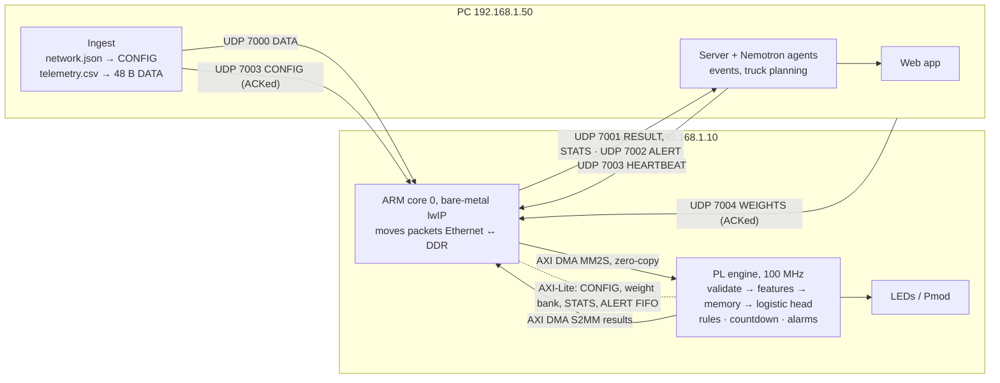
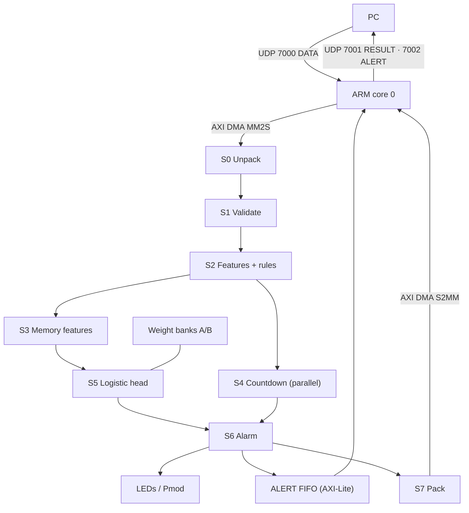

# FPGA Hardware Plan — Beat the Shutdown

Nov 7, 2026 · @Lucas

> **Repo copy of the FPGA source of truth.** Live doc: https://claude.ai/artifact/1fzKUqpVAnbrWTYDQkEmEQ
> (owned by Lucas; **never edit the live doc from automation**). Snapshot exported Sat Nov 7 2026; newest
> changelog row is Sat 21:20 CST. The text below is unchanged except for Markdown cleanup (table line
> breaks, escaped characters) and two diagrams redrawn from the surrounding text because the export
> dropped the embedded figures. When the live doc changes, update this copy and add the changelog row.
> Cross-check findings from the repo side are kept separately in [`review_notes.md`](review_notes.md) so
> this file stays Lucas's text.

The Eclypse Z7 ingests facility telemetry over Ethernet. In the FPGA fabric it validates and normalizes each record, runs the logistic-regression classifier on current and memory features, and runs the rule checks and tank countdown. It returns a result for every record, plus alarms, to the server and its Nemotron agents. The goal is that the Ethernet link, not the FPGA, limits throughput.

## Start here: who builds what

The I/O contract (v1) is stable enough to code against. Any change gets a changelog row below and a version bump in the packet header. Byte layouts are under **I/O contract**.

| Who | Read first | Build now | What may still change |
| --- | --- | --- | --- |
| Mudit (ML) | Model definition and ML handoff (memory feature set v1), then "Asks for Mudit" | Train 4 logistic regressions on memory feature set v1; `features_int.py` (bit-exact integer features); streaming golden vectors; int16 export | Weight blob format (follows his quantization) |
| Ingest (PC) owner | I/O contract: ports, DATA, Facility CONFIG, GLOBAL CONFIG, ingest rules | `ingest`: `network.json` → CONFIG packets; `telemetry.csv` → 48 B DATA records, timestep-major, UDP 7000 | Bounds values in CONFIG |
| Server / agents owner | RESULT, ALERT, STATS, HEARTBEAT; Autonomous mode and alerts | Send a HEARTBEAT every 1 s; consume RESULT and ALERT; build events (onset / ongoing / resolved); plan trucks; compute the fallback countdown band | ALERT acknowledgement (open question 7) |
| Web app owner | RESULT, ALERT, STATS fields | Per-facility status, scores, countdown, alarms; throughput from STATS | Nothing major |
| Lucas (FPGA) | Everything | Engine microarchitecture → RTL → proofs → board | Engine internals only; the wire format stays v1 |

## Status and changelog

The end-to-end link works today: browser → PC web server → UDP → board ARM → AXI → FPGA multiplier and back, 506/506 correct at 0.51 ms median round trip. On the board, the ARM measured 1 GbE line rate (2.45M records/s, 0% loss) on a zero-copy path. The I/O contract v1 and engine microarchitecture v2 are ready. Next is RTL and formal proofs.

| When (CST) | Change |
| --- | --- |
| Sat 21:20 | Measured the ARM's UDP receive ceiling on the board. - With 1472 B packets: 1 GbE line rate, 0% loss, about 2.45M records/s. - Only if the ARM never copies the payload. Copy, or copy + cache flush, collapses delivery to about 1–4k packets/s.  Design change: zero-copy PS→PL path. DMA reads straight from the received buffers, and the ARM drops excess packets itself before the Ethernet receive ring can starve. |
| Sat 21:06 | Decided: single 100 MHz clock for the whole PL engine. Started the ARM UDP receive-ceiling measurement on the board. |
| Sat 21:10 | Model switched from CNN to four logistic regressions on causal-memory features; the CNN is dropped. Reason: the CNN's 96-step window meant 7 h 55 min without valid output after every start or reset.  Engine redone as v2: - 7 stages, 16 cycles per record - proposed single 100 MHz clock - about 10 DSPs - instant weight swap, no warm-up  RESULT field `warmup_left` renamed `since_reset`; status 2 is now reserved. Memory feature set v1 proposed for Mudit to validate. |
| Sat 21:00 | Engine microarchitecture v1 written up as a proposal for Lucas to correct: - clocks - PS↔PL path - stage-by-stage pipeline - state, weight and config memories - swap/replay controller - alarms - register map - proof partitioning - resource estimate |
| Sat 20:50 | Engine decisions: - 1 GbE build; 5 GbE is a scalability exercise only (parametric RTL, synthesis report), not required to run on this board - same-facility hazards: scoreboard stall - weight swap: recompute histories from 96 stored input steps (about 1 ms pause per swap) - overload: back-pressure into the ARM  Proposed cycles-per-record: 64 at 200 MHz. |
| Sat 20:45 | Doc made team-ready. Changes: - added Start here - replaced the stale I/O contract, microarchitecture, CNN and open-question text with the current decisions - added layouts for GLOBAL CONFIG, CONFIG_ACK, HEARTBEAT, STATS and WEIGHTS - added the ingest slot rules |
| Sat 20:40 | Decided: 5-bit flat facility ID (32 slots). The FPGA raises E-STOP and Night Shift in every mode and also reports them to the agents (ALERT packet). ALERT record defined; the facility index moves to Pmod JB. |
| Sat 20:35 | Server-down mode decided: - heartbeat every 1 s, timeout 5 s - the FPGA buffers and replays results - Report to Night Shift alerts - Emergency Stop on a confirmed leak - alerts go out on the board's LEDs and Pmod GPIO only  Truck dispatch stays on the server. Facility count reopened: the judging test/ set is a different network (S6–S11, 6 systems). |
| Sat 20:25 | Draft wire layouts v1 written (DATA 48 B, per-facility CONFIG 64 B, RESULT 32 B, common 16 B header); these replace the older 16 B record draft. Facility field sized at 2 bits (4 facilities) per Lucas, but the practice network has 15 facilities, so this is flagged for confirmation. Started the walkthrough of crucial server-down functions. |
| Sat 20:15 | Decided: a separate host ingest process converts the CSV into 48 B binary per-facility records (Option A). All checks and feature math stay on the FPGA. |
| Sat 20:00 | Bad-data policy decided: hold the last value for up to 2 steps, then reset; out-of-range values are treated as missing; 8 fixed well slots with a presence mask. Still open: whether the host or the ARM does the CSV pivot. |
| Sat 19:50 | Countdown band method decided (rolling min/max of net inflow). Started the bad-data / illegal-input design for preprocessing; questions out to Lucas. |
| Sat 19:45 | Decided: FPGA does streaming preprocessing; ask Mudit to cap receptive field at ≤96; FPGA emits 4 logits + rule flags + countdown per record; countdown p50 and p10/p90 on the FPGA, with a server-side band as fallback. New principle: the FPGA must keep running every crucial function when the server is down. |
| Sat 19:35 | Read Mudit's FPGA_CLASSIFIER_HANDOFF.md (the authoritative classifier spec). Events are built server-side. Conflicts with this plan listed under CNN → Handoff reconciliation; decisions pending. |
| Sat 19:05 | Decided: decision head is deterministic, and the whole design must be formally provable. Board returns a result for every record. Throughput demo / replay is out of scope here (another teammate owns it); the FPGA just handles whatever it is sent. Classifier outputs being re-aligned to SPEC.md categories and actions. |
| Sat 18:56 | Decided: preprocessing runs on the FPGA (raw 16 B records). Board outputs 4 raw decisions (Send Trucks, Report to Night Shift, Do Nothing, Emergency Stop); Nemotron agents on the server do all planning. Engine sized for 1 GbE now, 5 GbE exploration later. CNN: two heads on normalized physics features, so it transfers to the unseen judging network. |
| Sat 18:40 | Started microarchitecture definition. Goal: performance first; Ethernet should be the bottleneck. Targets NVIDIA + EOG. I/O and CNN contract drafted below, pending decisions. |
| Sat 16:17 | ML split agreed: teammate owns preprocessing + training + int8 export; FPGA side loads exported weights. |
| Sat 10:50 | Board reloaded after reboot; 506/506 UDP check passing, web UI verified. |
| Fri 22:40 | First full hardware run: bitstream + lwIP app on board, browser multiply works. |
| Fri 21:25 | JTAG blue-screens fixed by uninstalling NoMachine (its USB filter drivers). |

## System at a glance

*Embedded figure in the live doc: "System data paths · PC, ARM, fabric". Redrawn here from the text; if
they differ, the live doc's figure wins.*

Telemetry goes in on one UDP stream. The ARM only moves it between Ethernet and DDR; the fabric runs the classifier and sends results back the same way. Weights take a separate, acknowledged path into the inactive bank.

## Settled decisions

The hardware is a Digilent Eclypse Z7 (Zynq-7020) on Vivado/Vitis 2026.1, built and deployed by script from Lucas's PC; these choices are fixed unless the changelog says otherwise.

| Item | Decision / fact |
| --- | --- |
| Board | Digilent Eclypse Z7, XC7Z020-1CLG484C: 53,200 LUTs, 106,400 FFs, 140 × 36 Kb BRAM (~630 KB), 220 DSP48E1, 2× Cortex-A9 @ 667 MHz, 1 GiB DDR3L (32-bit, 1066 MT/s), 16 MB QSPI, microSD |
| Network | One Gigabit Ethernet port, RTL8211E PHY wired to the processor side (MIO). No transceivers on this chip, so 1 GbE is the hard ceiling on this board |
| Power / boot | 12 V ≥ 5 A barrel jack. JP5: JTAG = left pins (used now), SD = right pins (demo option) |
| Link today | PC 192.168.1.50/24 ↔ board 192.168.1.10, UDP port 7777, direct cable, no DHCP |
| PS↔PL | AXI4-Lite on M_AXI_GP0 at 0x43C0_0000, 100 MHz fabric clock (FCLK0) |
| Build | `vivado/build.tcl`: in-memory synth/impl (no .dcp files), XSA export retried up to 5×. Outputs in `C:\vb2` |
| PS app | Vitis 2026.1 workspace `vws2`, lwIP Echo Server template with `echo.c` replaced by our code |
| Deploy | `deploy\win_deploy_verify.bat` (JTAG + UART capture + 506-vector UDP check), `win_webserver.bat` (UI at http://127.0.0.1:8000), `win_sw_deploy.bat` (rebuild PS app + deploy) |
| Verification | Icarus testbench + SymbiYosys (k-induction prove, bounded check, cover) before every hardware build |

**Workarounds that must stay in place** (all found the hard way):

- Vitis 2026.1 hides lwIP on Windows: its `lwip220.yaml` has a UTF-8 BOM. We add a BOM-free copy (`eswfix/`) as an extra software repo.
- The lwIP template needs a TTC timer, so TTC0 is enabled in the PS configuration.
- The template's DHCP wait never times out on a direct cable; `main.c` is patched to use 192.168.1.10 immediately.
- Board files are not used; the Eclypse PS7 preset is applied directly from `eclypse_ps7_preset.tcl`.
- Vivado checkpoint writes fail intermittently on this PC (likely antivirus); in-memory build avoids them.
- NoMachine must stay uninstalled; its USB filter drivers crash the PC when the JTAG server starts.

## Ethernet and throughput ceiling

At 1 GbE the board can receive about 2.44 million facility-records per second (48 B records, 30 per packet). At that rate the whole practice week (30,240 records) takes about 12 ms. The logistic model needs about 140 multiply-accumulates per record (0.34 GMAC/s), so the fabric keeps up with a wide margin and Ethernet is the limit. All figures below are calculated, not measured.

**Assumptions.** UDP over standard 1500-byte frames: 1,472 B payload, 1,538 B on the wire, 95.7% efficient. Each packet carries the 16 B header and up to 30 DATA records of 48 B. One record = one facility at one 5-minute step.

| Link | Payload | Packets/s | Records/s (48 B) | Model compute | Cycles per record at 100 MHz |
| --- | --- | --- | --- | --- | --- |
| 1 GbE (this board) | 119.6 MB/s | 81.3 k | 2.44 M | 0.34 GMAC/s | 41 |
| 5 GbE (what-if) | 598 MB/s | 406 k | 12.2 M | 1.7 GMAC/s | 8.2 |
| 10 GbE (what-if) | 1,196 MB/s | 813 k | 24.4 M | 3.4 GMAC/s | 4.1 |

- **5G/10G are what-ifs.** The Zynq-7020 has no multi-gigabit transceivers and the PHY is a 1 GbE part, so this board cannot run them. On compute alone the regression fits easily: 5 GbE needs 8 cycles per record at 100 MHz (about 16 DSPs for the head), and 10 GbE about 4 (about 32 DSPs).
- **Jumbo frames barely help:** 9000-byte frames raise 1 GbE payload only to 124 MB/s (+4%). I believe the Zynq-7000 Ethernet MAC does not support them anyway (to confirm).
- **The ARM keeps up only if it never touches the payload.** This was measured Sat 21:20; see below.
- **Demo scale.** The real data is tiny: 15 facilities × 2,016 steps = 30,240 records, about 12 ms at line rate. To show sustained throughput, the replay must loop or scale out to many synthetic facilities (owned by another teammate).
- **Selling stat:** at the measured 2.45 M records/s, the link carries 5-minute data for about 735 million facilities. v1 holds state for 32 facilities (about 200 B each); on-chip BRAM alone could hold roughly 3,000 (estimate).

### Measured: ARM UDP receive ceiling (Sat 21:20)

**Setup:**

- **Board:** the perf probe in `ps/udp_mul.c` (UDP 7000) on the real board, over the direct cable. lwIP 2.2 raw API in a polled loop, 64 receive descriptors, a 2,048-buffer pool, UDP checksum offloaded to the Ethernet MAC.
- **Sender:** a Python sender on the PC (`deploy/udp_perf.py`), 3 s per test.
- **Counting:** loss = packets sent − packets the app received.
- **CPU busy** is an estimate: 1 − idle main-loop rate / idle rate with no traffic (5.7M loops/s).
- Raw logs: `deploy/perf_round1.log`, `deploy/perf_round2.log`.

| Per-packet work on the ARM (1472 B payload unless noted) | Offered (packets/s) | Delivered (packets/s) | Loss | CPU busy (est.) |
| --- | --- | --- | --- | --- |
| Count only | 81.7k (line rate) | 81.7k = 962 Mbps = 2.45M records/s | 0% | ~52% |
| Count only, 1024 B | 113.7k | 113.7k | 0% | ~73% |
| Count only, 512 B | 199k | 0.7k (collapse) | 99.6% | — |
| **Zero-copy: keep the buffer, as if DMA owned it (256 in flight)** | 81.3k | **81.3k** | **0%** | ~56% |
| Zero-copy, 1024 B | 116.6k | 116.6k | 0% | ~78% |
| Cache flush of the payload only | 80.6k | 80.6k | 0% | ~73% |
| Copy into non-cacheable memory | 81.2k | 69.0k | 15% | — |
| Copy into a cached ring | 80.5k | 3.6k (collapse) | 96% | — |
| Copy + cache flush (the earlier plan) | 81.0k | 1.2k (collapse) | 98.5% | — |
| Copy + cache flush at 50% / 75% of line rate | 40.4k / 60.5k | 40.4k / 3.9k | 0% / 94% | — |

**What it means for the design**

- **Ethernet is the bottleneck, as intended.** The ARM receives full 1472 B packets at 1 GbE line rate with about half its time spare, but only on a zero-copy path. Copying 1.5 KB per packet costs more than the 12.3 µs budget per packet.
- **Overload collapses, it doesn't degrade.** Once the 64 receive descriptors run dry, delivery falls to about 1k packets/s, not to "whatever the CPU can do". So the ARM must never let the receive ring starve.
- **Design rules from this:**
  - The PS→PL path is zero-copy scatter-gather DMA straight out of the received buffers (details under Microarchitecture).
  - When the DMA window is full, the ARM drops DATA packets itself and counts them in STATS.
  - Ingest always sends full packets (30 records).
- **GEM statistics:** the MAC's received-frames counter read 0 throughout, so loss was computed from sender counts. The resource-error counter did work.

## I/O contract (draft)

All traffic is UDP on the one Ethernet link. Every packet starts with the 16 B common header below, all fields are little-endian, and this is **v1**.

| Port | Direction | Types | Contents | Reliability |
| --- | --- | --- | --- | --- |
| 7000 | PC → board | DATA | Up to 30 × 48 B records per packet, timestep-major | Best effort; sequence gaps counted in STATS |
| 7001 | board → PC | RESULT, STATS | Up to 45 × 32 B results per packet; STATS every 1 s | Best effort; `result_no` exposes gaps; buffered and replayed while the server is down |
| 7002 | board → PC | ALERT | 16 B record on every alarm change | Buffered and replayed after an outage; ACK + retry still open (question 7) |
| 7003 | both | CONFIG, CONFIG_ACK, HEARTBEAT | GLOBAL and per-facility config; server heartbeat every 1 s | CONFIG is ACKed and retried |
| 7004 | both | WEIGHTS, WEIGHTS_ACK | Chunked weight blob | Every chunk ACKed; CRC32 over the whole blob; bank swap only after it checks |
| 7777 | both | MUL | Existing multiply test | Kept as a health check |

- **Order:** DATA records are sent timestep-major (all facilities at step t, then t+1). Two records of the same facility are therefore far apart in the pipeline, so the engine needs no hazard logic.
- **Ingest slot rules:** `fac_id` is the facility's position in `network.json` (systems in file order, then facilities in file order), starting at 0. Well slots follow each facility's well order in the file. If a network has more than 32 facilities, or a facility has more than 8 wells, ingest refuses and says so.
- **Startup order:** GLOBAL CONFIG, then one Facility CONFIG per facility (each ACKed), then WEIGHTS, then DATA.
- **Weights version:** every RESULT carries the active weights version, so the server knows which model made each call.

### Wire layouts v1 (draft, Sat 20:25)

These replace the earlier 16 B record draft. All fields are **little-endian** (the ARM's native order, and the same order as Mudit's int16 fixtures), so the DMA hands bytes to the fabric without swapping. Signed fields are two's complement.

**Facility count (decided Sat 20:40): 5 bits, flat ID, 32 slots.** *Facts:* the practice network has 15 facilities (S1 3, S2 3, S3 2, S4 4, S5 3), and judging uses a different network with 6 systems (S6–S11). *Estimate:* that network has 12–24 facilities at the practice density. The `fac_id` field is 16 bits on the wire; the FPGA drops any id ≥ 32 or any slot not enabled in CONFIG.

**Per-facility on-chip state (estimate, not synthesized):** about 200 B. That covers the validate state and hold registers, the 19 memory features, the 16-entry net-inflow ring and the alarm counters.

32 slots is about 6.4 KB, under 2 BRAM36 (estimate).

#### Common packet header, 16 B (every port)

| Off | Type | Field | Notes |
| --- | --- | --- | --- |
| 0 | u32 | magic | `0x46474F45` ("EOGF" in bytes) |
| 4 | u8 | version | 1 |
| 5 | u8 | type | 1 DATA, 2 RESULT, 3 ALERT, 4 CONFIG, 5 CONFIG_ACK, 6 WEIGHTS, 7 WEIGHTS_ACK, 8 STATS, 9 HEARTBEAT |
| 6 | u16 | count | records in this packet |
| 8 | u32 | seq | per-port sequence number; gaps = lost packets |
| 12 | u32 | aux | type-specific (RESULT: records the FPGA dropped since the last packet) |

A 1,472 B UDP payload holds 30 DATA records or 45 RESULT records. At 1 GbE (81.3k packets/s) that is about 2.44M facility-steps/s in. Results are smaller than inputs, so the return direction is never the limit.

#### DATA record, 48 B (host → FPGA, UDP 7000)

| Off | Type | Field | LSB / encoding |
| --- | --- | --- | --- |
| 0 | u16 | fac_id | the facility's index in the CONFIG table |
| 2 | u16 | reserved | must be 0 |
| 4 | u32 | ts_unix | raw timestamp; the FPGA requires a delta of +300 s per facility (+0 = duplicate, < 0 = out of order, > 300 = gap) |
| 8 | u32 | present | bit 0 inflow, 1 level, 2 pump status, 3 pump flow, 4 discharge, 5 receive flow, 6 pipeline psi; bits 8–15 well status [0..7]; bits 16–23 well water [0..7] |
| 12 | i16 | inflow_bpd | 0.5 bpd (±16,383) |
| 14 | i16 | level_pct | 0.01 % (±327.67) |
| 16 | i16 | pump_flow_bpd | 0.5 bpd |
| 18 | i16 | receive_flow_bpd | 0.5 bpd |
| 20 | i16 | discharge_psi | 0.1 psi (±3,276.7) |
| 22 | i16 | pipeline_psi | 0.1 psi |
| 24 | u8 | pump_status | raw value, so illegal codes reach the FPGA |
| 25 | u8 | reserved | 0 |
| 26 | u16 | well_status | 2 bits per well slot, raw 0–3 (2 and 3 are illegal) |
| 28 | i16×8 | well_water_bpd | 0.5 bpd |
| 44 | u32 | reserved | 0 |

The host does encoding only. A value that cannot be represented (non-finite, or outside the int16 range) is sent with its `present` bit cleared. Psi and level are exact at these LSBs (the CSV has 1 and 2 decimals). Flow is rounded to 0.5 bpd, about 1 feature LSB. Headroom over the practice maxima is 4.5× for flow (3,662 bpd), 2.6× for pressure (1,261 psi) and 3.5× for level.

#### Facility CONFIG record, 64 B (host → FPGA, UDP 7003, ACKed)

| Off | Type | Field | Meaning |
| --- | --- | --- | --- |
| 0 | u16 | fac_id | slot being written |
| 2 | u8 | n_wells | 1–8 |
| 3 | u8 | flags | bit 0 enable |
| 4 | u32 | M_inv_B | multiplier for channels 0 and 10: round(8192/B · 2^S) |
| 8 | u32 | M_inv_Q | channels 1, 2, 3: round(8192/Q · 2^S) |
| 12 | u32 | M_inv_W | channel 9: round(16384/W · 2^S) |
| 16 | u32 | M_net | channel 11: round(16384·288·C/(10000·B) · 2^S) |
| 20 | i16 | P0 | disposal pressure, 0.1 psi |
| 22 | u16 | shutdown_lvl | 0.01 % |
| 24 | u16 | warning_lvl | 0.01 % |
| 26 | u16 | reserved | 0 |
| 28 | u32 | K_cd | countdown constant: 24·C scaled for minutes |
| 32 | i16×7 | lo[] | lower bounds for the 7 facility readings, same LSBs as DATA |
| 46 | i16×7 | hi[] | upper bounds |
| 60 | i16×2 | well_lo, well_hi | water bounds for every well slot |

Every feature is `sat16((raw · M + 2^(S−1)) >> S)`: one multiply, a round and a saturate per channel. Channels 4–6 use fixed constants from the handoff (/100, /150, /50), so they are hard-wired. The GLOBAL CONFIG record (below) carries S and the other run-wide settings. `features_int.py` must reproduce this arithmetic bit for bit.

#### RESULT record, 32 B (FPGA → host, UDP 7001, one per DATA record)

| Off | Type | Field | Notes |
| --- | --- | --- | --- |
| 0 | u16 | fac_id | echo |
| 2 | u8 | status | 0 VALID, 1 HELD, 2 reserved, 3 INVALID, 4 DROPPED (duplicate, out of order, or unknown facility) |
| 3 | u8 | since_reset | records since this facility's last history reset, saturating at 255 |
| 4 | u32 | ts_unix | echo |
| 8 | u32 | reason | bit 0 field held, 1 step gap held, 2 history reset, 3 out of range, 4 illegal enum, 5 feature saturated, 6 pump/flow inconsistent, 7 well status/water inconsistent, 8 duplicate, 9 out of order, 10 unknown facility |
| 12 | i16×4 | logits | `[pipeline_leak, pump_degradation, pump_failure, facility_shut_in]`; scale set by Mudit's quantization |
| 20 | u8 | rules | bit 0 pump_fault (status 2), 1 shut_in (all configured wells status 0 and water 0), 2 level ≥ shutdown, 3 level ≥ warning, 4 not filling |
| 21 | u8 | weights_ver | active weight bank version |
| 22 | u16×3 | countdown p10, p50, p90 | minutes to shutdown; `0xFFFF` = not filling or more than 45 days |
| 28 | u32 | result_no | monotonic count of results across all facilities |

Rules and logits are computed from the first record. Right after a reset the memory features are empty, so the logits rest on the current record until history builds up. `since_reset` shows how much memory backs them.

#### GLOBAL CONFIG record, 32 B (host → FPGA, UDP 7003, header `aux` = 0)

A Facility CONFIG packet uses header `aux` = 1.

| Off | Type | Field | Meaning |
| --- | --- | --- | --- |
| 0 | u8 | S | feature shift for every `M` multiplier |
| 1 | u8 | hold_max | longest hold before history resets (2) |
| 2 | u8 | cd_log2 | countdown window = 2^cd_log2 steps (4 → 16) |
| 3 | u8 | persist_K | consecutive steps needed to raise an alarm |
| 4 | u16 | hb_period_ms | 1000 |
| 6 | u16 | hb_timeout_ms | 5000 |
| 8 | i16×4 | logit_thr | per-class thresholds in logit units, in handoff order |
| 16 | i16 | gap_thr | leak flow-gap threshold, feature units (1/16384) |
| 18 | u8 | flags | bit 0 = stream enable |
| 19 | u8×13 | reserved | 0 |

#### CONFIG_ACK record, 8 B (FPGA → host, UDP 7003)

Fields: `fac_id` (u16; 0xFFFF = GLOBAL), status (u8: 0 OK, 1 bad slot, 2 bad value, 3 busy), reserved (u8), and the acknowledged CONFIG packet's `seq` (u32).

#### HEARTBEAT (server → FPGA, UDP 7003)

Header only (`count` = 0), sent every `hb_period_ms`. If none arrives for `hb_timeout_ms`, the FPGA enters AUTONOMOUS mode. The board's liveness signal is its STATS packet.

#### STATS record, 64 B (FPGA → host, UDP 7001, every 1 s)

Sixteen u32 counters: records in, results out, dropped duplicate, dropped out-of-order, dropped unknown facility, invalid, held, history resets, DATA sequence gaps, bad packets, alerts raised, mode (0 NORMAL, 1 AUTONOMOUS), active weights version, engine busy cycles, uptime in seconds, results waiting in the replay buffer.

#### WEIGHTS / WEIGHTS_ACK (UDP 7004)

- **WEIGHTS chunk:** header `aux` = blob version; offset (u32), length (u16, ≤ 1,024), flags (u16; bit 0 = COMMIT), then the data bytes.
- **COMMIT chunk:** carries the total length (u32) and the CRC32 of the whole blob.
- **On commit, the board:** writes the inactive bank, checks the CRC, runs the self-test vectors packed in the blob, and swaps banks at a record boundary.
- **WEIGHTS_ACK:** offset (u32), status (u8: 0 OK, 1 CRC fail, 2 bad length, 3 self-test fail, 4 swapped), active version (u8), reserved (u16).
- **Blob contents:** 4 × 31 int16 weights, 4 int32 biases and the output shift S, about 270 B, so a single chunk. The exact byte order is fixed once Mudit's export is (open question 11).

## Autonomous mode and alerts

**Detecting it:** the server sends a HEARTBEAT packet (type 9) every 1 s. If 5 s pass without one, the FPGA enters AUTONOMOUS mode. The first heartbeat afterwards returns it to NORMAL. Both times are in GLOBAL CONFIG.

**What the FPGA does on its own**

| Function | Server down | Trigger (deterministic, provable) |
| --- | --- | --- |
| Classify, rules, countdown | always runs | every record |
| Buffer and replay | ARM keeps every RESULT and ALERT in a DDR ring and replays them in `result_no` order on reconnect | AUTONOMOUS mode |
| Report to Night Shift | alert raised | any rule flag, or a model logit above its CONFIG threshold for K consecutive VALID/HELD steps |
| Emergency Stop | E-STOP asserted | confirmed leak: the flow-gap rule ((pump − receive)/Q above its threshold) **and** the leak logit above its threshold, both for K consecutive steps |
| Send Trucks | not done; server only | needs fleet-wide planning and cost trade-offs |

**Alert outputs: board LEDs and Pmod GPIO only.**

*Fact:* the Eclypse Z7 has 2 RGB LEDs, 2 push-buttons and 2 Pmod ports (16 PL I/Os, 3.3 V out) on the programmable-logic side ([Digilent reference manual](https://digilent.com/reference/programmable-logic/eclypse-z7/reference-manual)). Pin names come from the master XDC.

*Proposed mapping, not yet confirmed:*

- **LD0 (system):** green = server up, blue = AUTONOMOUS, red blinking = input fault.
- **LD1 (worst active alert):** off = none, amber = Night Shift, red = E-STOP.
- **Pmod JA:** E_STOP (latched, active high), NIGHT_SHIFT, SERVER_DOWN, heartbeat toggle, 4 spare.
- **Pmod JB:** 5-bit index of the facility raising the worst alert, a valid strobe, 2 spare.
- **BTN0:** operator acknowledge. It clears latched alerts and E-STOP only when the triggering condition is gone.

E-STOP is latched in the fabric: a rule sets it, and only an explicit acknowledge (BTN0 or a server CONFIG command) clears it.

**In every mode (decided Sat 20:40):** the FPGA raises E-STOP and Night Shift itself, on the LEDs and Pmod lines, whether or not the server is up. It also reports each alert to the agents as an ALERT packet. While the server is up, the packet goes out immediately on UDP 7002. While it is down, the packet is buffered and replayed. The agents plan the response (trucks, inspections), but they don't gate the FPGA's local alarm.

#### ALERT record, 16 B (FPGA → server, UDP 7002, sent on every change)

| Off | Type | Field | Notes |
| --- | --- | --- | --- |
| 0 | u16 | fac_id | 0–31 |
| 2 | u8 | kind | 1 NIGHT_SHIFT raised, 2 E-STOP raised, 3 cleared (condition gone), 4 acknowledged (BTN0 or server) |
| 3 | u8 | source | bit 0 rule, bit 1 model, bit 2 raised while AUTONOMOUS, bit 3 replayed from buffer |
| 4 | u32 | ts_unix | the record that triggered it |
| 8 | u32 | result_no | links to that record's RESULT |
| 12 | u8 | rules | rule bits at the trigger (same encoding as RESULT) |
| 13 | u8 | classes | bit per model class above threshold, in logit order |
| 14 | u16 | countdown_p10 | minutes, `0xFFFF` = not filling |

Events (onset, ongoing, resolved) are still built on the server; ALERT reports only the FPGA's own alarm state changes.

**Open:**

- K and the thresholds. Mudit's calibration will set the logit thresholds.
- Pin assignments for LEDs, buttons and Pmods, from the master XDC.

## Microarchitecture (draft)

The ARM only moves packets. The fabric does all per-record work in one in-order pipeline that keeps about 200 B of state per facility.

**Processor side (ARM, bare metal)**

- **Core 0 (bare-metal, polled main loop)** runs lwIP and handles all the traffic.
- **DATA is zero-copy** (measured Sat 21:20):
  - The receive callback checks the 16 B header and points an AXI DMA MM2S scatter-gather descriptor straight at the records inside the received buffer.
  - The buffer is freed when that descriptor completes. The MAC already wrote the payload to DDR and the ARM never writes it, so no copy and no cache flush are needed.
  - Up to 256 buffers can be in flight (tested at line rate with 0% loss).
- **Overload rule:** if the DMA window is full, the ARM frees the incoming DATA packet immediately and counts it in STATS. It never lets the MAC's receive ring run dry, because that collapses delivery to about 1k packets/s.
- **Results** return through AXI DMA S2MM into a DDR ring, 32 B per record. Core 0 packs them into RESULT packets. In AUTONOMOUS mode they stay in a replay ring instead (proposed 256 MB).
- **Alerts** are rare (tens per run), so they don't use DMA. The fabric queues them in a small ALERT FIFO, which core 0 polls over AXI-Lite.
- **Control:** core 0 writes CONFIG tables and weight banks over AXI-Lite, pulses the heartbeat bit when a HEARTBEAT arrives, and reads STATS counters once per second.
- **Core 1** is idle in v1. Measured core 0 load at line rate is about 56% (estimate), so it isn't needed yet.

**Fabric (PL)**

### Engine v2: logistic regression (decided Sat 21:10; details are proposals)

**Why it changed.** The CNN needed 96 consecutive steps of history, 7 h 55 min at 5-minute sampling, before it could give any valid output. That applied after every start and every history reset, and in the practice week the first leak begins before an empty buffer fills. Logistic regression on causal-memory features is valid from the first record. Mudit's decision-tree probes (not regression results) show that the memory matters:

- leak recall: 64.8% from the current record only, 98.7% with memory;
- degradation recall: 68.4% current only, 86.3% with memory.

**What follows from it:**

- **One clock (decided Sat 21:06):** 100 MHz (FCLK0), so there are no clock-domain crossings.
- **Rate:** 16 cycles per record → 6.25M records/s, 2.6× the 1 GbE ceiling of 2.44M/s (estimate).
- **No warm-up state:** results are valid from record 1. `since_reset` tells the server how much history backs them.
- **Instant weight swap** at a record boundary. The memory features don't depend on the weights, so there is no replay and no 96-column feature ring.
- **Unchanged from Sat 20:50:** the per-stage scoreboard stall and back-pressure to the ARM.

*Embedded figure in the live doc: "FPGA engine v2 · PC, ARM, 7 pipeline stages + side units". Redrawn here
from the text; if they differ, the live doc's figure wins.*

Records go down the left column one at a time, in order; results return up the right edge through DMA. The countdown, weight banks and LED/Pmod outputs hang off the stage they serve.

**Pipeline (16 cycles per record per stage)**

| Stage | Work | Per-facility state | Cycles | DSPs |
| --- | --- | --- | --- | --- |
| S0 Unpack | 6 × 64-bit beats → 48 B record; slot and reserved-field checks | — | 6 | 0 |
| S1 Validate | timestamp step, enum and range checks; hold ≤ 2 steps or reset; presence mask | last timestamp, last valid value of 23 fields, hold counter, `since_reset` | ≤ 16 | 0 |
| S2 Features + rules | 12 channels `sat16((raw·M + r) >> S)`, one shared DSP; well sums; rule comparators | previous level | 12–16 | 1 |
| S3 Memory features | 5 last-running values, 10 moving averages, net-flow average, steps since run, has-run: shifts and adds only | about 60 B | ≤ 16 | 0 |
| S4 Countdown (parallel from S2) | 16-entry net-inflow ring; mean (shift), max, min; one pipelined divider gives the 3 quotients | 64 B | ≤ 16 | 0 |
| S5 Logistic head | 4 × 31 MACs + bias, 48-bit accumulate, round-shift, saturate to int16 | — | 16 | 8 |
| S6 Alarm | persistence counters, Night Shift / E-STOP latches, LEDs and Pmod, ALERT FIFO, heartbeat timer | about 8 B | ≤ 4 | 0 |
| S7 Pack | 32 B RESULT → 4 beats → S2MM | — | 4 | 0 |

Latency is about 8 stages × 16 cycles = 128 cycles, about 1.3 µs at 100 MHz (estimate), plus DMA batching.

**Memories**

- **Per-facility state:** about 200 B, so 6.4 KB for 32 slots (2 BRAM36 or LUTRAM).
- **Weights:** 2 banks × (4 × 31 int16 weights + 4 int32 biases + the output shift), about 270 B each, in LUTRAM.
- **CONFIG:** one BRAM.

**Weight swap.** The ARM writes the inactive bank over AXI-Lite and sets the swap request. The bank flips at the next record boundary of S5. There is no replay, and no record mixes two banks.

**AXI-Lite register map** (new block at `0x43C1_0000`, 64 KB; `axi_mul` stays at `0x43C0_0000`)

| Offset | Register |
| --- | --- |
| 0x0000 | ID `EOG1`, then VERSION |
| 0x0008 | CTRL: bit 0 stream enable, 1 soft reset, 2 heartbeat (write 1 to pulse), 3 swap request, 4 server acknowledge |
| 0x000C | STATUS: mode, swap pending, active bank, FIFO levels |
| 0x0010–0x002F | GLOBAL CONFIG (32 B) |
| 0x0040–0x004F | ALERT FIFO (reading the last word pops it) |
| 0x0060 | LED/Pmod override (for bring-up) |
| 0x0100–0x01FF | STATS counters |
| 0x1000–0x17FF | Facility CONFIG table, 32 × 64 B |
| 0x4000–0x43FF | Inactive weight bank window |

**Partitioning for proofs.** Every module is parameterized (number of facilities, features, cycles per record), so SymbiYosys runs on tiny instances. Bit-exactness at full size comes from simulation against Mudit's vectors.

| Module | Main properties |
| --- | --- |
| `eog_unpack` | AXI-Stream rules; one record per 6 beats; no loss or duplication |
| `eog_validate` | a hold never exceeds `hold_max`; a longer gap resets; status and reason bits match the inputs |
| `eog_features` | saturation correct; the multiplier abstracted as an uninterpreted function (as in `axi_mul`) |
| `eog_memory` | each moving average stays between the min and max of its inputs; updates only on running records; reset clears everything |
| `eog_countdown` | divider: q·d + r = n, r < d; ring max/min/mean correct by induction |
| `eog_head` | the 48-bit accumulator never overflows (31 products of int16 × int16 plus bias < 2^36); round and saturate correct |
| `eog_swap` | the bank flips only at a record boundary; no record mixes banks |
| `eog_alarm` | E-STOP set only by its rule, cleared only by an acknowledge after the condition is gone; AUTONOMOUS exactly at timeout |
| `eog_regs` | the AXI-Lite properties already proven for `axi_mul` |
| `eog_top` (bounded) | every accepted record yields exactly one RESULT, in order |

**Resource estimate (before synthesis):** about 9–10 of 220 DSPs, about 10 of 140 BRAM36, and roughly 3–6K of 53K LUTs. Compute runs 2.6× faster than the link, so Ethernet is the bottleneck by a wide margin.

**5 GbE exercise:** 12.2M records/s needs 8 cycles per record at 100 MHz (16 DSPs for the head). The divider is already pipelined at 1 per cycle, so it fits the DSP budget easily.

**Build order (de-risk first)**

1. ~~Measure the ARM's UDP receive ceiling~~ **Done Sat 21:20:** line rate with zero-copy (see the Ethernet section).
2. v1 data path over AXI-Lite (what `axi_mul` uses). It's simple but caps at roughly 20–40 MB/s (estimate). It gets the model correct end to end first.
3. v2: zero-copy AXI DMA scatter-gather for line rate.

## Model definition and ML handoff

The classifier is **four independent logistic regressions** (decided Sat 21:10; it replaces the CNN, which is dropped). What still comes from Mudit's [handoff](https://github.com/MuditUpadhyay04/HackUTD/blob/main/docs/research/FPGA_CLASSIFIER_HANDOFF.md):

- the 12 channels and their formulas;
- the output order `[pipeline_leak, pump_degradation, pump_failure, facility_shut_in]`;
- int16 features at 1/16384;
- sigmoid, events and planning on the server.

Each logit is `sat16((Σ wᵢ·xᵢ + b + 2^(S−1)) >> S)` over 31 features, with int16 weights, an int32 bias and a 48-bit accumulator. The FPGA uses the logits only for its own fixed threshold + persistence alarms.

**Memory feature set v1** (proposed by the FPGA side for Mudit to validate; integers, shifts and adds only)

| Index | Feature | Update rule |
| --- | --- | --- |
| 0–11 | the 12 current channels, handoff v1 order | every record |
| 12–16 | last running value of channels 1, 2, 3, 5, 6 (pump flow, receive flow, flow gap, discharge offset, pipeline offset) | copied when pump status = 1 |
| 17–21 | fast running mean of the same 5 (α = 1/8, about 40 min) | `e += ((x << 8) − e) >>> 3` on running records; feature = `e >>> 8` |
| 22–26 | slow running mean of the same 5 (α = 1/64, about 5.3 h) | `e += ((x << 8) − e) >>> 6` on running records |
| 27 | smoothed tank net flow (channel 11, α = 1/8) | every record |
| 28 | steps since the pump last ran: `min(n, 64) << 8` | +1 per record; 0 on running records |
| 29 | has run since reset: 0 or 16384 | set on the first running record |
| 30 | memory depth: `min(since_reset, 64) << 8` | +1 per record |

- **Initialization:** on the first running record after a reset, both moving averages are set to `x << 8`, so they don't start biased toward 0.
- **Before any running record:** features 12–26 and 29 are 0.
- **Reset:** a history reset (gap > 2 steps) clears all memory. Held records update memory like normal records.
- **Shift semantics:** `>>>` is an arithmetic right shift (rounds toward −∞). `features_int.py` must copy it exactly.

**How the ML lead makes it generalize:** augment training windows (scale capacities, flows and pressures, add noise, vary fault severity and onset), cross-validate leaving one system out at a time (S1–S5) as a stand-in for the unseen network, and calibrate confidence (temperature scaling) on the snapshot folders.

**Rules for any model that goes on the fabric**

- **Causal, fixed memory, no window.** Every feature uses only the current and past records, so there is no warm-up.
- **Fixed feature set.** Adding or removing a feature means a new bitstream (about 7 min). Weights load over UDP 7004 at run time.
- **Integer arithmetic:** int16 features and weights, a 48-bit accumulator, one output shift. The widths are final once Mudit confirms.
- **One shared integer feature file** (`features_int.py`), used for training and as the FPGA's reference, so the board never sees inputs unlike its training data.

**Hardware side delivers**

- The engine loads the weight blob (about 270 B, one packet) into the inactive bank and swaps at the next record boundary.
- It must match `features_int.py` plus the integer logistic model bit for bit, in simulation and on the board.
- The rules and countdown don't depend on the model and run even with no weights loaded. Then `weights_ver` is 0 and the logits are 0.

### Handoff reconciliation (Sat 19:35)

Mudit's [FPGA_CLASSIFIER_HANDOFF.md](https://github.com/MuditUpadhyay04/HackUTD/blob/main/docs/research/FPGA_CLASSIFIER_HANDOFF.md) is the classifier spec. It matches this plan on causal temporal convolution, metadata-normalized physics features and server-side events, and differs on the points below.

**Superseded in part (Sat 21:10):** the model is now logistic regression on memory features (see the model definition above). Table rows about the CNN, the receptive field and the 96-step window are kept as history. The 12 channels, the output order, the int16 scale and server-side events all still hold.

| Topic | Handoff says | This plan / Lucas said | Proposed resolution |
| --- | --- | --- | --- |
| Outputs | 4 independent sigmoid logits, fixed order `[pipeline_leak, pump_degradation, pump_failure, facility_shut_in]`; normal = all zero; no softmax | 4 raw decisions; earlier a 4-class head | Adopt the 4 logits as head 1. Decisions/actions sit after it (open) |
| Inputs | 12 channels × 96 steps (7 h 55 min), int16 at scale 1/16384, channel-first | 6 features × 24 steps | Adopt the 12 channels and 96-step history |
| Model | Example: 6 causal Conv1d, 16 ch, k3, dilations 1–32 (receptive field 127), last-timestep head, ~4,580 params, ~424 K MACs per window; no global average pooling | Small 2-layer CNN with pooling | Adopt, but cap receptive field at ≤ 96 (e.g. dilations 1,2,4,8,16,16 → 95) so streaming gives exactly the full-window answer |
| Where preprocessing runs | Host: parse, normalize, window, quality-check, send full windows | FPGA, from raw 16 B records | Open: FPGA needs an integer-exact feature spec shared with training |
| Transport | Full 2,304 B window per facility per step | One record per step, state kept on chip | Streaming (≈96× less traffic per inference) |
| Actions | CNN is diagnosis only; host applies thresholds, persistence, safety rules and planning; never act on raw CNN scores | FPGA performs some actions, agents plan the rest | Open |
| Countdown | Host, physics formula with a robust inflow estimate | FPGA or server, p50 + p10/p90 | Open |
| Rule checks | Failure (pump status 2) and shut-in (all wells 0) as explicit device/host safety checks | Deterministic, provable logic | Agree: rule comparators in the fabric, formally proven |

#### Decided (Sat 19:45)

- **Preprocessing runs on the FPGA, streaming.** Raw records go in, one per facility per 5-minute step. Per-facility constants (1/B, 1/Q, C, P0, shutdown limit, well count) are loaded over CONFIG. The 12 channels and their int16 scale (1/16384) follow the handoff exactly.
- **Per-record output:** the 4 logits in handoff order `[pipeline_leak, pump_degradation, pump_failure, facility_shut_in]`, plus formally proven rule flags (`pump_fault` = status 2, `shut_in` = all wells off, `level_at_limit`), plus the countdown.
- **Countdown on the FPGA:** p50 and p10/p90 hours to shutdown, computed for every record. The server also computes the band as a fallback and cross-check.
- **Design principle (new):** if the server is down or unreachable, the FPGA must still perform every crucial function that doesn't need the server. Which functions count as crucial is tied to the action split (Q1, on hold).

**Countdown method (Sat 19:50).** Per facility, net inflow per step = facility `inflow_bpd` − pump `flow_bpd`. The FPGA keeps the last N = 16 values (80 min; a power of two, so the mean is a shift):

- p50 uses the rolling mean.
- p10 (soonest) uses the rolling maximum.
- p90 (latest) uses the rolling minimum.

In each case, hours = 24 · C · max(shutdown − level, 0) / (100 · net inflow). A net inflow ≤ 0 gives a "not filling" sentinel. The min/max envelope approximates the band; it is not a true 10th/90th percentile. N = 16 is a starting value, not tuned.

#### Asks for Mudit

1. Train four logistic regressions on memory feature set v1 (31 features). Report precision and recall per class with one system held out at a time, including cold-start frames.
2. Write `features_int.py`: the 12 channels plus the 19 memory features, bit-exact with the integer rules above (arithmetic shifts, initialization and reset rules).
3. Golden vectors in streaming form: the raw record sequence, then the expected features and int16 logits at every step, including holds, resets and pump-off stretches.
4. Export int16 weights, int32 biases and one output shift S. Suggest the logit thresholds and the persistence K.
5. Propose feature changes (drop or add features, change the averaging rates) if validation calls for them. That stays cheap until the RTL freezes.

### Bad data and illegal inputs (Sat 20:00)

**Facts:** the practice data is clean: 393,120 rows, 2,016 timestamps exactly 300 s apart, 105 assets, and no missing, duplicate or non-finite values (Mudit's audit, re-checked here). Observed ranges: flow 0–3,662 bpd, pressure 905–1,261 psi, level 29.5–92 %, pump status {0,1,2}, well status {0,1}. The judging set is unseen, so we design for dirty data anyway.

**Decided**

- **Missing field or skipped step:** the FPGA holds the last valid value for up to 2 consecutive steps, and results produced while holding are flagged HELD. After that, the facility's history resets: its memory features restart empty but stay valid, and channel 11 = 0 on the first record. Only past data is used; nothing is backfilled.
- **Out-of-range value:** treated as missing, then handled by the rule above. Bounds per facility come from CONFIG. It never feeds the model as a real reading.
- **Wells:** 8 fixed slots per record, each with status and water, plus a presence mask. The configured well count says which slots are real. The FPGA computes the well sums and the all-wells-off shut-in check from the individual wells.
- **Every RESULT carries a status** (VALID / HELD / INVALID / DROPPED) plus reason bits and `since_reset`, so bad input is never reported as normal. The rule flags fire whenever their own inputs are valid.

**Handling by class**

| Class | Caught by | Handling |
| --- | --- | --- |
| Unparseable or non-finite value | pivot stage | field marked absent |
| Unknown asset or metric | pivot stage | dropped, counted |
| Imbalanced columns (missing or extra series at a timestamp) | pivot builds mask → FPGA | missing → hold/reset policy |
| Duplicate reading or step | pivot (keeps first) + FPGA step check | repeat dropped, counted |
| Time gap | FPGA per-facility step counter | hold ≤ 2, then reset |
| Out-of-order step | FPGA | dropped, counted |
| Illegal enum (pump status ∉ {0,1,2}, well status ∉ {0,1}) | FPGA | field treated as missing |
| Out of physical range | FPGA | treated as missing |
| Cross-field inconsistency (pump off but flow > 0) | FPGA | flagged only: can be a real fault signature; the flow gap is never clamped |
| Feature overflow (int16 range [−2, 2)) | FPGA | saturated + flagged |
| Bad packet (magic, length, CRC) | ARM | packet dropped, counted |

**Decided (Sat 20:15): the host converts the CSV.** A small ingest process, separate from the Nemotron/web server, groups the CSV rows into 48 B binary records with a presence mask:

- It does no normalization, no features and no judgment.
- Mudit's training pipeline reuses the same conversion code, so training and inference see identical inputs.
- Because it is a separate process, a crash of the planning server does not stop data reaching the FPGA.
- The FPGA parses only the fixed 48 B layout, so that parser can be formally proven. The conversion itself is tested, not proven.

Trade-offs considered: CSV is 774–1,370 B per facility-step versus 48 B, so at 1 GbE the binary path carries about 2.5M facility-steps/s against about 155k/s for CSV. Estimate, not measured: parsing CSV on the ARM would run at about 50–150k facility-steps/s, making the ARM the bottleneck instead of Ethernet.

## Verification plan

Every hardware block passes simulation against the bit-exact Python model and a SymbiYosys proof before it is built, the same flow that already verified `axi_mul`.

| Check | Tool | What it proves | When |
| --- | --- | --- | --- |
| Golden match | Icarus testbench + Mudit's streaming golden vectors | RTL features and logits equal the integer reference exactly, record by record, including across holds and resets | Every RTL change |
| Protocol | SymbiYosys k-induction | AXI-Stream: data held until accepted, no dropped or duplicated records; AXI-Lite rules as in `axi_mul` | Every RTL change |
| Arithmetic safety | SymbiYosys | The 48-bit accumulator never overflows (31 int16 × int16 products plus bias < 2^36); output shift and saturation are correct | Once |
| Weight swap | SymbiYosys | The bank flips only at a record boundary; no record mixes weights from two banks | Once |
| Liveness | SymbiYosys cover + bounded check | Every accepted record produces exactly one result in bounded cycles | Every RTL change |
| Alarm and data-quality logic | SymbiYosys | E-STOP is set only by its rule and cleared only by an acknowledge once the condition is gone. A hold never exceeds 2 steps. AUTONOMOUS starts exactly at the heartbeat timeout. Every DATA record yields exactly one RESULT. | Every RTL change |
| On board | Boot self-test + UDP verify script | Weights load, vectors match, end-to-end records in = results out at line rate | Every deploy |

This is the "agentic formal verification" story for judges: the agent writes the RTL, and nothing reaches the board without a proof report and a bit-exact match.

## Open questions

These block the I/O contract and the engine RTL; each answer moves into the sections above and the changelog.

- [x] **1. Classifier:** four logistic regressions on memory feature set v1. The CNN was dropped Sat 21:10 because of its 7 h 55 min warm-up.
- [x] **2. Preprocessing:** on the FPGA, streaming. The host only converts the CSV into 48 B records.
- [x] **3. Board outputs:** logits + rule flags + countdown per record. The FPGA raises Night Shift and E-STOP itself and reports them to the agents. Trucks are planned on the server.
- [x] **4. Throughput target:** 1 GbE now; 5 GbE as a scalability exercise only.
- [x] **5. Facility slots:** 32 (5-bit flat ID).
- [x] **6. Result stream:** a result for every record.
- [ ] **7. Transport:** all UDP with ACKed CONFIG and WEIGHTS (draft). Should ALERT also be ACKed and retried?
- [x] **8. Decision triggers:** Night Shift and E-STOP rules are defined under Autonomous mode and alerts; the values are question 10.
- [x] **9. Decision logic:** deterministic and formally provable.
- [ ] **10. Values:** persistence K, the logit thresholds and the flow-gap threshold (from Mudit's calibration).
- [ ] **11. Weight blob byte order** (after Mudit's export).
- [ ] **12. Pin map** for LEDs, buttons and Pmods (master XDC).
- [x] **13. Engine microarchitecture v2:** drafted; single 100 MHz clock confirmed Sat 21:06.
- [ ] **14. Memory feature set v1:** to be validated by Mudit.
- [x] **15. ARM UDP receive ceiling:** measured Sat 21:20. Line rate with zero-copy; copying collapses.

## Sources

- [Digilent Eclypse Z7 Reference Manual](https://digilent.com/reference/programmable-logic/eclypse-z7/reference-manual): board specs, Ethernet PHY, boot jumpers, power
- [HackUTD ZeroDay EOG challenge repo](https://github.com/nihaal419/HackUTD-ZeroDay): data format, events, plan rules
- [Team project overview](https://claude.ai/artifact/XyRUpbFJisX48WrbFAYA2H): agent architecture, overview CNN proposal
- [FINN paper](https://arxiv.org/abs/1612.07119): reference FPGA CNN throughput figures
- [Microsoft: bug check 0x139](https://learn.microsoft.com/en-us/windows-hardware/drivers/debugger/bug-check-0x139--kernel-security-check-failure): the JTAG blue screen
