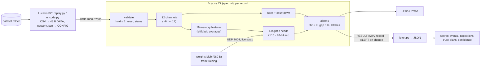

# ML architecture — release candidate v3

Owner: Mudit (ML) · Sun Nov 8 2026, 01:50 CST (updated 02:40 for R7 option C) · Status: **FROZEN for the demo.**
The FPGA spec is locked; only a bug or new data reopens this.

| Item | Version |
| --- | --- |
| Wire format | v1 (`docs/plan/lucas/fpga_hardware_plan.md`) |
| FPGA spec | **v4, locked** (`FPGA/spec/numerics.md`) + Lucas's final rulings: FPGA spec questions 20–25, 38, 67–70 (**70 = R7 option C**). Our questions ML-1 … ML-13 and their answers: [`fpga_spec_questions.md`](fpga_spec_questions.md) |
| Normative integer reference | `ml/hutd_ml/features_int.py` (spec v4 says so); exact semantics in `ml/README.md` → "RESULT semantics" |
| Feature set | id **1**: 31 integer features, unchanged since the FPGA plan's "memory feature set v1" |
| Deployed weights | **v3** (`weights_ver` 3): `ml/artifacts/v3/` |
| Previous weights | v2 (`weights_ver` 2), kept because its golden sets are what the RTL is verified against |

## 1. Summary

Four independent logistic regressions run on the Eclypse Z7 for every facility every 5 minutes:

- pipeline leak;
- pump degradation;
- pump failure;
- facility shut-in.

Each looks at 31 integer features the FPGA computes itself from the raw readings: 12 current channels normalized by
that facility's own specs, plus 19 "memory" features that remember what the pump looked like when it last ran.

A fixed decision layer turns the four scores into alarms (threshold + K steps in a row) and into the RESULT/ALERT
stream that the server turns into events, inspections and truck plans.

**Training:**

- the practice week plus distorted copies of it;
- leak/degradation time steps that are physically invisible are excluded from training;
- validation holds out one whole system at a time;
- the weights are exported to the FPGA's exact integer arithmetic.

## 2. Pipeline and where each step runs



| Step | Runs on | Code / spec |
| --- | --- | --- |
| CSV → binary records, CONFIG from `network.json` | Lucas's PC | `ml/hutd_ml/encode.py`, `replay.py` |
| Validation, features, heads, rules, countdown, alarms | FPGA fabric | spec v4; `features_int.py` is the reference |
| Weights, thresholds, K, `gap_thr` | trained offline, loaded at runtime | `ml/hutd_ml/train.py` → `artifacts/v3/` |
| Binary → JSON, confidence (Platt), heartbeat | Lucas's PC (or the server) | `ml/hutd_ml/listen.py`, `ml/INTEGRATION.md` |
| Events, inspections, truck/shut-in plans | server | Jason, `global_plan.md` |

## 3. Inputs and preprocessing

- **Only `network.json` and `telemetry.csv`.** Nothing is hardcoded:
  - per-facility constants come from `network.json`: B, Q, C, W, P0, limits, bounds;
  - every unit is integer-encoded: flow 0.5 bpd, level 0.01 %, pressure 0.1 psi;
  - every reading carries a present bit.
- **Validation** happens on the FPGA (A4/A6, spec v4 §3):
  - duplicates and out-of-order records are dropped;
  - a missing or impossible reading is held for ≤ 2 steps. After that (R7 option C) records are INVALID until a
    fully-OK record arrives. Memory is **not** reset; only a time gap, a CONFIG write or a facility's first record
    starts a new history;
  - every RESULT says VALID / HELD / INVALID / DROPPED with reason bits. Bad data is never "healthy".

## 4. Features (31, frozen)

Features are `int16`, where 16384 = 1.0. Channels 0–11 follow the original handoff formulas; 12–30 are the memory
features.

| # | Feature | What it is | Why it's there |
| --- | --- | --- | --- |
| 0 | inflow_norm | facility inflow / B | tank filling rate; shut-in |
| 1 | pump_flow_norm | pump flow / Q | degradation (healthy ≈ 1.0) |
| 2 | receive_flow_norm | pipeline receive flow / Q | = ch1 − ch3 (redundant, kept; see §9) |
| 3 | flow_gap_norm | (pump − receive) / Q | leak; E-STOP gap rule |
| 4 | tank_fraction | level / 100 | context, countdown |
| 5 | discharge_offset_norm | (discharge − P0) / 150 | degradation (pump pushes less hard) |
| 6 | pipeline_offset_norm | (pipeline − P0) / 50 | leak (pressure drops) |
| 7, 8 | pump_running, pump_fault | status == 1 / == 2 | gating; failure |
| 9 | wells_active_fraction | wells on / W | shut-in |
| 10 | well_water_norm | Σ well water / B | ≈ ch0 on clean data, but not under missing data |
| 11 | tank_net_flow_norm | Δlevel converted to bbl/day / B | filling vs draining |
| 12–16 | last-running value of ch 1, 2, 3, 5, 6 | copied while the pump runs | **memory:** evidence survives pump-off periods |
| 17–21 | fast average (α 1/8, ≈ 1 h wall) of the same | running records only | denoised recent level |
| 22–26 | slow average (α 1/64, ≈ 8 h wall) of the same | running records only | each facility's own baseline |
| 27 | smoothed tank net flow (α 1/8) | every record | trend |
| 28 | steps since the pump last ran (≤ 64) | | how stale the memory is |
| 29 | has run since reset | | memory is valid |
| 30 | memory depth (≤ 64 records) | | cold start |

**Why memory:** about a quarter of leak / degradation time has the pump off, so the current readings look healthy.
With current channels only, leak precision is 0.23; with memory, 0.95.

**Why the set is frozen:**

- §9 shows no feature change pays for an RTL change.
- The three receive-flow memory slots (13, 18, 23) and channel 2 are almost exactly linear combinations of the
  pump-flow and flow-gap slots (measured within 1–2 LSB). They cost nothing and are kept, so the RTL stays as
  specified.

## 5. Model

- **Four independent logistic regressions** (multi-label: a failed pump and a shut-in facility are true together;
  "normal" = all four low). No softmax.
- **Integer form** (spec v4 §8):
  - `logit_k = sat16((Σ_i W[k][i]·x_i + B[k] + 2^(S_out−1)) >>> S_out)`;
  - W is int16 with `Fw` fractional bits (v3: Fw = 8, S_out = 14), B is int32, the accumulator is 48 bits (in
    practice < 2^31);
  - logits are in 1/256 units.
- **Why logistic regression:**
  - valid from the first record (the CNN needed 8 h of history);
  - 124 multiply-adds per record;
  - bit-exact and formally provable;
  - weights load at runtime;
  - interpretable (§8).

  A linear model can also form differences such as "fast − slow average", which is exactly what it learned.

## 6. Decision layer (runtime-loadable, GLOBAL CONFIG)

| Setting | v3 value | Meaning |
| --- | --- | --- |
| `logit_thr` | [−64, 0, 0, 0] (1/256) | a class is "hit" when its logit is **>** threshold |
| `persist_K4` | [1, 3, 1, 1] | hits needed in a row (degradation: 3 steps = 15 min) |
| `gap_thr` | 504 (3.1 % of Q) | E-STOP needs flow gap > `gap_thr` **and** a leak hit, K(leak) times in a row |
| `persist_K`, `S`, `HOLD_MAX`, `CD_LOG2` | 1, 17, 2, 4 | fallback K; fixed by the RTL |

- **Night Shift** = any rule (pump fault, shut-in, level ≥ shutdown / warning) or any active class.
- Night Shift and E-STOP latch until acknowledged on the board (D8).
- The server receives every RESULT, so it isn't limited by these thresholds.
- **Confidence for the UI** comes from Platt calibration on held-out logits, applied by `listen.py`:
  `p = 1 / (1 + exp(−(a·logit/256 + c)))`. The (a, c) pairs per head are in `weights.json`
  `calibration_platt`.

## 7. Training recipe (frozen)

| Step | Choice |
| --- | --- |
| Data | `history/full_week` only. Snapshots / mock test are prefixes of it, so not independent. |
| Labels | half-open `[onset, end)` per facility from `answer_key.json` (offline only); shut-in derived from the readings |
| **Observable labels** | leak / degradation positives **before the pump first runs inside their event** get weight 0. Nothing can show the problem yet; training on those steps teaches the model to fire on healthy-looking pump-off data. Evaluation keeps the full labels. |
| Augmentation | copies with healthy pressure offsets ×0.8 / ×1.2, sizes ×0.7 / ×1.5, extra sensor noise (`augment.TRAIN`), all passed through the real encoder and engine |
| Loss | L2 logistic regression per head, class-balanced; **C = 3** (leak, degradation) and 0.03 (failure, shut-in); no feature scaling (the FPGA uses raw features) |
| Validation | train on 4 systems, score the 5th, for each of S1–S5; out-of-fold scores computed **after** int16 export |
| Thresholds / K | per class, on the out-of-fold integer logits, within ≤ 0.05 false alerts per facility-day. Priority: most events caught, then fastest median detection, then shortest worst-case detection, then frame recall. |
| `gap_thr` | max(492, 1.25 × the healthy running flow-gap 99.9th percentile) |
| Export | shared `Fw`, `S_out = Fw + 14 − 8`; 980 B blob with 10 self-test vectors (4 synthetic extremes + 6 real rows), CRC32 |

Reproduce:

```sh
cd ml && python -m hutd_ml.train --data <full_week> --answer-key <full_week>/answer_key.json \
    --out artifacts/v3 --version 3 --augment --observable --c 3,3,0.03,0.03
```

(about 3 min; the training-data SHA-256 is recorded in `weights.json`)

## 8. Results (v3)

**Clean practice week**, each system scored by a model that never saw it, with integer logits. These numbers are
optimistic, because the thresholds were chosen on the same scores.

| Head | Precision / recall | Events caught | Median / worst delay after onset | False alerts per facility-day |
| --- | --- | --- | --- | --- |
| Leak | 0.95 / 0.99 | 5/5 | 5 / 60 min (EVENT_1 starts with the pump off) | 0.019 |
| Degradation | 0.95 / 0.90 | 5/5 | 155 / 180 min | 0.038 |
| Failure | 1.00 / 1.00 | 13/13 | 0 | 0 |
| Shut-in | 1.00 / 1.00 | — | — | 0 |

- E-STOP: 5/5 leaks, 0 records outside a leak.
- int16 vs float: decisions 99.998 % identical, logit error ≤ 0.014.
- **Mock-test dry run** (same week; sanity only): at "now" it flags exactly the two pump failures in progress,
  S5_B and S5_C, with p50 countdowns of 205 and 123 min.

**Robustness**: a held-out system distorted *before* encoding, with clean thresholds kept. False alerts per
facility-day, leak / degradation:

| Distortion | v2 (previous) | **v3** |
| --- | --- | --- |
| Healthy pressure offsets ×0.7 | 0.04 / 0.03 | 0.01 / 0.04 |
| Healthy pressure offsets ×1.3 | 0.08 / 0.27 | 0.05 / 0.11 |
| Extra sensor noise | 0.19 / 0.17 | 0.13 / 0.09 |
| 2 % of readings missing, old hold rule A6 | 0.33 / 0.26 (AP 0.83 / 0.73) | 0.15 / 0.20 (AP 0.80 / 0.71) |
| 2 % of readings missing, **R7 option C (current)** | — | 0.21 / 0.11 (AP **0.93 / 0.77**) |
| All sizes ×0.5 / ×2, disposal pressure +200 psi | identical to clean | identical to clean (normalization makes this structural) |

**What the weights learned**, which is good for explaining the model:

- **Leak:** the slow pipeline-pressure average weighs +53, the fast one −33, the last running value −15. In words:
  *pipeline pressure has dropped below its own 8-hour baseline*, while the pump still discharges normally.
- **Degradation:** the fast discharge-pressure average weighs −70, the slow one +51; the last running pump flow
  weighs −42. In words: *the pump pushes less hard and moves less water than its own baseline*.
- **Failure:** pump status = fault (+9.6).
- **Shut-in:** wells active, inflow and well water all zero (−2.9 each).

**Known limits:**

- Degradation is detected 2.5–3 h after onset. The pump is often off for the first ~2 h, and the first percent of
  wear is inside normal noise. Events last 24–36 h, so this is still ~30 h before the failures that follow.
- Failure and shut-in come straight from status bits; the ML value is leak and degradation.
- Everything rests on one synthetic week, 5 + 5 events.

## 9. Experiments that fixed this architecture (Sun 01:00–01:40)

`python -m hutd_ml.experiments`, results in `ml/artifacts/experiments{,2}/`. All rows use the same protocol as §8.
"FA" = false alerts per facility-day, leak / degradation; "Degradation" = precision / recall, median / worst delay.

| Config | Degradation (clean) | FA at pressure ×1.3 | FA with noise | Decision |
| --- | --- | --- | --- | --- |
| Feature set v1, previous recipe (= v2) | 0.95 / 0.85, 170 / 275 min | 0.08 / 0.27 | 0.19 / 0.17 | baseline |
| Remove the 5 redundant features (26) | 0.95 / 0.83, 190 / 285 | 0.10 / 0.23 | 0.21 / 0.08 | no gain; redundancy confirmed |
| Slots 13/18/23 → "dropped below baseline", clamped (`relu3`) | 0.94 / 0.88, 190 / 270 | 0.09 / 0.14 | 0.12 / 0.11 | gain ≈ training-only changes; needs RTL → rejected |
| Slots → very slow averages (α 1/256) | 0.95 / 0.81, 230 / 400 | 0.16 / 0.20 | 0.16 / 0.10 | worse → rejected |
| Slots → clamped drop below the very slow average | 0.95 / 0.86, 260 / 340 | 0.05 / 0.10 | 0.04 / 0.09 | slower → rejected |
| Observable labels, C 1 | 0.95 / 0.83, 170 / 275 | 0.02 / 0.07 | 0.19 / 0.16 | robust; adopted (labels) |
| + missing-data augmentation | 0.95 / 0.83, 200 / 275 | 0.09 / 0.06 | 0.08 / 0.05 | leak FA 0.75 on missing data → rejected |
| **Observable labels, C 3 (= v3)** | **0.95 / 0.90, 155 / 180** | **0.05 / 0.11** | **0.13 / 0.09** | **adopted** |

Conclusion: **the feature set and the RTL stay as specified.** All the gains came from the training recipe, which
the board picks up by loading a new 980-byte weight blob.

## 10. Versioning and runtime control

| `weights_ver` | Meaning |
| --- | --- |
| 0 | no model loaded: logits 0, reason `NO_MODEL`; rules and countdown still work |
| 1 | v1, retired (pre-review spec) |
| 2 | v2: augmented, C 1. Golden sets used for RTL verification. |
| **3** | **v3: deployed** |
| 240 | untrained pseudo-random test weights (RTL bring-up only) |

| Can change… | How | Needs Lucas? |
| --- | --- | --- |
| Weights | new blob over UDP 7004, swapped at a record boundary. Live demo: `replay.py --swap-at-step N --swap-weights … --swap-version V` | no |
| Thresholds, K, `gap_thr` | GLOBAL CONFIG (`global_config.json` → `replay.py --config`) | no |
| Confidence calibration, event rules | server (`listen.py`, Jason) | no |
| Feature definitions, arithmetic, validation | spec bump + RTL change | **yes** |

**Release checklist** (all scripted):

1. `train.py` → `report.md`;
2. `golden.py` G0/G1/G2;
3. `board.py` against `fakeboard.py`, every RESULT and ALERT identical;
4. `pytest`;
5. `fpga_sync.py` (xcheck vs `eog_ref.py`);
6. push;
7. on the demo PC: `replay.py --weights artifacts/vN/weights.bin --weights-version N --config artifacts/vN/global_config.json`.

## 11. Open items

| Item | Owner | Effect on ML |
| --- | --- | --- |
| ~~R7 hold/reset policy~~ | Lucas | **Decided: option C** (FPGA spec question 70), implemented in `features_int.py`; golden sets regenerated (ml `59f3746`). C vs A6 under missing data: `ml/artifacts/missing_data/report.md` |
| ~~ML-1 … ML-13~~ | Lucas | **All answered** (FPGA spec questions 38, 67–70); see [`fpga_spec_questions.md`](fpga_spec_questions.md) |
| ~~`eog_ref.py` at v4~~ | Lucas's team | **Done** (`f264be2`): v4 `eog_ref.py` and `features_int.py` agree bit for bit on G0/G1/G2 |
| `eog_ref.py` with option C (FPGA T0.2c) | Lucas's team | then `python -m hutd_ml.fpga_sync` must PASS without flags on the regenerated G2 |
| Leak false alarms with missing readings under C | ML | rise at fixed thresholds (one flow field held while its partner updates). Testing missing-data augmentation; weights only, no RTL change |
| Judging network `test/` (S6–S11) | — | run `replay.py` on it unchanged; check the facility count ≤ 32 and wells ≤ 8 (the encoder refuses otherwise) |
