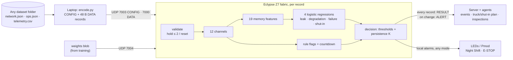

# ML plan — four logistic regressions for the Eclypse Z7

Owner: **Mudit** · Sat Nov 7 2026, 22:45 CST · Status: **IN PROGRESS.** The plan was accepted as-is (revert
later if needed); D1–D5 are implemented in [`ml/`](../../../ml/README.md).

Builds on Lucas's [FPGA plan](../lucas/fpga_hardware_plan.md), the source of truth for the wire format, engine and
feature rules, and on [`global_plan.md`](../../../global_plan.md) (hard rules §2, contracts §5). Dataset:
[nihaal419/HackUTD-ZeroDay](https://github.com/nihaal419/HackUTD-ZeroDay) at commit `135ba4c`.

## Progress update (Sun 01:10 CST): Lucas's review applied (FPGA task T0.0)

- **`features_int.py` is now the normative reference for the RTL.**
- **Applied:**
  - `S_feat` = 17;
  - inflow countdown only (`review_r1r2`);
  - FRAMING → DROPPED, checked before the facility lookup;
  - latched Night Shift / E-STOP with CLEARED alerts in the agreed order;
  - per-class K in GLOBAL bytes 20–23.
- **Also aligned with the FPGA spec:** first-record history reset; DROPPED → `since_reset` 0 / `weights_ver` 0;
  reason bits 11 / 13 / 14 (README A20–A22).
- **Weights v2 retrained** under this spec: `logit_thr` [0, 384, 0, 0], K 1, `gap_thr` 504. Leak 0.94 / 0.99,
  degradation 0.95 / 0.84, median 170 min. Golden sets regenerated (v0, v2; v1 removed). G0 / G1 / G2 plus all
  130 alerts pass over UDP against the stand-in.
- **Cross-check vs `FPGA/model/eog_ref.py`** (`python -m hutd_ml.xcheck`): the remaining differences are FPGA-side
  updates still pending (D6 countdown mean, D7 hold policy, A10 strict `>`, A14 `lo/hi` order). There is also one
  layout conflict: SHUTIN_WATER_MAX vs `persist_K4` in GLOBAL bytes 20–21.

## Progress update (Sun 00:45 CST)

- **Robustness pass done** (`ml/README.md` → Robustness pass; `ml/artifacts/robustness/report.md`):
  - Sizes and disposal pressure: invariant.
  - v1 breaks if the healthy pressure offsets differ (up to 4.9 false alerts per facility-day).
  - **Weights v2** fix this. They are trained with augmented copies (pressure offsets, sizes, noise) at C = 1:
    false alerts ≤ 0.2 per facility-day under every pressure distortion, with the same clean accuracy. Degradation
    recall is 0.84 and its median delay 170 min.
  - **v2 is now the default** (`ml/artifacts/v2/`, `weights_ver` 2, `logit_thr` = [0, 448, 0, 0], K = 1,
    `gap_thr` = 504). G0, G1 and G2 pass byte for byte over UDP against the stand-in.
- **Missing data is the remaining weakness:** the hold/reset policy wipes memory about 2.7 times per facility-day
  when 2 % of readings are missing. Logged for Lucas as review R7.
- **Ingest decided:** CSV → binary runs on Lucas's PC (`hutd_ml/replay.py`).
- **Server / dashboard integration:** `hutd_ml/listen.py` + `ml/INTEGRATION.md`.

## Progress (Sat 23:15 CST)

| # | Status | Where |
| --- | --- | --- |
| D1 encoder + wire layouts | Done | `ml/hutd_ml/encode.py`, `wire.py` |
| D2 bit-exact engine reference | Done; 19 places where the FPGA plan is silent are written down as assumptions A1–A19 for Lucas to confirm | `ml/hutd_ml/features_int.py`, `ml/README.md` |
| D3 weights v0 + golden sets | Done: G0, G2 with untrained test weights (`weights_ver` 240) | `ml/artifacts/v0/golden/` |
| D4 trained weights v1 | Done; report in `ml/artifacts/v1/report.md` | `ml/artifacts/v1/` |
| D5 edge-case set G2 + UDP harness | Done, plus a software stand-in for the board (`fakeboard.py`). Loopback G0 / G1 / G2 byte-identical, heartbeat-gap replay OK. | `ml/hutd_ml/board.py`, `fakeboard.py` |
| D6 live retrain → swap | Not started (the harness and stand-in already support the WEIGHTS swap) | — |

**v1 results** (held-out systems, integer logits, wire-v1 single K = 1):

| Head | Precision / recall | Events | Median delay |
| --- | --- | --- | --- |
| Leak | 0.94 / 0.99 | 5/5 | 5 min |
| Degradation | 0.95 / 0.83 | 5/5 | 190 min |
| Failure | 1.00 / 1.00 | 13/13 | 0 |
| Shut-in | 1.00 / 1.00 | — | — |

**Other outputs:**

- **Thresholds** in 1/256 logit units: `[64, 384, 0, 0]`.
- **`gap_thr`** = 504. E-STOP fires on 5/5 leaks and on no frame outside a leak.
- **int16 export** matches the float model 100%.
- **Per-class K** is no longer needed with these thresholds (§7 item 1 dropped to optional).

**Follow-ups:**

- C for leak/degradation landed on the edge of the grid (3.0). Weights are larger, Fw = 9; check robustness
  before the demo.
- Pressure augmentation (§4.5) is not done yet.

## 0. Summary

**My job:** produce the four logistic regressions the FPGA runs, plus everything Lucas needs to prove the board
computes exactly what training computed. Deliverables, in the order they unblock people:

| # | Deliverable | Unblocks | Needs training? |
| --- | --- | --- | --- |
| D1 | `wire.py` + `encode.py`: dataset folder → GLOBAL CONFIG, Facility CONFIG and 48 B DATA records (the "laptop converts CSV to binary" step) | Lucas's RTL testbench, the ingest sender, training inputs | No |
| D2 | `features_int.py`: bit-exact integer model of the engine (validate → 12 channels → 19 memory features → head → rules → countdown) | Golden vectors, training features | No |
| D3 | **Weights v0** (untrained, deterministic) + golden vector sets G0/G1 | Lucas can test RTL tonight, without waiting for training | No |
| D4 | **Weights v1**: trained, int16-exported, with per-class thresholds, persistence K, `gap_thr` and a validation report | The real demo; FPGA open questions 10 and 14 | Yes |
| D5 | Edge-case golden set G2 + `board.py` UDP harness that sends CONFIG/WEIGHTS/DATA and diffs every RESULT | On-board verification | No |
| D6 | Retrain → new blob → live weight swap over UDP 7004 | The "retrained weights" story from the whiteboard | Yes |

**What the feasibility probe says (§3):**

- Logistic regression on Lucas's memory feature set v1 works.
- Holding out one system at a time: leak precision 0.94, recall 0.99. Degradation precision 0.86, recall 0.89.
  Without memory features these were 0.23 / 0.84 and 0.30 / 0.72.
- int16 export changes no decisions.
- Degradation is caught late: median about 4.7 h after its labelled onset.
- The leak model leans heavily on pipeline pressure, which is a risk on the unseen judging network.

## 1. How the system works, and what "the model decides" means



The model does **not** output a single class. It outputs **four independent scores**, because a failed pump and
a shut-in facility are true at the same time. Healthy means all four are below threshold; Mudit's handoff forbids
a softmax for this reason. A **fixed decision layer** (thresholds + persistence, in Lucas's S6 alarm stage) then
turns the scores and rule flags into the outcome:

| Condition at a facility | FPGA does itself ("do it yourself") | Sent to server | Server / agents do |
| --- | --- | --- | --- |
| Every record | Classify, rules, countdown | RESULT: status, 4 logits, rules, countdown, weights version | Build events: onset, ongoing, resolved |
| Leak score ≥ threshold for K steps | Night Shift alarm (LED/Pmod) | ALERT | `field_inspection`; estimate lost volume |
| Leak score **and** flow-gap rule, both for K steps | E-STOP latch (local alarm signal only, see global O6) | ALERT | Still `field_inspection`, per the challenge |
| Degradation score ≥ threshold for K steps | Night Shift | ALERT | `field_inspection`; hydraulic capacity loss |
| Pump failure (rule `pump_fault`, or the score) | Night Shift; countdown in every RESULT | ALERT with countdown | Countdown + cheapest plan across the **system's shared fleet**. Trucks are never planned on the FPGA. |
| Shut-in (all wells off) | Night Shift | ALERT | Show production loss; keep the root-cause failure event; don't open a second incident |
| Server down (no heartbeat for 5 s) | All of the above continues; results and alerts buffered | Replayed on reconnect | Catch up |
| Bad or missing data | Status HELD, INVALID or DROPPED; never reported as normal | RESULT with reason bits | Show data-quality state |

**"Any new dataset" means** the laptop encoder and the model contain nothing specific to the practice network:

- every constant comes from that folder's `network.json`;
- the features are normalized by each facility's own B (baseline inflow), Q (pump rating), C (tank capacity),
  P0 (disposal pressure) and W (well count);
- the model never sees asset IDs, timestamps or system numbers.

§4.5 covers how we test that it transfers.

## 2. What in the dataset matters for training

| Fact | Consequence for training |
| --- | --- |
| One labelled week: 5 systems, 15 facilities, 45 wells, 2,016 steps, **30,240 facility-steps**, no missing data | Small data: logistic regression is a good fit, and we must not overfit |
| The snapshots and the mock test are **exact prefixes** of the full week | Train and validate on `full_week` only; the snapshots are **not** held-out data |
| Judging `test/` is a different network (S6–S11), never seen | Validate by holding out **whole systems** (5 folds) as a stand-in |
| Positives: leak 1,452 · degradation 1,924 · failure 936 · shut-in 199 (frames); 5 / 5 / 13 events / 12 episodes | Heavy imbalance: class weighting; report per head and per event, never overall accuracy |
| 29% of leak frames and 26% of degradation frames have the **pump off**, so the signature is invisible | Memory features (last running value, running means) are essential. The probe confirms it (§3). |
| Failure = pump `status` 2 in every frame; shut-in = all wells 0 in every frame | Those two heads are tautological. The rule flags carry them; report model-only results separately and don't oversell. |
| Simplifications: inflow = sum of wells; healthy pump = 1.5 × inflow; 3 wells each; setpoints 70 / 30; pressure offsets +150 / +50, which SPEC calls "placeholders" | Don't let the model depend on these exactly. Augment (§4.5) and check pressure reliance (§3). |
| Degradation can turn into failure (3 of 5 events) | Labels are half-open `[onset, end)`, so a failure onset ends the degradation label |

## 3. Feasibility probe (done Sat 22:40)

[`docs/research/probe_logistic_memory.py`](../../research/probe_logistic_memory.py) computes memory feature set
v1 with the plan's integer rules (`S_feat` = 11; some assumptions are listed in §6) and fits one scikit-learn
logistic regression per head. Each run trains on 4 systems and scores the held-out one, so every frame is scored
by a model that never saw its system.

**Frame precision / recall at p = 0.5, pooled over held-out systems:**

| Features | Leak | Degradation | Failure | Shut-in |
| --- | --- | --- | --- | --- |
| Current 12 channels only | 0.23 / 0.84 | 0.30 / 0.72 | 1.00 / 1.00 | 1.00 / 1.00 |
| **Memory set v1 (31)** | **0.94 / 0.99** | **0.86 / 0.89** | 1.00 / 1.00 | 1.00 / 1.00 |
| 31, stronger L2 (C = 0.1) | 0.92 / 0.99 | 0.80 / 0.83 | 1.00 / 1.00 | 1.00 / 1.00 |
| 31 minus pump/well status inputs | 0.95 / 0.99 | 0.80 / 0.88 | 0.27 / 0.95 | 1.00 / 1.00 |
| 31 minus pressure channels (23) | 0.88 / 0.92 | 0.93 / 0.85 | 1.00 / 1.00 | 1.00 / 1.00 |

**With a threshold and persistence K** chosen to keep false alerts ≤ 0.05 per facility-day. These were picked on
the same held-out scores, so they are optimistic.

| Head | Logit threshold | K | Precision / recall | Events caught | Delay after labelled onset |
| --- | --- | --- | --- | --- | --- |
| Leak | 0.00 | 1 | 0.94 / 0.99 | 5 / 5 | median 5 min, max 60 min (EVENT_1 starts while the pump is off) |
| Degradation | +0.44 | 3 | 0.94 / 0.82 | 5 / 5 | median 280 min, max 405 min |
| Failure | −3.75 | 1 | 1.00 / 1.00 | 13 / 13 | 0 |
| Shut-in | −3.25 | 1 | 0.98 / 1.00 | 12 episodes | — |

**int16 export**, trained on all five systems:

- Setup: weights int16 with 10–13 fractional bits, biases int32, accumulator well under 2^31, logits at 1/256.
- Result: maximum logit error 0.004 and decision agreement 99.99–100%. Quantization is not a problem.

**What this tells us**

1. **Memory features are what make it work.** Keep Lucas's set v1 as the baseline.
2. **Degradation is the weak head.** It is detected, but late: early wear sits inside healthy noise, and 4 of
   5 events start while the pump is off. Ideas to test, in this order:
   - a longer-memory baseline feature, such as a slower average or the best running flow since reset;
   - per-head K;
   - severity augmentation.
3. **Pressure dependence.** The leak model's top weights are the pipeline-pressure averages (`slow − fast`, i.e.
   pressure drop from baseline). If the judging network has different pressure behavior, leak recall could drop
   toward the 0.88 / 0.92 no-pressure numbers. Mitigations:
   - the difference form adapts to each facility's own baseline;
   - pressure augmentation (§4.5);
   - the flow-gap features remain as a second path.
4. **Collinear features** (last value, fast and slow averages of the same channel) give large weights of opposite
   sign (up to about 25). Pick the L2 strength by held-out system, and check that int16 headroom holds.
5. **Different heads want different K** (leak 1, degradation 3), but GLOBAL CONFIG has one `persist_K`. I'll ask
   for per-class K (§7).

## 4. The pipeline, from CSV to weights on the FPGA

### 4.1 Repo layout (proposed, new `ml/` folder)

```
ml/
  README.md               how to run each step
  requirements.txt        numpy, pandas, scikit-learn (no GPU needed)
  hutd_ml/
    wire.py               every packet layout from the FPGA plan: header, DATA, CONFIG, RESULT, ALERT, STATS, WEIGHTS
    encode.py             dataset folder → CONFIG + DATA bytes (the ingest encoder; the UDP sender wraps it)
    features_int.py       bit-exact engine reference, with per-stage outputs
    model_int.py          integer head, quantization, blob pack/unpack, CRC32
    labels.py             answer key → targets (OFFLINE ONLY; never imported by encode/features/model)
    train.py              fits the 4 heads, held-out-system validation, ablations
    export.py             weights.bin + weights.json + global_config.json + report
    golden.py             golden vector sets G0, G1, G2
    board.py              UDP harness: config → weights → data → diff RESULTs
  tests/                  pytest: layouts, round-trips, width/overflow asserts, determinism
  artifacts/<version>/    weights.bin, weights.json, global_config.json, report.md, golden/
```

### 4.2 Encoder (D1): the laptop's CSV → binary step

- Implements C2 and C3 exactly:
  - `fac_id` = position in `network.json`; well slots in file order;
  - LSBs 0.5 bpd, 0.01 % and 0.1 psi, with the `present` mask;
  - timestep-major order, 30 records per packet;
  - startup order GLOBAL CONFIG → Facility CONFIG → WEIGHTS → DATA.
- Derives everything from the folder. It refuses with a clear message if there are > 32 facilities, > 8 wells,
  or a CONFIG multiplier wider than the hardware multiplier (review R3).
- **CONFIG bounds `lo[]` / `hi[]` come from metadata, not from observed practice ranges**, because observed
  ranges would hardcode the practice network. Proposal:
  - flows −1 … 4 × max(Q, B) bpd;
  - pressures 0 … the pipeline's `max_pressure_psi`;
  - level −5 … 105 %;
  - well water −1 … 4 × that well's baseline.
- Training calls the same function, so training inputs and board inputs are identical byte for byte.
- Output formats for Lucas:
  - `.bin` (little-endian);
  - `.mem` (`$readmemh`, one 64-bit beat per line, 6 beats per DATA record to match stage S0);
  - a CSV dump of the decoded fields.

### 4.3 `features_int.py` (D2)

- A literal transcription of the plan:
  - validation: timestamp step, enums, bounds, hold ≤ 2 then reset, `since_reset`;
  - channels: `sat16((raw·M + 2^(S−1)) >> S)`;
  - the 19 memory features, with arithmetic shifts and the initialization and reset rules;
  - the logistic head: 48-bit accumulator, round-shift, saturate;
  - rule flags and the countdown (including the R1/R2 fixes if Lucas adopts them).
- **Width asserts everywhere** (int16 features, EMA registers, the 48-bit accumulator), so an overflow shows up in
  Python before it shows up in RTL.
- Emits **per-stage intermediates**, so a mismatch points at one module: validated fields → 12 channels →
  19 memory features → 4 logits → rules / countdown / status / reason.
- Cross-checks:
  - the 12 channels against the float formulas in the handoff (within a few LSB);
  - the latest frame of Mudit's five `.i16le.bin` fixtures.

### 4.4 Labels (offline only)

- Per facility, an event's label covers the half-open interval `[onset_unix, end_unix)`.
- Shut-in is derived from the readings: all wells have status 0 and water 0.
- Unobservable frames (pump off, early weak signal) **keep their true labels**; an optional mask is used for
  analysis only.
- Labels attach to each record's newest timestamp. No future data is used in features.

### 4.5 Training (D4)

- **Model:** four independent L2 logistic regressions on the 31 integer features ÷ 16384, i.e. exactly the values
  the FPGA computes. Class-weighted; optionally event-balanced, so long events don't dominate.
- **No scaler.** The FPGA applies the weights to the raw features. (A fitted scaler could be folded into the
  weights, but that inflates small-variance weights and costs int16 headroom.)
- **Hyperparameters:** C (and later the feature-set changes) chosen by mean and worst-fold held-out-system score.
- **Export constraints in the loss:**
  - |w| small enough for int16 at ≥ 10 fractional bits, with one common output shift;
  - the bias fits int32.
- **Generalization ("any new dataset"):**
  - Augment in the **raw domain before encoding**, so augmentations go through the real encoder:
    - consistent scaling of B, Q, C and the flows;
    - perturbed pressure offsets, ±30% around the +150 / +50 psi offsets plus P0 shifts;
    - 1–2× sensor noise;
    - dropped samples (exercises HELD records and resets);
    - shrunken leak and degradation severity (earlier detection);
    - facilities rebuilt with 1–8 wells.
  - **Report each augmentation as a robustness test** (train clean, test augmented) as well as using it in
    training.
  - The server may flag "feature outside its training range": export each feature's training min / max.
- **Final model:** after selection, refit on all 5 systems.

### 4.6 Validation report (ships with each weights version)

- Per head:
  - precision, recall, F1;
  - events detected; time to first alert (median / max);
  - false alerts per facility-day; clearance lag after the event ends;
  - split by pump running vs off, and for cold start (first 64 records after a reset).
- Ablations: current-only, memory v1, no status inputs, no pressure. The rule-only vs model-only numbers for
  failure and shut-in are stated honestly.
- **Calibration** (scores → probabilities shown in the UI): temperature / Platt fitted on **held-out-system
  scores**. **Not on the snapshot folders**, as the FPGA plan suggests: they are prefixes of the training week
  (leakage). I'll flag this to Lucas.
- **Integer == float:** decision agreement and maximum logit error, as in the probe.
- **Mock-test dry run:** encoder + integer model on `mock_test_2026-10-10T1530` (no labels). Compare with the
  snapshot answer keys only afterwards, as a sanity check.

### 4.7 Thresholds, persistence and `gap_thr`

- Per-head logit thresholds are chosen on held-out scores against an explicit budget (proposal: ≤ 0.05 false
  alerts per facility-day). They are written into GLOBAL CONFIG `logit_thr[4]` as int16 at **1/256 logit units**.
- `gap_thr` (the leak flow-gap rule used to confirm E-STOP) starts from the healthy running flow-gap 99th
  percentile (+1.84 % of Q, about 302 LSB) plus margin. Proposal: **3 % of Q = 492 LSB**, then tuned against leak
  recall.
- **K:** per class if Lucas agrees (§7); otherwise one compromise K = 2 with the thresholds re-tuned.

### 4.8 Export: weight blob (proposal for FPGA open question 11 / review R5)

There are **two different shifts called S** in the FPGA plan. I'll name them:

- **`S_feat`** (GLOBAL CONFIG): the feature-multiplier shift. ≤ 11 per review R3; the probe used 11.
- **`S_out`** (weight blob): the logit output shift.

With weights at `Fw` fractional bits, features at 14 and logits at `L_out` = 8: `S_out = Fw + 14 − 8`.

**Proposed blob layout**, little-endian, 280 B + 70 B per self-test vector. 10 vectors = 980 B, one 1,024 B chunk.

| Off | Type | Field | Notes |
| --- | --- | --- | --- |
| 0 | u16 | blob_format | 1 |
| 2 | u8 | n_heads | 4 |
| 3 | u8 | n_features | 31 |
| 4 | u8 | S_out | shared by all heads |
| 5 | u8 | n_vectors | self-test vectors that follow (≤ 10) |
| 6 | u16 | feature_set_id | 1 = memory feature set v1; the board refuses a mismatch |
| 8 | i16[4][31] | weights | head-major in logit order `[leak, degradation, failure, shut_in]`; features in v1 index order |
| 256 | i32[4] | biases | at `Fw + 14` fractional bits |
| 272 | u32 | model_hash | first 4 bytes of SHA-256 of `weights.json` |
| 276 | u32 | reserved | 0 |
| 280 | {i16[31] features, i16[4] expected logits} × n | self-test | features chosen to cover saturation and sign edges |

The blob version travels in the WEIGHTS header `aux` and comes back as `weights_ver` in every RESULT.
`weights.json` carries the same numbers in human-readable form, plus float weights, scales, the feature list, the
training-data hash and the metrics.

### 4.9 Golden vectors (D3, D5): what Lucas gets

Each set includes its CONFIG and weights, the DATA records (`.bin`, `.mem`, `.csv`), the **expected per-stage
values and the expected 32 B RESULT for every record**, and `compare.py`, which reads an RTL or board dump and
names the first mismatching record, stage and field.

| Set | Contents | When |
| --- | --- | --- |
| **G0 smoke** | 1 facility, about 30 records, small enough to check by hand; weights v0 | First, with D2 |
| **G1 practice week** | All 30,240 records; weights v0, then v1 | With D3, refreshed at D4 |
| **G2 edge cases** | Synthetic sequences covering: <br>- held fields for 1, 2 and 3 steps (then reset)<br>- time gaps, duplicates, out-of-order records<br>- illegal enums (pump 3, well status 2 / 3), out-of-range values<br>- feature saturation<br>- unknown or disabled `fac_id`<br>- 1-well and 8-well facilities<br>- cold start, long pump-off stretches<br>- failure onset with the pump running (R1), tripped tank (R2) | With D5 |

**Weights v0** are deterministic and come in two flavors:

- **pseudo-random** int16, to exercise signs, the accumulator range and saturation;
- **"rule-like"**, hand-set so the alarms actually fire, for an early end-to-end demo.

### 4.10 Testing on the FPGA (what "test it on the FPGA" means)

`board.py` runs on the laptop over the existing direct cable (192.168.1.50 ↔ 192.168.1.10):

1. Health check on the MUL port 7777.
2. GLOBAL CONFIG + one Facility CONFIG per facility; check every CONFIG_ACK.
3. WEIGHTS chunk + COMMIT; check WEIGHTS_ACK (CRC ok, self-test ok, swapped), then STATS `active weights version`.
4. Stream G0, then G2, then G1. Compare every RESULT byte for byte with the expected values. Check STATS counters
   against the expected drops, holds and resets.
5. Heartbeat on; stop it for more than 5 s → AUTONOMOUS. Check the buffered RESULTs and ALERTs replay in
   `result_no` order.
6. **Live swap:** send weights v2 mid-stream. `weights_ver` must change at one record boundary, and later results
   must match v2.

RESULT carries logits but not features. A logit mismatch can therefore come from any stage, so I'll ask for a
small **debug readback** (§7).

## 5. Keeping the FPGA side easy

1. **One source for every number.** `wire.py` mirrors the FPGA plan's tables. If code and plan disagree, the plan
   is fixed first (Lucas's call), then the code.
2. **Testable before trained.** Weights v0 and the golden vectors arrive before any training result.
3. **RTL-friendly formats:**
   - `$readmemh` files, one 64-bit beat per line;
   - little-endian binaries;
   - CSV for humans.
4. **Per-stage expected values**, so a mismatch localizes to one module.
5. **Integer-only reference.** Nothing the FPGA must match is computed in floating point.
6. **Everything versioned:** `feature_set_id`, model version, blob CRC, golden-set hash.
7. **Feature set frozen early.** Changing a feature costs Lucas a new bitstream (about 7 min); weights and
   thresholds load at runtime, so I can retrain right up to the demo without touching RTL.

## 6. Questions for Lucas (needed for bit-exactness)

| # | Question | My assumption in the probe |
| --- | --- | --- |
| L1 | Exact integer constants for the hard-wired channels 4–6 (multiplier and shift) | `round(16384/10000 · 2^S)`, `round(16384/1500 · 2^S)`, `round(16384/500 · 2^S)` with the same `S_feat` |
| L2 | Channels 7 / 8: exactly 16384 or 0? | Yes |
| L3 | Rounding `(raw·M + 2^(S−1)) >> S` with an arithmetic shift: round half up for negatives too? | Yes (Python `>>`) |
| L4 | Does the feature at record t include record t's own memory update (post-update)? | Post-update |
| L5 | Feature 27 (smoothed net flow): initialized to `x << 8` on the first record after a reset? | Yes |
| L6 | `since_reset` on the first record after a reset: 0 or 1? (feature 30 and RESULT) | 0 |
| L7 | Steps-since-run counter (feature 28) before the pump has ever run: counts from the reset? | Counts from 0 at reset |
| L8 | Held records: is the held pump status used for the "running" test? Is channel 11 = 0 when the level is held? | Held value used; Δ level = 0 |
| L9 | Is `S_feat` a GLOBAL CONFIG value, and do we agree on ≤ 11 (single DSP48)? | 11 |
| L10 | Is a single `S_out` for all 4 heads fine? (The probe's heads wanted `Fw` 10–13; common `Fw` = 10 works.) | Single |

## 7. Proposed changes for Lucas (non-blocking, cheap)

1. **Per-class persistence K:** `persist_K[4]` from GLOBAL CONFIG's reserved bytes. The probe wants leak K = 1
   and degradation K = 3.
2. **Weight blob layout** from §4.8 (answers open question 11 and review R5).
3. **Countdown fixes R1 / R2** ([review notes](../lucas/review_notes.md)): build the band from inflow, and report
   0 for a tripped tank. I'll mirror whichever version he picks in `features_int.py`.
4. **Debug readback:** for one selected facility, the 31 features of the last record, readable over AXI-Lite (or
   an optional DEBUG packet). It makes on-board mismatches debuggable.
5. **Calibration** on held-out-system scores, not on the snapshot folders (§4.6).

## 8. Timeline (now Sat 22:45 → Sun)

| Phase | Work | Gate / handoff |
| --- | --- | --- |
| A, about 1.5 h | `wire.py`, `encode.py`, `features_int.py` with tests; weights v0; G0 + G1 | **Hand to Lucas** → RTL testbench can start |
| B, about 1.5 h | Labels, training, held-out-system report, thresholds / K / `gap_thr`; blob export | **Weights v1** + GLOBAL CONFIG values; answers FPGA Q10 and Q14 |
| C, about 1 h | G2 edge cases; `board.py` harness | Ready for the board as soon as engine v1 is up |
| D, with Lucas | On-board runs; fix mismatches (spec first, then code) | Board matches golden byte for byte |
| E, stretch | Augmentation robustness, calibration, degradation features, live retrain → swap demo | Demo polish |

**Freeze rule:** the feature set freezes at the end of phase B. After that, only weights and thresholds change.

## 9. Risks

| Risk | Mitigation |
| --- | --- |
| Spec ambiguity → bit mismatches on the board | §6 answered before RTL; per-stage golden values; `compare.py` |
| One week, 5 systems → overfitting | Held-out-system validation, L2, worst-fold reporting, augmentation, honest numbers |
| Judging network differs (pressures, sizes, well counts) | Metadata-normalized features, pressure ablation and augmentation, out-of-range flags on the server |
| Degradation detected late | Report it honestly; try longer-memory features; show the score trend in the UI |
| Failure / shut-in "accuracy" is tautological | Report the rule and model numbers separately; pitch the memory-feature heads as the ML story |
| Encoder owner (global O9) unassigned | `encode.py` is needed for training anyway, so I own the encoding library; the UDP sender is a thin wrapper (`board.py`) whoever runs the demo |

All of this follows `global_plan.md` §2: the answer key is used only offline, nothing is hardcoded, "now" = the
last telemetry timestamp, and nothing unmeasured is claimed.
