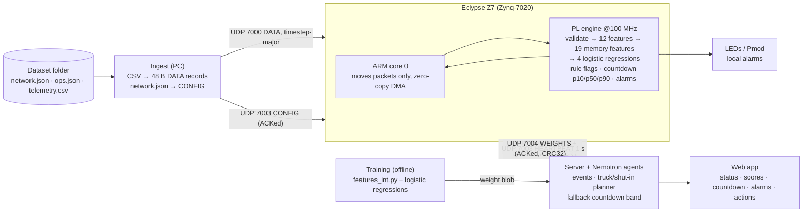

# Global plan — Beat the Shutdown

HackUTD 2026: Zero Day · last updated **Sat Nov 7 2026, 21:45 CST** · hacking ends **Sun Nov 8** (confirm the
exact submission cutoff in the [Hackerpack](https://hackutd-2026.notion.site/HackUTD-2026-Zero-Day-Hackerpack-3b163cec774080bea6c5fb7358a42dac))

## How this file works

- This is the team's **cross-team source of truth**. Ideas start in each owner's plan under
  [`docs/plan/<owner>/`](docs/plan/). Once a decision has solidified there, it is promoted here with a changelog row.
- Per-owner folders: `docs/plan/gurneal/`, `docs/plan/jason/`, `docs/plan/lucas/`, `docs/plan/mudit/`. A plan kept in an
  external doc gets a repo copy in its owner's folder, with a header that names the live version and the export time.
- Status labels:
  - **DECIDED**: build against it.
  - **PROPOSED**: you may code against it, but the owner still has to confirm and it may change.
  - **OPEN**: don't assume anything.
- The detail for each domain lives in its owner's plan; this file records what the other teams depend on. If an
  owner's plan and this file disagree, raise it with both owners. Don't silently pick one.
- **FPGA source of truth:** [`docs/plan/lucas/fpga_hardware_plan.md`](docs/plan/lucas/fpga_hardware_plan.md), a repo copy
  of Lucas's [live doc](https://claude.ai/artifact/1fzKUqpVAnbrWTYDQkEmEQ). Automation must never edit the live
  doc; update the repo copy instead.
- **Reviewers and bots:** check every change against §2 (hard rules) and §5 (contracts). A change that touches a
  contract needs the approvers listed in §8.

## 1. What we're building

We're building an operator console for the challenge's produced-water network. It finds **pipeline leaks, pump
degradation and pump failures** in the sensor readings. For each pump failure it gives the **countdown to tank
shutdown** and the **cheapest response**: trucks, shutting in some wells early, or accepting the trip. Each system's
trucks are planned as one shared fleet.

The differentiator is per-record validation, features, inference, rule checks and the countdown in the **Eclypse
Z7 FPGA fabric**, sized so that the 1 GbE link is the bottleneck. **Nemotron agents** on the server do the
planning, and a web dashboard shows the results.

**Priority:** a working end-to-end demo on Sunday beats extra scope. The demo must run on
`history/mock_test_*` and then on the judging `test/` folder (systems S6–S11, a network we haven't seen) **without
code changes**.

Judges look at creativity, UX and aesthetics, usefulness, how correct/optimal the cost optimization is, data
coming from the files (no hardcoding), and whether we followed the instructions (challenge README).

## 2. Hard rules (every component)

1. **Runtime inputs are only** `network.json`, `ops.json` and `telemetry.csv` from a dataset folder.
   `answer_key.json` is for offline training and evaluation only. Never load it at runtime.
2. **No hardcoding.** Don't hardcode asset IDs, facility or well counts, event times, or practice-network
   constants. Read everything from the files.
3. **"Now" is the last `ts_unix` in `telemetry.csv`**, never the system clock. The practice week is in October.
4. **Actions by category.** A leak or pump degradation gets a field inspection (`field_inspection`) and no
   countdown. A pump failure gets `hours_to_limit` and the cheapest plan.
5. **Trucks are planned per system.** All ongoing failures in a system share its `emergency_fleet_size`. Follow
   the SPEC truck rules:
   - the first trip arrives `response_min` after the call, then one every `cycle_min`;
   - each trip removes a flat `truck_capacity_bbl` at a flat `cost_per_trip`;
   - every trip must arrive before the repair ends, and a trip can't remove more water than the tank holds.
6. **Recommendations never rewrite the recorded telemetry.** What-if and replay results run as a separate
   simulation.
7. **Alerts view order:** pump failures first, soonest shutdown first, with ties going to the higher lost revenue
   per hour. Leaks and worn pumps follow in any order.
8. **E-STOP and Night Shift on the board are local alarm signals** (LEDs and Pmod) for the demo. They are not
   validated industrial safety control, and nothing is wired to actuate equipment. See O6.
9. **Bad or missing data is never reported as healthy.** Every result carries VALID, HELD, INVALID or DROPPED plus
   reason bits.
10. **No unmeasured claims in the pitch.** No accuracy, latency, resource or throughput claim unless it was
    measured; label estimates as estimates.

## 3. Architecture

**DECIDED** unless marked otherwise. The source is the FPGA plan through its Sat 21:20 changelog row.

The diagram shows the server sending WEIGHTS. The FPGA plan doesn't say which PC process sends them (O12).

| Part | Responsibility |
| --- | --- |
| **Ingest (PC)** | Encodes the CSV into 48 B binary records with a presence mask, and `network.json` into CONFIG packets. It computes no features and makes no judgments. It runs as a separate process, so a server crash doesn't stop data. Training reuses the same conversion code. |
| **FPGA** | For every record: validation with hold ≤ 2 steps then reset, the 12 channels plus 19 memory features, 4 logits, rule flags (`pump_fault`, `shut_in`, level ≥ shutdown, level ≥ warning, not filling), the countdown, and local alarms. It returns **one RESULT per record**. If the server is down (no heartbeat for 5 s) it keeps classifying, buffers results and alerts, and replays them on reconnect. |
| **Server / agents** | Sends a heartbeat every 1 s. Consumes RESULT, ALERT and STATS and builds events (onset, ongoing, resolved). Applies sigmoid and thresholds as needed. Plans trucks and shut-ins per system with Nemotron agents. Computes a fallback countdown band. |
| **Web app** | Shows per-facility status, scores, countdown, alarms and recommended actions, plus throughput from STATS. |
| **Training** | Four logistic regressions on memory feature set v1, a bit-exact `features_int.py`, and an int16 export. |

## 4. Owners

| Area | Owner | Plan | Current focus |
| --- | --- | --- | --- |
| FPGA (Eclypse Z7) | Lucas | [`docs/plan/lucas/`](docs/plan/lucas/) | Engine v2 RTL + SymbiYosys proofs; v1 data path over AXI-Lite first |
| Model, features, training | Mudit | [`docs/plan/mudit/`](docs/plan/mudit/ml_plan.md) (PROPOSED, under discussion) | The five "Asks for Mudit" in the FPGA plan: encoder + `features_int.py` + weights v0 and golden vectors first, then trained weights v1 |
| Agents / server | Jason | — | Heartbeat, RESULT/ALERT consumption, events, truck planner |
| Web app / full stack | Gurneal (Jimmy), with Jason | — | Dashboard on RESULT, ALERT and STATS |
| Ingest (PC) | **Runs on Lucas's PC** (decided Sun 00:20); code: `ml/hutd_ml/replay.py` | [`ml/INTEGRATION.md`](ml/INTEGRATION.md) | CSV → DATA, `network.json` → CONFIG; `listen.py` turns board output into JSON for the server |
| Replay / throughput demo | **OPEN**: "another teammate" per the FPGA plan (O10) | — | Loop or scale out records to show sustained throughput |

## 5. Interface contracts

| ID | Contract | Status | Defined in | Change needs |
| --- | --- | --- | --- | --- |
| C1 | Dataset inputs: the three files, their schemas, equipment behavior and plan rules | DECIDED (organizers) | Reference repo [`SPEC.md`](https://github.com/nihaal419/HackUTD-ZeroDay/blob/main/SPEC.md) | Fixed |
| C2 | UDP wire protocol **v1**: ports 7000–7004 plus 7777 health check; 16 B header (magic `EOGF`, version, type, count, seq, aux); DATA 48 B; RESULT 32 B; ALERT 16 B; STATS 64 B; GLOBAL CONFIG 32 B; Facility CONFIG 64 B; HEARTBEAT; WEIGHTS chunks; little-endian | DECIDED v1 (layouts still marked draft) | FPGA plan, "I/O contract" | Lucas + consumers; header version bump + changelog row |
| C3 | Slot rules: `fac_id` = position in `network.json` (systems, then facilities, in file order); ≤ 32 facilities and ≤ 8 wells, otherwise ingest refuses; startup order GLOBAL CONFIG → Facility CONFIG → WEIGHTS → DATA | DECIDED | FPGA plan, "I/O contract" | Lucas + ingest owner |
| C4 | Features: the 12 channels (handoff §4 formulas, int16 at 1/16384) plus memory feature set v1 (19 features), 31 in total | Channels DECIDED; memory set PROPOSED (O5) | FPGA plan, "Model definition"; [handoff §4](docs/research/FPGA_CLASSIFIER_HANDOFF.md) | Mudit + Lucas |
| C5 | Model: four independent logistic regressions with output order `[pipeline_leak, pump_degradation, pump_failure, facility_shut_in]`; int16 weights, int32 bias, 48-bit accumulator, one output shift; normal = all zero, no softmax | DECIDED (widths final once Mudit confirms) | FPGA plan, "Model definition" | Mudit + Lucas |
| C6 | `features_int.py`: one integer reference, bit-exact, shared by training, RTL simulation and the server | DECIDED (not written yet) | FPGA plan, "Asks for Mudit" | Mudit + Lucas |
| C7 | Weight blob: about 270 B, CRC32, self-test vectors, swap at a record boundary | PROPOSED; byte order OPEN (O3) | FPGA plan, "WEIGHTS" | Mudit + Lucas |
| C8 | Alarms: Night Shift and E-STOP triggers, persistence K, thresholds | Triggers DECIDED; values OPEN (O2); E-STOP framing OPEN (O6) | FPGA plan, "Autonomous mode and alerts" | Lucas + Jason (Mudit for values) |
| C9 | Server events and recommended actions: categories and action types follow SPEC `events.json` | PROPOSED | [SPEC, events.json](https://github.com/nihaal419/HackUTD-ZeroDay/blob/main/SPEC.md#eventsjson-optional) | Jason + Gurneal |
| C10 | Server → web app API | OPEN (O11) | — | Jason + Gurneal |

## 6. Superseded — do not build

| Superseded item | Replaced by | When (CST) |
| --- | --- | --- |
| The **CNN** in [`FPGA_CLASSIFIER_HANDOFF.md`](docs/research/FPGA_CLASSIFIER_HANDOFF.md) (6 dilated Conv1d layers), its `[1, 12, 96]` window and its 7 h 55 min warm-up | Four logistic regressions on causal memory features, valid from the first record | Sat 21:10 |
| Host-side normalization and windowing; the **2,304 B full-window int16 transport** in `model-input-v1.json` | Streaming raw 48 B records; preprocessing on the FPGA | Sat 19:45 / 20:15 |
| Board outputs as four raw decisions (Send Trucks / Night Shift / Do Nothing / E-STOP) | Logits + rule flags + countdown for every record; trucks planned on the server | Sat 19:45 |
| The 16 B raw-record draft and the 2-bit facility field | 48 B DATA records; 5-bit flat ID with 32 slots | Sat 20:25 / 20:40 |
| An ARM receive path that copies (or copies and cache-flushes) packets | Zero-copy scatter-gather DMA from the receive buffers; copying collapses delivery | Sat 21:20 |

Still valid from the handoff:

- the 12 channel formulas, the output order and the int16 scale;
- sigmoid, events and planning on the server;
- the training and validation rules: split by whole system or event, report per-head metrics, never use answer-key
  fields as features, keep the true labels for unobservable frames.

Mudit's five `.i16le.bin` fixtures still check the channel formulas, but they are not streaming golden vectors.

## 7. Status and path to the demo

**Working (Sat 21:20, measured):**

- Browser → PC web server → UDP → board ARM → AXI → FPGA multiplier and back: 506/506 correct, 0.51 ms median
  round trip.
- The ARM receives at the 1 GbE line rate (2.45 M records/s, 0% loss), but only on the zero-copy path.

**Build order.** Each step should leave a demoable state.

1. Ingest emits DATA and CONFIG packets. The server sends heartbeats and parses RESULT, ALERT and STATS. *(ingest
   owner, Jason)*
2. `features_int.py`, the integer logistic model and streaming golden vectors, plus a first trained weight set.
   *(Mudit)*
3. FPGA v1 data path over AXI-Lite: validate, features, rules, countdown and head, bit-exact against the golden
   vectors in simulation and on the board. *(Lucas)*
4. Server events, truck/shut-in planner and dashboard running on live RESULT and ALERT. *(Jason, Gurneal)*
5. FPGA v2 zero-copy DMA at line rate, plus replay/scale-out for the throughput demo. *(Lucas + replay owner)*
6. Live weight update over UDP 7004 from a retrained model. *(Mudit + Lucas)*

**Before judging:**

- Run end to end on `mock_test_*`, then on a fresh folder, to prove nothing is hardcoded.
- When `test/` appears, check that its facility and well counts fit within the 32 and 8 slot limits.

**Fallback (PROPOSED):** the rule flags and the countdown don't depend on the model, and the server already
computes a fallback countdown band. So if the board is unplugged, the dashboard should show "board offline" and
keep its server-side countdown and rules, not go blank.

## 8. Change control

| What changes | Who must agree | Also do |
| --- | --- | --- |
| Wire format, slot rules (C2, C3) | Lucas + every consumer (ingest, server, web) | Bump the header `version`; add a changelog row in the FPGA plan and here |
| Features, model, `features_int.py`, weight blob (C4–C7) | Mudit + Lucas | Regenerate the golden vectors |
| Alarm semantics, recommended actions (C8, C9) | Lucas + Jason; UI wording with Gurneal | Re-check hard rules 4 and 8 |
| Server ↔ web API (C10) | Jason + Gurneal | — |
| Hard rules (§2) | Whole team; they come from the challenge | — |

Lucas's live FPGA doc is **never edited by automation**; update the repo copy and its changelog instead.

## 9. Open questions

| # | Question | Owner | Blocks |
| --- | --- | --- | --- |
| O1 | Should ALERT be ACKed and retried? (FPGA Q7) | Lucas + Jason | C2 |
| O2 | Persistence K, the logit thresholds and the flow-gap threshold (FPGA Q10) | Mudit | C8 |
| O3 | Weight blob byte order and the number of self-test vectors (FPGA Q11; [review R5](docs/plan/lucas/review_notes.md)) | Mudit + Lucas | C7 |
| O4 | Pin map for LEDs, buttons and Pmods (FPGA Q12) | Lucas | — |
| O5 | Validate memory feature set v1; its averaging windows span about 1 h / 8 h of wall-clock time, not 40 min / 5.3 h (FPGA Q14; review R6) | Mudit | C4 |
| O6 | E-STOP on a confirmed leak vs. the challenge's leak → inspection rule and hard rule 8 (review R4) | Lucas + Jason | C8 |
| O7 | **Countdown fix:** build the band from facility inflow (a failed pump moves 0 bpd), not from inflow − pump flow, and report 0 for a tripped tank (review R1, R2). In practice data the current method shows "not filling" at 13/13 failure onsets. | Lucas; Jason for the fallback band | RESULT countdown, dashboard |
| O8 | Global feature shift S vs. the S2 multiplier width; ingest checks every CONFIG multiplier (review R3) | Lucas + Mudit | C2, C6 |
| O9 | ~~Who owns ingest?~~ Decided: CSV → binary runs on Lucas's PC (`hutd_ml.replay`). Still open: does the server run on Lucas's PC, or does `hutd_ml.listen --post` forward JSON to it? | Jason | Step 1 |
| O10 | Who owns the replay / throughput demo? | Team | Step 5 |
| O11 | Server → web app API | Jason + Gurneal | C10 |
| O12 | Nemotron agent scope, their inputs, and which PC process sends WEIGHTS | Jason | C9 |

## 10. Changelog

| When (CST) | Change |
| --- | --- |
| Sun Nov 8 00:20 | Ingest decided: CSV → binary on Lucas's PC (`ml/hutd_ml/replay.py`). Added `listen.py` (board output → JSON + heartbeat, optional HTTP bridge) and `ml/INTEGRATION.md` for the server and dashboard; they can develop now against `fakeboard.py`. |
| Sat Nov 7 23:15 | ML pipeline in `ml/`: encoder, bit-exact engine reference, trained weights v1, golden sets, UDP board harness and software board stand-in. Proposed values for O2: `persist_K` = 1, `logit_thr` = [64, 384, 0, 0] (1/256), `gap_thr` = 504. Assumptions A1–A19 in `ml/README.md` need Lucas's confirmation. No contract changes. |
| Sat Nov 7 22:45 | Linked Mudit's ML plan (PROPOSED). No contract changes yet; its proposals for Lucas (per-class K, weight blob layout, debug readback) need his sign-off before they land in §5. |
| Sat Nov 7 21:45 | Created the global plan from Lucas's FPGA plan (snapshot through its Sat 21:20 row): architecture, owners, contracts C1–C10, the superseded CNN/window/transport items, the demo path, change control and open questions. Logged repo-side review findings R1–R6 as O3, O5–O8. |
