# Global plan — Beat the Shutdown

HackUTD 2026: Zero Day · last updated **Sun Nov 8 2026, 08:05 CST** (integration of the backend/frontend, FPGA and
ML branches onto `main`; weights v4; Lucas's board-run plan) · hacking ends **Sun Nov 8** (check the exact cutoff in the
[Hackerpack](https://hackutd-2026.notion.site/HackUTD-2026-Zero-Day-Hackerpack-3b163cec774080bea6c5fb7358a42dac))

## How this file works

- This is the team's **single source of truth** for cross-team decisions. Each owner's working plan lives in
  `docs/plan/<owner>/`; once a decision there has solidified, it is promoted here with a changelog row.
  Module-level detail stays in the owner's files (§4).
- Status labels:
  - **DECIDED**: build against it.
  - **ADOPTED**: decided for the demo by integrating working code; the owners named may still revise it, through
    §8.
  - **PROPOSED**: you may code against it, but the owner still has to confirm.
  - **OPEN**: don't assume anything.
- **The FPGA is the fixed point (Mudit, Sun 02:55).** FPGA spec v4 (wire format, numerics, module contracts) is
  locked, and the RTL is built to it: every module is signed off (FPGA `3560bda`) and runs on the board (§7).
  Changing either would take far longer than we have, so **everything else adapts to them**: ingest, ML, the
  server, agents and the console. Nothing here asks for an FPGA or RTL change. A component that seems to need one
  raises it with Lucas only if something is actually broken; Lucas decides, and a workaround outside the FPGA is the
  default.
- **Who has the final word (Mudit, Sun 02:35).** This is a tiebreaker, not a shortcut: the approvers listed in §8
  are always consulted first, and the final say applies only when they still disagree.

  | Domain | Final say |
  | --- | --- |
  | Spec, FPGA, RTL, wire format, numerics | **Lucas** |
  | Model, features, training, weights, ingest and board tooling (`ml/`) | **Mudit** |
  | Operator API / server | **Jason** |
  | Agents and Nemotron (C12, C13) | **Mudit + Jason**, jointly (Sun 07:25) |

  **Agents and Nemotron (O18, decided Sun 07:25):** Mudit and Jason own them together (Jason's PR #9 had proposed
  handing them to Mudit alone).
  The closed-loop agent POC (`docs/plan/jason/agent-loop-plan.md`) is Mudit's work.

  Lucas's spec v4 names `features_int.py` the normative integer reference. Where the two disagree, it is a spec
  question Lucas rules on, and the ML side follows. The rule doesn't name the web console: UI-only matters are
  Gurneal's, and anything touching the server ↔ web contract follows the server rule (Jason).
- If an owner's plan and this file disagree, the owner with the final say for that domain decides. Record the result
  here.
- **Reviewers and bots:** check every change against §2 (hard rules) and §5 (contracts). A change that touches a
  contract needs the approvers in §8. Known gaps are tracked in §9 with an owner, so a review can tell a new problem
  from a known one; tracking a gap doesn't exempt it from the hard rules.

## 1. What we're building

An operator console for the challenge's produced-water network. It finds **pipeline leaks, pump degradation and
pump failures** in the sensor readings. For each pump failure it gives the **countdown to tank shutdown** and the
**cheapest response** (trucks, early well shut-ins, or accepting the trip), planned across each system's shared
truck fleet.

What sets it apart:

- **Per-record inference in the Eclypse Z7 FPGA fabric**: validation, features, four logistic heads, rules,
  countdown and local alarms, sized so the 1 GbE link is the bottleneck.
- **An operator backend** that owns datasets, runs, incidents, the shared-fleet planner and scenarios.
- **One Nemotron agent coordinator** that explains and compares validated plans.
- **A web console** for operators.

**Priority:** a working end-to-end demo on Sunday beats extra scope. The demo must run on `history/mock_test_*` and
then on the judging `test/` folder (systems S6–S11, a network we haven't seen) **without code changes**.

Judges look at creativity, UX and aesthetics, usefulness, how correct/optimal the cost optimization is, data
coming from the files (no hardcoding), and whether we followed the instructions.

## 2. Hard rules (every component)

1. **Runtime inputs are only** `network.json`, `ops.json` and `telemetry.csv` from a dataset folder.
   `answer_key.json` is for offline training and evaluation only. Never load it at runtime.
2. **No hardcoding.** Don't hardcode asset IDs, facility or well counts, event times, or practice-network
   constants. Read everything from the files.
3. **"Now" is the last `ts_unix` in `telemetry.csv`**, never the system clock. The practice week is in October.
4. **Actions by category.** A leak or pump degradation gets a field inspection (`field_inspection`) and no
   countdown. A pump failure gets `hours_to_limit` and the cheapest plan.
5. **Trucks are planned per system.** All ongoing failures in a system share its `emergency_fleet_size`. Follow
   the SPEC truck rules:
   - the first trip arrives `response_min` after the call, then one every `cycle_min`;
   - each trip removes a flat `truck_capacity_bbl` at a flat `cost_per_trip`;
   - every trip must arrive before the repair ends, and a trip can't remove more water than the tank holds.
6. **Recommendations never rewrite the recorded telemetry.** What-if and replay results run as a separate
   simulation.
7. **Alerts view order:** pump failures first, soonest shutdown first, with ties going to the higher lost revenue
   per hour. Leaks and worn pumps follow in any order.
8. **E-STOP and Night Shift on the board are local alarm signals** (LEDs and Pmod) for the demo. They are not
   validated industrial safety control, and nothing is wired to actuate equipment. The console shows them
   display-only.
9. **Bad or missing data is never reported as healthy.** Every result carries VALID, HELD, INVALID or DROPPED plus
   reason bits.
10. **No unmeasured claims in the pitch.** No accuracy, latency, resource or throughput claim unless it was
    measured; label estimates as estimates.

Rules 11–13 are **PROPOSED** (integration, Sun 02:40) until the whole team confirms them (§8). Rule 11 restates
Lucas's spec v4; rules 12 and 13 restate Jason's agent plan and runbook.

11. **One reference for the board's arithmetic.** `ml/hutd_ml/features_int.py` is normative (FPGA spec v4). Any
    output labeled "board", "FPGA" or "model score" comes from the board or from `fakeboard.py`, which runs that
    reference. Other software runtimes must be labeled "not FPGA bit-exact".
12. **The agent advises, the deterministic layer decides.** Detection, countdowns, fleet feasibility and costs are
    deterministic. The agent explains and compares validated plans; it never dispatches trucks, actuates
    equipment, acknowledges board alarms or deploys weights.
13. **No secrets in the repo, logs or browser bundle.** API keys, DB URLs and tokens are server-side environment
    variables only.

## 3. Architecture

**ADOPTED** at integration (Sun 02:40) as the path the code implements; rows marked PROPOSED below still need
their owners' confirmation. The parts named in §4 own the detail.

```mermaid
flowchart LR
    U["operator uploads<br/>network.json · ops.json · telemetry.csv"] --> API
    DS[("dataset folder")] --> RP["replay.py on the board PC<br/>CSV → 48 B DATA, CONFIG, WEIGHTS"]
    RP -- "UDP 7000 / 7003 / 7004" --> B["Eclypse Z7 (spec v4)<br/>validate · 31 features · 4 heads<br/>rules · countdown · alarms"]
    RP -. "same protocol, no board" .-> FB["fakeboard.py<br/>(bit-exact software board)"]
    B -- "UDP 7001 / 7002 → 192.168.1.50 (fixed)" --> L["listen.py on the board PC<br/>binary → JSON + heartbeat"]
    FB --> L
    L -- "HTTP POST JSON batches" --> ING["ingest endpoint<br/>(today: frontend /api/ingest; target: operator API, §9 I-1)"]
    ING --> API["operator API (apps/api, Elysia)<br/>runs · incidents · planner + validator · scenarios"]
    API --> AG["Nemotron agents<br/>deterministic orchestrator → scoped sub-agents<br/>(libfx; AI SDK fallback)"]
    AG -- "validated output only" --> API
    AG -. "traces, outcomes" .-> LL["agent learning loop (offline, weekly)<br/>prompt registry · outcome records · critic"]
    LL -. "champion prompts" .-> AG
    LL -. "advisory experiment specs" .-> TR["train.py → golden sets → board_suite<br/>(Mudit; human deploys weights)"]
    API -- "Eden + SSE" --> WEB["web console (frontend/, Next.js)"]
    B --> LED["LEDs / Pmod (display-only alarms)"]
```

| Part | Responsibility | Where | Status |
| --- | --- | --- | --- |
| **Ingest (CSV → binary)** | Encodes the CSV into 48 B binary records with a presence mask, and `network.json` into CONFIG. Sends CONFIG → WEIGHTS → DATA; supports a live weight swap mid-stream. Computes no features. | `ml/hutd_ml/replay.py` + `encode.py`, on Lucas's PC | DECIDED |
| **FPGA engine** | One RESULT per record: validation (hold ≤ 2, then INVALID per R7 option C), 12 channels + 19 memory features, 4 logistic heads, rules, countdown (inflow ring), latched Night Shift / E-STOP, buffering while the server is down. | Spec v4 in `FPGA/spec/`; RTL and proofs on branch `FPGA`; board on Lucas's PC | DECIDED, spec locked |
| **Software board** | The same UDP protocol and bit-exact results as the board, for development and the no-board demo path. | `ml/hutd_ml/fakeboard.py` | DECIDED |
| **Board → JSON** | Binds 7001 / 7002 on the board PC, decodes RESULT / ALERT / STATS to JSON, sends the 1 s heartbeat, POSTs batches. Heartbeats stop when the POST target is down, so the board buffers. | `ml/hutd_ml/listen.py`; schema in `ml/INTEGRATION.md` §3 | DECIDED |
| **Operator API** | Uploads, immutable imports, runs (dataset, cutoff, runtime `auto/software/fpga`), incidents, host countdowns, shared-fleet solver + independent validator, scenarios, export, SSE, agents. | `apps/api/`, `packages/contracts/`, `db/` | ADOPTED (Jason) |
| **Agents** | A **deterministic orchestrator** (code, not an LLM) runs scoped Nemotron sub-agents: triage, plan explainer, handoff and strategy, plus an evidence reviewer on request. Sub-agents may ask the orchestrator for another subtask (`request_subtask`, bounded depth and budget). Tools only read, compare or submit text. Every output passes deterministic validators (grounded check: numbers and IDs must come from the facts, no completed-action claims) before the console shows it. libfx runtime, AI SDK fallback, deterministic draft without a provider. | `apps/api/src/features/agents/` (`orchestration/`); plan `docs/plan/jason/agent-loop-plan.md`; endpoint `docs/plan/jason/nemotron-inference-operations.md` | Single coordinator ADOPTED (Jason); orchestrator **PROPOSED** (C13), implemented and measured |
| **Agent learning loop** | Offline, weekly: every decision and its outcome are recorded (the outcome comes from the following 6 h of telemetry, a runtime input, never the answer key); a critic (Nemotron) proposes a revised prompt from the worst traces; a challenger replaces the champion only on a measured same-week win; held-out cases stay separate. It may *propose* weight experiments, which Mudit runs through `train.py`, golden sets and `board_suite`; a human deploys weights. | `apps/api/src/features/agents/learning/`, `db/migrations/002_agent_learning.sql`, `apps/api/scripts/agent-weeks.ts` | **PROPOSED** (C13), proof of concept |
| **Web console** | Presentation only: upload / select / replay, incidents, plans, board view, handoff. No detector or planner of its own. | `frontend/` | ADOPTED (Gurneal, Jason) |
| **Training** | Four logistic regressions on feature set 1; v4 recipe (v3 + a 2 %-missing training copy); int16 export; golden sets; robustness and R7 reports. | `ml/` | DECIDED |

## 4. Owners and where each plan lives

| Area | Owner | Plan / detail | Current focus |
| --- | --- | --- | --- |
| FPGA (Eclypse Z7) | Lucas | `docs/plan/lucas/` (incl. `board_run_plan.md`), `FPGA/AGENTS.md`, `FPGA/spec/` (v4, locked), `FPGA/TASKS.md`, `HANDOFF.md` (FPGA lead session state), `FPGA/reports/` (board bring-up, lead response) | Board bring-up: B1–B3 PASS on hardware (50 MHz); B4 (O16) and the clock decision (O17); SD boot; live runs with `board_suite` / `win_live*.bat` |
| Model, features, ingest, board tooling | Mudit | `docs/plan/mudit/ml_architecture.md` (frozen), `ml/README.md`, `ml/INTEGRATION.md` | Weights v4 deployed; board run with Lucas on the v4 golden sets; ingest via `listen.py` with Jason / Gurneal |
| Operator API (Jason); agents and Nemotron (Mudit + Jason) | Jason; Mudit + Jason | **`docs/plan/jason/START_HERE.md`** (briefing: ML / FPGA state, verified commands, his open items), `docs/plan/jason/agent-backend-architecture.md`, **`agent-loop-plan.md`** (closed-loop agents, Mudit), `backend-demo-runbook.md`, `nemotron-inference-*.md`, root `README.md` | Agent loop POC (Mudit): board ingest into runs (I-1 / plan P2), handoff acceptance (I-17), Postgres learning store (I-16); ownership O18 |
| Web console | Gurneal (Jimmy), with Jason | `frontend/`, `frontend/docs/live-api.md` | Board view from the operator API's snapshot (I-2) |

## 5. Interface contracts

| ID | Contract | Status | Defined in | Change needs |
| --- | --- | --- | --- | --- |
| C1 | Dataset inputs: the three files, their schemas, equipment behavior and plan rules | DECIDED (organizers) | Reference repo `SPEC.md` | Fixed |
| C2 | UDP wire protocol **v1**: ports 7000–7004 (+7777); 16 B header; DATA 48 B; RESULT 32 B; ALERT 16 B; STATS 64 B; GLOBAL 32 B (bytes 20–23 `persist_K4`, 24–31 reserved 0); Facility CONFIG 64 B; HEARTBEAT; WEIGHTS chunks + COMMIT. RESULT / STATS / ALERT go to **192.168.1.50** (fixed); ACKs go to the sender. | DECIDED; FPGA spec **v4 locked** | `FPGA/spec/numerics.md`, `docs/plan/lucas/fpga_hardware_plan.md`, `ml/hutd_ml/wire.py` | Lucas + every consumer; spec bump |
| C3 | Slot rules: `fac_id` = position in `network.json`; ≤ 32 facilities and ≤ 8 wells (the encoder refuses otherwise); startup order GLOBAL → Facility CONFIG → WEIGHTS → DATA | DECIDED | spec v4 §10, `encode.py` | Lucas + Mudit |
| C4 | Feature set **1**: 12 channels + 19 memory features (31), int16 at 1/16384, `S = 17` | DECIDED, **frozen** | spec v4 §4–5; `ml_architecture.md` §4 | Spec bump (Lucas + Mudit) |
| C5 | Model: four independent logistic regressions `[leak, degradation, failure, shut_in]`; int16 W, int32 B, 48-bit accumulator, shared `S_out`; logits at 1/256 | DECIDED | spec v4 §8; `ml_architecture.md` §5 | Mudit + Lucas |
| C6 | `features_int.py` is the normative integer reference; FPGA `eog_ref.py` must match it bit for bit (checked by `python -m hutd_ml.fpga_sync`) | DECIDED | spec v4 header; ruling #23; `ml/README.md` "RESULT semantics" | Mudit + Lucas |
| C7 | Weight blob: 980 B (header, 4×31 int16, 4 int32, hash, 10 self-test vectors), CRC32; the ARM checks the header and self-tests; swap at a record boundary | DECIDED | spec v4 §8 (D11); FPGA questions 67–69 | Mudit + Lucas |
| C8 | Alarms: hit = logit **>** threshold, per-class K, E-STOP = gap rule + leak hit; latched Night Shift / E-STOP with CLEARED alerts; values from the deployed weights' `global_config.json` (**v4**: `persist_K4` [2,4,1,1], `logit_thr` [−128,−64,0,0], `gap_thr` 504) | DECIDED | spec v4 §9; `ml/artifacts/v4/` | Lucas (logic) / Mudit (values) |
| C9 | Events and actions: the operator API builds incidents (onset / ongoing / resolved) from host interpretation; leak and degradation → inspection; failure → countdown + system plan from the bounded solver + independent validator (`best_feasible_found`); optional SPEC `events.json` export | **PROPOSED**: implemented in PR #4; Jason + Gurneal to confirm | `agent-backend-architecture.md` §"Deterministic domain layer" | Jason + Gurneal |
| C10 | Server ↔ web API: the operator API (Elysia, Eden-typed `App`, SSE cursors), proxied by the Next app with a server-side token | **PROPOSED**: implemented in PR #4; Jason + Gurneal to confirm | `agent-backend-architecture.md` §"Feature API"; `apps/api/src/app.ts`; `packages/contracts/` | Jason + Gurneal |
| C11 | Board → server JSON: `result` / `alert` / `stats` objects from `listen.py` (names, calibrated probability, `above_threshold` per record, **`active` = K hits in a row, the detection**, status, reasons, countdown, `weights_ver`), POSTed as arrays; `[]` while idle | DECIDED for what `listen.py` emits (Mudit); the console consumes it today; the operator API's ingest is I-1 (Jason to confirm the shape) | `ml/INTEGRATION.md` §3 | Mudit + Jason + Gurneal |
| C12 | Agent scope: scoped read-only tools and server-validated finalization. The **grounded check** replaces the vocabulary whitelist: numbers and ID-like tokens must appear in the facts; no completed-action claims; citations; a length cap. Nemotron per `nemotron-inference-operations.md`, with thinking off by default and the context window / output budget from env (`NEMOTRON_*`). AI SDK fallback; a deterministic draft without a provider | **PROPOSED**: implemented in PR #4 + the agent loop POC; Jason to confirm | `agent-backend-architecture.md` §"Agent design"; `agent-loop-plan.md` §2 | Jason |
| C13 | Closed-loop agents: a deterministic orchestrator assigns sub-agents and bounded recursive subtasks; a prompt registry with versioned templates; outcome records; champion / challenger promotion only on a measured same-week win, with held-out cases kept separate. Agents may propose weight experiments (C5 recipes, C8 values), never C2–C4 or C6, and never deploy them | **PROPOSED** (Mudit); implemented and measured as a proof of concept | `docs/plan/jason/agent-loop-plan.md` §3, §9 | Jason (agents) + Mudit (any weights proposal) |

## 6. Superseded — do not build

| Superseded | Replaced by | When |
| --- | --- | --- |
| The CNN and its `[1,12,96]` window (`docs/research/FPGA_CLASSIFIER_HANDOFF.md`) | Four logistic regressions on causal memory features | Sat 21:10 |
| Host-side windowing / 2,304 B full-window transport (`model-input-v1.json`) | 48 B streaming records; preprocessing on the FPGA | Sat 19:45 |
| Countdown from inflow − pump flow; tripped tank reading "not filling" | Ring of facility inflow, prefilled; tripped tank → 0 (D1 / D2 / D6) | Sun 00:45 |
| Hold overflow → history reset (A6) | **R7 option C**: hold overflow → INVALID, memory kept (FPGA spec question 70) | Sun 02:10 |
| The frontend's bundled detector / planner and direct model calls | The operator API (C9 / C10) | PR #4 |
| Weights v1 (pre-review spec) | v4 deployed; v3 kept as the fallback; v2 kept for RTL verification | Sun 02:45 |
| The ~200-word vocabulary whitelist in `validateFinalization` (it rejected normal prose: in the measured trace the only handoff it accepted was the single word "incidents") | The grounded check (C12) | Sun 05:39 |

## 7. Path to the demo (in this order)

**Status (Sun 08:05, Mudit): Nemotron + FPGA + v4 is integrated end to end but not yet validated on the board.**

| Area | State | What closes it |
| --- | --- | --- |
| FPGA engine (Lucas) | Every module signed off; on the board, golden B1–B3 bit-exact (50 MHz build) | Lucas's FPGA → `main` PR after T2.top; O16 (B4 replay), O17 (clock) |
| ML, weights v4 (Mudit) | Deployed; bit-exact on the board; SD-card default model (`weights.eog`) | — |
| Board → API → Nemotron agents (Mudit + Jason) | Integrated: v4's board detections become incidents, the agents explain them, fallbacks are never blank; the combined suite passes 6/6 on the software board with live Nemotron | **Validation:** Lucas runs `ml/COMBINED_TEST.md` on the board. Quality refinements in I-16 … I-19 don't block it |
| **Front end** (Gurneal, with Jason) | **Open** | I-2 (board view from `Snapshot.board`), I-7 (`SIMULATE_BOARD` dev-only), I-11 review, I-12 (console `/api/events` link), I-13 (approvals persisted), I-14 (shared contracts) |
| **Photon** (Gurneal) | **Open** | I-12: `Photon/bot.mts` calls `/api/brief` and `/api/events`, which no API serves; point it at the operator API (`/api/runs/:id/snapshot`, `/api/runs/:id/export`) |

**Working now (measured):**

- The board does the 1 GbE UDP round trip (Lucas).
- `features_int.py` ≡ `eog_ref.py` bit for bit on the full practice week (v2, v3, v4; v4 with R7 option C at FPGA
  `10be393`) and the edge cases; the FPGA side's `check_mudit.py` passes on all 8 golden sets.
- **Every FPGA module is signed off** under Lucas's three-tier standard (lint, sim, formal; FPGA `3560bda`).
- **The engine runs on the board** (50 MHz bring-up build, Sun ~04:40): golden B1–B3 are bit-exact on hardware: 4 bad
  weight blobs refused, the 41 edge cases, and the full week (30,240 RESULTs, 71 ALERTs). B4 (results buffered during
  a heartbeat gap) has 10 corrupted RESULTs: O16.
- The full board suite (`python -m hutd_ml.board_suite`, `ml/BOARD_CHECKLIST.md`) passes on the software board,
  including the live demo path (`replay.py` → board → `listen.py`) checked field by field against the reference.
- replay → software board → listen → HTTP: 4,500 / 4,500 results delivered.
- The operator API and console run end to end in software mode (Jason's PR #4 report, browser-checked). Measured
  on the integrated tree (Sun 02:55): `bun run test` 88 pass, 1 skip, **2 fail** (I-10; the same on PR #4 alone);
  `bun run typecheck` clean; `ml` tests 12 / 12.
- **Nemotron agents work live** (agent loop checkpoint C1, Sun 05:39, single runs, not a benchmark): 8 of 8 analyses
  accepted from Nemotron (libfx path), median 5.1 s, median 8k input / 740 output tokens. Tool calling works with
  thinking on or off; the endpoint reports `max_model_len` 1,048,576.
- The orchestrator and the weekly loop ran 8 simulated weeks on `full_week`, with `mock_test` held out: prompts changed
  only on measured same-week wins. Every trucks or shut-in recommendation was warranted by the no-action telemetry
  (15 / 15), and the do-nothing forecast matched 22 / 22. No reliable held-out gain from prompt changes yet
  (`agent-loop-plan.md` §9.3).

1. **FPGA + CSV → binary** (Lucas, Mudit). **DECIDED** (Lucas, Sun 02:45; detail in
   [`docs/plan/lucas/board_run_plan.md`](docs/plan/lucas/board_run_plan.md)). Weights v4 for the board run and the
   demo, v3 as the fallback.

   | Step | What | Where | Time (estimate) |
   | --- | --- | --- | --- |
   | 0 | ~~Countdown, head and regs signed off~~ **Done** (every T1 module, `3560bda`) | FPGA agents | — |
   | a | T2.top: `eog_top`, top-level proof, full-week sim bit for bit against the model and weights v4 G0 / G1 / G2 | other machine | — |
   | b | T2.bd1: block design, LED / BTN0 / Pmod constraints, Vivado build | Lucas's PC | 30–60 min |
   | c | ARM app (`eog_app`, already host-tested): Vitis build, program the board | Lucas's PC | ~10 min |
   | d | **B1–B3 PASS on hardware (Sun ~04:40); B4: O16.** T2.board1: `board.py --golden ml/artifacts/v4/golden/g0 --weights-negative`, then g2, then g1, then `--heartbeat-test 6`; each byte-identical (RESULTs and ALERTs) before the next. Compare ALERTs on a freshly started board (latches survive CONFIG writes). Step-by-step checks, pass criteria and fault finding: [`ml/BOARD_CHECKLIST.md`](ml/BOARD_CHECKLIST.md). | board | 15–30 min |
   | e | First live run: `replay.py` with weights v4 + its `global_config.json` over the full week → board → `listen.py` → Jason's server; then the live weight swap (`--swap-at-step … --swap-config`, checklist L4) | board PC → server | — |

   No clock times until regs and T2.top land; Lucas pings Mudit when T2.bd1 starts. Until step e, steps 2–3 below
   run against `fakeboard.py` (same JSON), so they don't wait on the board.
2. **Board → console** (Jason, Gurneal, Mudit):
   - `listen.py --post` into the operator API's ingest (I-1);
   - board RESULTs attached to a run;
   - `Snapshot.board` populated (I-2);
   - same JSON whether the board or `fakeboard.py` produced it.
3. **Agents on board-fed incidents** (Mudit + Jason): the orchestrator's sub-agents explain plans and
   write the shift handoff over incidents from step 2. Built and run on the software board, reading board results
   from a JSONL file. Missing: board results inside API runs (I-1, plan P2). Watch it:
   `docs/plan/jason/agent-loop-plan.md` §10.
   **The combined Nemotron + v4 + FPGA test** comes right after the v4 board suite: one command,
   `python -m hutd_ml.combined_suite` ([`ml/COMBINED_TEST.md`](ml/COMBINED_TEST.md), the brief for Lucas's Claude;
   plan and results in [`docs/plan/mudit/nemotron_v4_fpga_test.md`](docs/plan/mudit/nemotron_v4_fpga_test.md)).
   v4's board detections now open the API's incidents. It passes 6/6 on the software board with live Nemotron.
4. **Judging dry run:**
   - `mock_test_*` end to end;
   - then a fresh folder;
   - then `test/` when it appears (check ≤ 32 facilities / ≤ 8 wells);
   - no code changes between runs.

**Fallback at every step:** if the board is unavailable, run `fakeboard.py` in its place (bit-exact, same JSON).
If that fails, the operator API's own software runtime, labeled "not FPGA bit-exact".

## 8. Change control

| What changes | Who must agree (**tiebreaker in bold**) | Also do |
| --- | --- | --- |
| Wire format, slot rules, FPGA numerics (C2–C4, C6–C8 logic) | **Lucas**, after hearing every consumer | Spec version bump; regenerate golden sets; `fpga_sync` PASS |
| Weights, thresholds, K (C8 values) | **Mudit** (tell Lucas the version) | New `ml/artifacts/vN/`, golden sets, loopback test |
| Board JSON (C11) | **Mudit** for what `listen.py` emits; **Jason** for how the server ingests it; Gurneal consulted | Update `ml/INTEGRATION.md` |
| Events, actions, server ↔ web API (C9, C10) | Jason + Gurneal (**Jason** breaks a tie) | Update `docs/plan/jason/` and this file |
| Agent scope, Nemotron (C12) | **Mudit + Jason** | Update `docs/plan/jason/` and this file |
| Closed-loop agents (C13) | **Mudit + Jason** for agents; **Mudit** for any weights proposal | Promotions only on a measured win; weights only through `train.py`, golden sets and `board_suite`; a human deploys |
| Alarm semantics (C8 logic) vs. recommended actions (C9) | Lucas + Jason; UI wording with Gurneal | Re-check hard rules 4 and 8 |
| Hard rules (§2), this section, "How this file works" | Whole team | — |
| Anything that would change FPGA spec v4 or the RTL | **Lucas**, and only to fix something broken ("How this file works") | Prefer a fix outside the FPGA |

Lucas's live FPGA doc is never edited by automation; update its repo copy. Branch `FPGA` is Lucas's; branch `ml` is
Mudit's integration branch; `main` receives merges from them.

## 9. Open items

**Integration tasks:**

| # | Task | Owner | Notes |
| --- | --- | --- | --- |
| I-1 | **Board results into API runs.** **Mostly done** (Sun 07:40): the API reads `listen.py`'s live JSONL (`BOARD_JSONL`, `BOARD_SOURCE`). When the results cover a run, the board's `active` heads open its leak / degradation / failure incidents, with provenance `fpga` for the real board and `weights vN`. **Left:** `POST /api/runs/:id/board` with an auth token in `listen.py` (I-19), so a board on another machine can feed the API; retire or align `apps/api/src/bridge.ts`. | Mudit + Jason (+ Gurneal) | `docs/plan/mudit/nemotron_v4_fpga_test.md` step 2 |
| I-2 | **One board-data authority in the console.** Render board data from the operator API `Snapshot.board`, not a second client-side feed. | Gurneal | PR #4 review finding 2 (round 2) |
| I-3 | **One encoder.** `apps/encoder` (TS) must produce `ml/artifacts/*/golden/g1/data.bin` byte for byte, or be retired in favor of `encode.py` / `replay.py`. | Jason + Mudit | C3 / C6 |
| I-4 | **Software runtime parity.** With board results (the board or `fakeboard.py`, bit-exact), detections come from them (I-1). Without them, `packages/fpga-sim` is labeled "not FPGA bit-exact" and needs a registered model for scores. | Mudit + Jason | Hard rule 11 |
| I-5 | Fill-rate display uses inflow − pump flow; use inflow only, as the countdown does (O7 fix). | Jason | PR #4 review finding 4 |
| I-6 | `packages/fpga-sim` alarm latches map E-STOP to pump fault and Night Shift to shut-in; C8 says otherwise. Fix, or drop if I-4 makes it unused. | Jason | PR #4 review finding 6 |
| I-7 | `SIMULATE_BOARD` feed: dev builds only, no invented `weightsVersion`; `BoardFacility` must carry RESULT status / reasons (hard rule 9). | Gurneal | PR #4 review round 2, findings 3–4 |
| I-8 | ~~AI SDK fallback~~ **Done**: v7 tool wiring, facts only through tools, no fake session link, labels; a snapshot without a telemetry time is refused instead of defaulting "now" to 0 (`de36e16`). | Mudit + Jason | — |
| I-9 | **Alarm acknowledge message.** No wire message exists for a server-side latch acknowledge, so `CTRL.server_ack` is never pulsed. The server team defines it; the ARM forwards it (T2.ps1 follow-up); RTL unchanged. A new wire message is C2, so Lucas approves the layout. Until then, acknowledge is BTN0 on the board only, and the console shows latches read-only (hard rules 8, 12). | Jason (+ Lucas) | FPGA spec question 77 |
| I-10 | ~~Two analysis-coordinator tests fail~~ **Done** (agent loop POC): honest timeouts and session failures. `bun run test` 124 pass, 1 skip (opt-in live provider), 0 fail. | Mudit + Jason | — |
| I-11 | ~~**Hard rule 9 in the console**~~ **Done in PR #6** (minimal fixes, no redesign): `unknown` health is drawn grey like `no_data` (water, pipe, tank, system status) and counts in the "no data" headline; a missing tank level is a grey ring and "tank level unknown", not an empty tank or 0 %; missing confidence, flows, pump status, receive flow and wear scores read "Unknown" / "No data" instead of 0, "Stopped" or a zero gap; plan totals with a missing cost read "Unknown", not `$0`; a pump-failure card says "Repair first" / "Not filling" instead of "Safe". `tsc`, `eslint` and `next build` pass. | Gurneal to review | PR #6 compliance review finding 1 |
| I-12 | Dead links: the console's `/api/events` download and Photon's `/api/brief` / `/api/events` calls; the operator API serves the export at `GET /runs/:id/export`. | Gurneal | PR #6 review finding 5 |
| I-13 | Operator approvals live only in React state; persist them through `POST /runs/:id/actions`. | Gurneal (+ Jason) | PR #6 review finding 5 |
| I-14 | `frontend/src/lib/engine/types.ts` forks `@hackutd/contracts`; use the shared contracts. | Gurneal + Jason | PR #6 review finding 5; C10 |
| I-15 | ~~Nemotron live check~~ **Done** (agent loop POC): the endpoint reports `max_model_len` 1,048,576 (the runbook's 4,096 is out of date). Context window, output budget and thinking mode come from env (`NEMOTRON_CONTEXT_WINDOW`, `NEMOTRON_MAX_OUTPUT_TOKENS`, `NEMOTRON_THINKING`, off by default). The `qwen3_coder` tool-call parser works with thinking on or off. | Mudit + Jason | — |
| I-16 | The Postgres learning store and migration `002_agent_learning.sql` are untested against a live database (memory mode + a JSON file so far). | Mudit + Jason | Agent plan §9.5 |
| I-17 | **Agent output quality** (measured by `combined_suite`, Sun 07:35–07:50). Acceptance varies by run; the orchestrator now writes deterministic fallbacks for triage / handoff, so the operator never gets a blank. **Left:** (a) handoffs exceed the 900-character cap with several incidents (950, 1,119, 2,635 seen); (b) on the API path, explainers mangle 64-hex plan IDs, so give the model short aliases (P1, P2) mapped server-side; (c) fluent but empty claims still pass the grounded check. | Mudit + Jason | `docs/plan/mudit/nemotron_v4_fpga_test.md` §5 |
| I-18 | Prompt promotion statistics: 2–4 samples per version is below the noise (an identical template once "won"). Repeat each case 2–3 times and promote on a confidence bound before claiming a gain (hard rule 10). | Mudit | Agent plan §9.3 |
| I-19 | `listen.py`: an auth-token option and a source field on POST (C11 emit side, for I-1). Note: a Python client calling the Nemotron endpoint needs a User-Agent, because Cloudflare refuses urllib's default (error 1010). | Mudit | Agent plan §5 |

**Open questions:**

| # | Item | Owner | Notes |
| --- | --- | --- | --- |
| O1 | Should ALERT be ACKed and retried? | Lucas + Jason | ALERTs are buffered and replayed today |
| O4 | Pin map for LEDs / buttons / Pmods | Lucas | T2.bd1 |
| O6 | E-STOP on a confirmed leak vs. the leak → inspection rule | Lucas + Jason | **Proposed resolution:** E-STOP stays a local LED / Pmod alarm (spec v4, hard rule 8); the console shows it read-only and still recommends an inspection. FPGA side done; Jason to confirm the server / console side. |
| O7 | Countdown fix (inflow, not inflow − pump flow; tripped tank → 0) | Lucas; Jason for the fallback band | FPGA side **done** (spec v4, D1 / D2 / D6). Server side open: I-5. |
| O10 | Throughput demo (loop / scale-out replay) | Lucas | T3.perf; never mixed with operator runs |
| O11 | Server → web app API | Jason + Gurneal | Proposed resolution: C10 (implemented in PR #4) |
| O12 | Nemotron agent scope and inputs | Jason | Proposed resolution: C12 + C13 (implemented: PR #4 and the agent loop POC); Jason to confirm |
| O15 | With **no model** loaded (`weights_ver` 0) the logits are 0, and v4's leak / degradation thresholds are negative (−128 / −64), so the board's alarm stage would count every record as a hit. Spec v4 as written (the FPGA is fixed). **Guarded:** `replay.py` refuses to stream unless the board confirms the pushed weights, and `listen.py` reports no detections at `weights_ver` 0. **SD boot** (Lucas, `FPGA/docs/SD_BOOT_WEIGHTS.md`) now loads a default model at power-on: put `ml/artifacts/v4/weights.eog` on the card. GLOBAL / Facility CONFIG are not on the card, so after a reset `replay.py` must run again. | Lucas (informational) + Mudit | Found Sun 03:40; SD boot Sun ~04:20 |
| O16 | **B4 on the board:** after a 6 s heartbeat gap, 10 of 30,240 buffered-and-replayed RESULTs come back with 8-byte words overwritten by old data; ALERTs are fine (71 / 71). The FPGA lead rules out the RTL and the ARM protocol logic; the suspect is the board's PS memory system (cache / DMA / lwIP) or the PC's receive path. Experiments E0–E5 proposed (`FPGA/reports/LEAD_board_response.md`). Normal streaming (B1–B3, the demo path) is bit-exact. Until fixed, don't demo the server-down replay. | Lucas | Board run Sun ~04:40 |
| O17 | **Clock:** 100 MHz misses timing by 8.1 ns (validate); the demo build runs at 50 MHz, which still handles more records/s than 1 GbE delivers. Lead recommends 50 MHz plus a validate pipelining fix for margin (decision D2); about a dozen doc lines name 100 MHz. Any rebuild: re-run `board_suite`. | Lucas | Lead response D2 / D5 |

Resolved since the last version:

- **O18:** agents and Nemotron are owned by Mudit + Jason jointly (Sun 07:25; PR #9 had proposed Mudit alone).
- **O2:** values = v4 (C8).
- **O13:** leak false alarms with missing readings under R7 C: fixed by weights v4 (0.21 → 0.03 per facility-day at
  2 % missing), no RTL change.
- **O14:** `eog_ref.py` with option C (FPGA T0.2c): done; `fpga_sync` PASS on v4 G0 / G2 / G1.
- **O3:** blob layout, D11.
- **O5:** feature set frozen.
- **O8:** spec v4.
- **O9:** ingest = `replay.py`.

## 10. Repository map

| Path | What | Owner |
| --- | --- | --- |
| `global_plan.md`, `AGENTS.md`, `CLAUDE.md` | This plan; agent instructions | Team |
| `apps/api/`, `packages/`, `db/` | Operator API, contracts, migrations; agents in `apps/api/src/features/agents/` (`orchestration/`, `learning/`), scripts `apps/api/scripts/agent-run.ts`, `agent-weeks.ts` | Jason (agents: Mudit + Jason) |
| `apps/encoder/` | TS DATA encoder (see I-3) | Jason |
| `frontend/` | Web console | Gurneal, Jason |
| `Photon/` | Test bot (Gurneal) | Gurneal |
| `FPGA/` | On `main`: spec v4, task board, kickoff, docs (Lucas's PR #5). RTL, proofs, testbenches, model, ARM app and build scripts stay on branch `FPGA` until Lucas's FPGA → `main` PR after T2.top | Lucas |
| `HANDOFF.md` | FPGA lead session state | Lucas |
| `ml/` | Ingest, `features_int.py`, training, weights, golden sets, board / fakeboard / listen / replay, sync tools | Mudit |
| `docs/plan/<owner>/` | Owner plans | each owner |
| `docs/research/` | Original audit and the CNN handoff (superseded in part) | Mudit |

## 11. Changelog

| When (CST) | Change |
| --- | --- |
| Sun Nov 8 08:05 | **Status set (Mudit):** with PR #12 merged, Nemotron + FPGA + v4 is integrated end to end, **not yet validated on the board** (Lucas runs `ml/COMBINED_TEST.md`). The only open areas are the **front end** and **Photon** (§7 status table). Jason's PR #9 closed (ownership recorded, O18). |
| Sun Nov 8 07:55 | **Combined Nemotron + v4 + FPGA test ready** (`ml/COMBINED_TEST.md`): board results carry their source (`listen.py --source`), model version and staleness; v4's board detections become API incidents (I-1 mostly done; I-8 done); the orchestrator names where detections came from, writes a deterministic handoff for an empty shift, and never-blank fallbacks for triage / handoff. `python -m hutd_ml.combined_suite`: board stages bit-exact → agents at 4 cutoffs → API path → stale drill. 6/6 PASS on the software board with live Nemotron (key stored for this session's environment, never in the repo); the quality gaps it measured are in I-17. API 130 pass / 1 skip / 0 fail. |
| Sun Nov 8 07:25 | **Agents and Nemotron: Mudit + Jason jointly** (O18 resolved). **Combined-test plan** (`docs/plan/mudit/nemotron_v4_fpga_test.md`). The deep dive found that v4's leak and degradation detections never become API incidents: without a registered model the runtime opens only pump failures. At step 1080 the API shows nothing while the board flags 3 problems. Board facts are always labeled `fakeboard` and carry no staleness or model version. Steps 0–8 with owners, sizes and pass criteria. |
| Sun Nov 8 07:15 | **Closed-loop Nemotron agents (Mudit, with Grok) integrated** from `feat/agent-loop-poc`: a deterministic orchestrator with scoped sub-agents and bounded recursive delegation; a prompt registry, outcome records and a weekly champion / challenger loop; a console Agents view. Promoted as **PROPOSED**: C12 updated (grounded check), new C13; the architecture shows the loop. Live, single runs: 8 / 8 analyses accepted from Nemotron. I-10 and I-15 done; I-8 done except the `nowUnix` default; new I-16 … I-19; O18 (who owns agents). Merged tree: API 124 pass / 1 skip / 0 fail, typecheck clean, console build OK, ML 14 / 14. |
| Sun Nov 8 06:50 | **The engine runs on the board.** Lucas's first hardware run (50 MHz build, Sun ~04:40): golden B1–B3 bit-exact (bad blobs refused, 41 edge cases, the full week with 71 ALERTs). B4 = O16 (buffered replay after a heartbeat gap; not the RTL, per the lead). Every FPGA module signed off (`3560bda`); `fpga_sync` PASS there. 100 MHz misses timing: O17. SD boot with a default model: `ml/artifacts/v4/weights.eog` (and v3) made with Lucas's `make_weights_sd.py`. **One-command board suite** `python -m hutd_ml.board_suite`: golden sets plus the live demo path (`replay.py` → board → `listen.py`) checked field by field against the reference, the v3 → v4 swap, and every other dataset folder; all PASS on the software board. `listen.py` no longer lags the board (select-based receive). |
| Sun Nov 8 03:55 | **Board test suite** (`ml/BOARD_CHECKLIST.md`): pre-flight clash checks, golden tests B1–B6 with pass criteria (now also every ALERT and four rejected weight blobs), fault finding by module, live checks L1–L5. **Live swap fixed:** `replay.py --swap-config` sends the new model's GLOBAL (thresholds, K) right after the swap, and `listen.py --model` reads each result with its own model's settings. Rehearsed on the software board: B1–B4 PASS; v3 → v4 swap exact at one step boundary (900 results, 0 mismatches against the offline engine). |
| Sun Nov 8 03:45 | **`active` added to the board JSON (C11, additive):** heads over threshold K records in a row, mirroring the board's persistence exactly (tested against the engine on the v4 edge-case set and the full week). Events should open on `active`, not on per-record `above_threshold`: the v4 thresholds were tuned with K, so the measured false-alert rates assume it. `ml/INTEGRATION.md`, Jason's briefing and the console's live store updated. New O15 (no-model alarms, guarded on the host). |
| Sun Nov 8 03:30 | **Briefing for Jason** (`docs/plan/jason/START_HERE.md`): what the board side delivers (C11 JSON, weights v4, board timeline), the three-terminal software path re-verified with v4 (600 results, 9 alerts, 35 POST batches), his open items in a suggested order. New I-15 (Nemotron context limit and tool-call parser). |
| Sun Nov 8 03:25 | **Plan statuses made honest** (PR #6 review): hard rules 11–13 and C9 / C10 / C12 are PROPOSED until their owners confirm (§8 approvers); O6, O7 (server side), O11, O12 reopened with their proposed resolutions; the final say is a tiebreaker after the §8 approvers are consulted; tracked review findings I-11 … I-14. I-11 (hard rule 9 in the console) fixed in PR #6 for Gurneal to review. |
| Sun Nov 8 02:55 | **The FPGA is the fixed point** (Mudit): spec v4 and the RTL stay as they are; every other part adapts to them ("How this file works", §8). |
| Sun Nov 8 02:55 | **Board-run plan decided** (Lucas's reply, `docs/plan/lucas/board_run_plan.md`): weights v4 for the board and the demo, v3 fallback; order T2.top → T2.bd1 → ARM build → T2.board1 (v4 G0, G2, G1, heartbeat test) → first live run → live swap, with estimates (§7). Lucas's PR #5 put the FPGA docs on `main`; FPGA code follows in his own FPGA → `main` PR after T2.top (his call), so this integration carries no FPGA code. FPGA spec question 73 done (GLOBAL table in the repo copy of Lucas's plan); question 77 → I-9 (Jason). |
| Sun Nov 8 02:45 | **Weights v4 deployed** (`weights_ver` 4, `ml/artifacts/v4/`): the v3 recipe plus a 2 %-missing training copy, because the judging data will have missing readings (Lucas). C8 values: `persist_K4` [2,4,1,1], `logit_thr` [−128,−64,0,0], `gap_thr` 504. Clean: leak 0.92/0.99 (10 / 65 min), degradation 0.96/0.90 (160 / 170 min). 2 % missing under R7 C: false alerts 0.03 / 0.17 per facility-day (v3: 0.21 / 0.11). R7 C beats A6 on every measure at 1–2 % missing (`ml/artifacts/missing_data_v4/`). `fpga_sync` PASS at FPGA `10be393`; ML follow-ups for FPGA questions 46, 48, 74, 75. O13, O14 resolved. |
| Sun Nov 8 02:40 | **Integration onto `main`.** Merged Jason's operator backend + Gurneal's console (PR #4, which contains PR #3's software runtime in a later form), PR #3's Nemotron runbook (cherry-picked) and the `ml` branch; Lucas's FPGA docs (spec v4 locked, task board) came separately through his PR #5 (02:51). Rewrote this plan as the single source of truth: architecture §3 with one path (replay → board / fakeboard → listen → API → agents / console); C9 / C10 / C12 ADOPTED from Jason's plan; new C11 (board JSON); hard rules 11–13; R7 option C; integration tasks I-1 … I-8 from the PR #4 compliance reviews; repository map. |
| Sun Nov 8 02:35 | **Final-say rule** (Mudit): spec / FPGA / RTL → Lucas; ML → Mudit; server and Nemotron → Jason. Recorded in "How this file works" and §8. |
| Sun Nov 8 02:10 | Lucas: **R7 = option C** (hold overflow → INVALID, no history reset). Answered ML-1 … ML-13 (FPGA spec questions 38, 67–70): fixed result destination 192.168.1.50; ACKs to the sender; blob checks; live swap supported. ML regenerated golden sets (ml `59f3746`); C vs A6 report in `ml/artifacts/missing_data/`. |
| Sun Nov 8 01:50 | **ML architecture frozen** (`docs/plan/mudit/ml_architecture.md`). Feature set and RTL unchanged. Training recipe v3: augmentation + observable labels + C 3. **Weights v3 deployed**: leak 0.95/0.99 (5 min); degradation 0.95/0.90 (median 155, worst 180 min). |
| Sun Nov 8 01:10 | Lucas reviewed A1–A19: `features_int.py` normative for the RTL; `S_feat` = 17, inflow countdown, FRAMING → DROPPED, latched alarms, per-class K. Weights v2 retrained. O3, O7, O8 resolved. |
| Sun Nov 8 00:45 | Weights v2 (augmented training): robust to different healthy pressure offsets. |
| Sun Nov 8 00:20 | Ingest decided: CSV → binary on Lucas's PC (`replay.py`). Added `listen.py` and `ml/INTEGRATION.md`. |
| Sat Nov 7 23:15 | ML pipeline in `ml/`: encoder, bit-exact reference, weights v1, golden sets, board harness, software board. |
| Sat Nov 7 22:45 | Linked Mudit's ML plan. |
| Sat Nov 7 21:45 | Created the global plan from Lucas's FPGA plan: architecture, owners, contracts C1–C10, demo path, open questions. |
