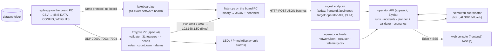

# Global plan — Beat the Shutdown

HackUTD 2026: Zero Day · last updated **Sun Nov 8 2026, 03:30 CST** (integration of the backend/frontend, FPGA and
ML branches onto `main`; weights v4; Lucas's board-run plan) · hacking ends **Sun Nov 8** (check the exact cutoff in the
[Hackerpack](https://hackutd-2026.notion.site/HackUTD-2026-Zero-Day-Hackerpack-3b163cec774080bea6c5fb7358a42dac))

## How this file works

- This is the team's **single source of truth** for cross-team decisions. Each owner's working plan lives in
  `docs/plan/<owner>/`; once a decision there has solidified, it is promoted here with a changelog row.
  Module-level detail stays in the owner's files (§4).
- Status labels:
  - **DECIDED**: build against it.
  - **ADOPTED**: decided for the demo by integrating working code; the owners named may still revise it, through
    §8.
  - **PROPOSED**: you may code against it, but the owner still has to confirm.
  - **OPEN**: don't assume anything.
- **The FPGA is the fixed point (Mudit, Sun 02:55).** FPGA spec v4 (wire format, numerics, module contracts) is
  locked, and the RTL is built to it (most modules signed off; countdown, head and regs finishing review, §7).
  Changing either would take far longer than we have, so **everything else adapts to them**: ingest, ML, the
  server, agents and the console. Nothing here asks for an FPGA or RTL change. A component that seems to need one raises it with Lucas only if something is actually broken; Lucas decides, and a workaround
  outside the FPGA is the default.
- **Who has the final word (Mudit, Sun 02:35).** This is a tiebreaker, not a shortcut: the approvers listed in §8
  are always consulted first, and the final say applies only when they still disagree.

  | Domain | Final say |
  | --- | --- |
  | Spec, FPGA, RTL, wire format, numerics | **Lucas** |
  | Model, features, training, weights, ingest and board tooling (`ml/`) | **Mudit** |
  | Operator API / server, agents, Nemotron | **Jason** |

  Lucas's spec v4 names `features_int.py` the normative integer reference. Where the two disagree, it is a spec
  question Lucas rules on, and the ML side follows. The rule doesn't name the web console: UI-only matters are
  Gurneal's, and anything touching the server ↔ web contract follows the server rule (Jason).
- If an owner's plan and this file disagree, the owner with the final say for that domain decides. Record the result
  here.
- **Reviewers and bots:** check every change against §2 (hard rules) and §5 (contracts). A change that touches a
  contract needs the approvers in §8. Known gaps are tracked in §9 with an owner, so a review can tell a new problem
  from a known one; tracking a gap doesn't exempt it from the hard rules.

## 1. What we're building

An operator console for the challenge's produced-water network. It finds **pipeline leaks, pump degradation and
pump failures** in the sensor readings. For each pump failure it gives the **countdown to tank shutdown** and the
**cheapest response** (trucks, early well shut-ins, or accepting the trip), planned across each system's shared
truck fleet.

What sets it apart:

- **Per-record inference in the Eclypse Z7 FPGA fabric**: validation, features, four logistic heads, rules,
  countdown and local alarms, sized so the 1 GbE link is the bottleneck.
- **An operator backend** that owns datasets, runs, incidents, the shared-fleet planner and scenarios.
- **One Nemotron agent coordinator** that explains and compares validated plans.
- **A web console** for operators.

**Priority:** a working end-to-end demo on Sunday beats extra scope. The demo must run on `history/mock_test_*` and
then on the judging `test/` folder (systems S6–S11, a network we haven't seen) **without code changes**.

Judges look at creativity, UX and aesthetics, usefulness, how correct/optimal the cost optimization is, data
coming from the files (no hardcoding), and whether we followed the instructions.

## 2. Hard rules (every component)

1. **Runtime inputs are only** `network.json`, `ops.json` and `telemetry.csv` from a dataset folder.
   `answer_key.json` is for offline training and evaluation only. Never load it at runtime.
2. **No hardcoding.** Don't hardcode asset IDs, facility or well counts, event times, or practice-network
   constants. Read everything from the files.
3. **"Now" is the last `ts_unix` in `telemetry.csv`**, never the system clock. The practice week is in October.
4. **Actions by category.** A leak or pump degradation gets a field inspection (`field_inspection`) and no
   countdown. A pump failure gets `hours_to_limit` and the cheapest plan.
5. **Trucks are planned per system.** All ongoing failures in a system share its `emergency_fleet_size`. Follow
   the SPEC truck rules:
   - the first trip arrives `response_min` after the call, then one every `cycle_min`;
   - each trip removes a flat `truck_capacity_bbl` at a flat `cost_per_trip`;
   - every trip must arrive before the repair ends, and a trip can't remove more water than the tank holds.
6. **Recommendations never rewrite the recorded telemetry.** What-if and replay results run as a separate
   simulation.
7. **Alerts view order:** pump failures first, soonest shutdown first, with ties going to the higher lost revenue
   per hour. Leaks and worn pumps follow in any order.
8. **E-STOP and Night Shift on the board are local alarm signals** (LEDs and Pmod) for the demo. They are not
   validated industrial safety control, and nothing is wired to actuate equipment. The console shows them
   display-only.
9. **Bad or missing data is never reported as healthy.** Every result carries VALID, HELD, INVALID or DROPPED plus
   reason bits.
10. **No unmeasured claims in the pitch.** No accuracy, latency, resource or throughput claim unless it was
    measured; label estimates as estimates.

Rules 11–13 are **PROPOSED** (integration, Sun 02:40) until the whole team confirms them (§8). Rule 11 restates
Lucas's spec v4; rules 12 and 13 restate Jason's agent plan and runbook.

11. **One reference for the board's arithmetic.** `ml/hutd_ml/features_int.py` is normative (FPGA spec v4). Any
    output labeled "board", "FPGA" or "model score" comes from the board or from `fakeboard.py`, which runs that
    reference. Other software runtimes must be labeled "not FPGA bit-exact".
12. **The agent advises, the deterministic layer decides.** Detection, countdowns, fleet feasibility and costs are
    deterministic. The agent explains and compares validated plans; it never dispatches trucks, actuates
    equipment, acknowledges board alarms or deploys weights.
13. **No secrets in the repo, logs or browser bundle.** API keys, DB URLs and tokens are server-side environment
    variables only.

## 3. Architecture

**ADOPTED** at integration (Sun 02:40) as the path the code implements; rows marked PROPOSED below still need
their owners' confirmation. The parts named in §4 own the detail.

| Part | Responsibility | Where | Status |
| --- | --- | --- | --- |
| **Ingest (CSV → binary)** | Encodes the CSV into 48 B binary records with a presence mask, and `network.json` into CONFIG. Sends CONFIG → WEIGHTS → DATA; supports a live weight swap mid-stream. Computes no features. | `ml/hutd_ml/replay.py` + `encode.py`, on Lucas's PC | DECIDED |
| **FPGA engine** | One RESULT per record: validation (hold ≤ 2, then INVALID per R7 option C), 12 channels + 19 memory features, 4 logistic heads, rules, countdown (inflow ring), latched Night Shift / E-STOP, buffering while the server is down. | Spec v4 in `FPGA/spec/`; RTL and proofs on branch `FPGA`; board on Lucas's PC | DECIDED, spec locked |
| **Software board** | The same UDP protocol and bit-exact results as the board, for development and the no-board demo path. | `ml/hutd_ml/fakeboard.py` | DECIDED |
| **Board → JSON** | Binds 7001 / 7002 on the board PC, decodes RESULT / ALERT / STATS to JSON, sends the 1 s heartbeat, POSTs batches. Heartbeats stop when the POST target is down, so the board buffers. | `ml/hutd_ml/listen.py`; schema in `ml/INTEGRATION.md` §3 | DECIDED |
| **Operator API** | Uploads, immutable imports, runs (dataset, cutoff, runtime `auto/software/fpga`), incidents, host countdowns, shared-fleet solver + independent validator, scenarios, export, SSE, agents. | `apps/api/`, `packages/contracts/`, `db/` | ADOPTED (Jason) |
| **Agents** | One Nemotron coordinator over bounded read/compute tools; the AI SDK runtime is the fallback; a deterministic draft when no provider is reachable. | `apps/api/src/features/agents/`; endpoint in `docs/plan/jason/nemotron-inference-operations.md` | ADOPTED (Jason) |
| **Web console** | Presentation only: upload / select / replay, incidents, plans, board view, handoff. No detector or planner of its own. | `frontend/` | ADOPTED (Gurneal, Jason) |
| **Training** | Four logistic regressions on feature set 1; v4 recipe (v3 + a 2 %-missing training copy); int16 export; golden sets; robustness and R7 reports. | `ml/` | DECIDED |

## 4. Owners and where each plan lives

| Area | Owner | Plan / detail | Current focus |
| --- | --- | --- | --- |
| FPGA (Eclypse Z7) | Lucas | `docs/plan/lucas/` (incl. `board_run_plan.md`), `FPGA/AGENTS.md`, `FPGA/spec/` (v4, locked), `FPGA/TASKS.md`, `HANDOFF.md` (FPGA lead session state) | Countdown / head / regs review, then T2.top full-week sim on the golden sets, T2.bd1 block design, T2.board1 board bring-up (validate with R7 C, features, memory, alarm, pack, mul, div, unpack DONE; T2.ps1 ARM app DONE) |
| Model, features, ingest, board tooling | Mudit | `docs/plan/mudit/ml_architecture.md` (frozen), `ml/README.md`, `ml/INTEGRATION.md` | Weights v4 deployed; board run with Lucas on the v4 golden sets; ingest via `listen.py` with Jason / Gurneal |
| Operator API, agents, Nemotron | Jason | **`docs/plan/jason/START_HERE.md`** (briefing: ML / FPGA state, verified commands, his open items), `docs/plan/jason/agent-backend-architecture.md`, `backend-demo-runbook.md`, `nemotron-inference-*.md`, root `README.md` | Board ingest into runs (I-1), the PR #4 review findings (§9) |
| Web console | Gurneal (Jimmy), with Jason | `frontend/`, `frontend/docs/live-api.md` | Board view from the operator API's snapshot (I-2) |

## 5. Interface contracts

| ID | Contract | Status | Defined in | Change needs |
| --- | --- | --- | --- | --- |
| C1 | Dataset inputs: the three files, their schemas, equipment behavior and plan rules | DECIDED (organizers) | Reference repo `SPEC.md` | Fixed |
| C2 | UDP wire protocol **v1**: ports 7000–7004 (+7777); 16 B header; DATA 48 B; RESULT 32 B; ALERT 16 B; STATS 64 B; GLOBAL 32 B (bytes 20–23 `persist_K4`, 24–31 reserved 0); Facility CONFIG 64 B; HEARTBEAT; WEIGHTS chunks + COMMIT. RESULT / STATS / ALERT go to **192.168.1.50** (fixed); ACKs go to the sender. | DECIDED; FPGA spec **v4 locked** | `FPGA/spec/numerics.md`, `docs/plan/lucas/fpga_hardware_plan.md`, `ml/hutd_ml/wire.py` | Lucas + every consumer; spec bump |
| C3 | Slot rules: `fac_id` = position in `network.json`; ≤ 32 facilities and ≤ 8 wells (the encoder refuses otherwise); startup order GLOBAL → Facility CONFIG → WEIGHTS → DATA | DECIDED | spec v4 §10, `encode.py` | Lucas + Mudit |
| C4 | Feature set **1**: 12 channels + 19 memory features (31), int16 at 1/16384, `S = 17` | DECIDED, **frozen** | spec v4 §4–5; `ml_architecture.md` §4 | Spec bump (Lucas + Mudit) |
| C5 | Model: four independent logistic regressions `[leak, degradation, failure, shut_in]`; int16 W, int32 B, 48-bit accumulator, shared `S_out`; logits at 1/256 | DECIDED | spec v4 §8; `ml_architecture.md` §5 | Mudit + Lucas |
| C6 | `features_int.py` is the normative integer reference; FPGA `eog_ref.py` must match it bit for bit (checked by `python -m hutd_ml.fpga_sync`) | DECIDED | spec v4 header; ruling #23; `ml/README.md` "RESULT semantics" | Mudit + Lucas |
| C7 | Weight blob: 980 B (header, 4×31 int16, 4 int32, hash, 10 self-test vectors), CRC32; the ARM checks the header and self-tests; swap at a record boundary | DECIDED | spec v4 §8 (D11); FPGA questions 67–69 | Mudit + Lucas |
| C8 | Alarms: hit = logit **>** threshold, per-class K, E-STOP = gap rule + leak hit; latched Night Shift / E-STOP with CLEARED alerts; values from the deployed weights' `global_config.json` (**v4**: `persist_K4` [2,4,1,1], `logit_thr` [−128,−64,0,0], `gap_thr` 504) | DECIDED | spec v4 §9; `ml/artifacts/v4/` | Lucas (logic) / Mudit (values) |
| C9 | Events and actions: the operator API builds incidents (onset / ongoing / resolved) from host interpretation; leak and degradation → inspection; failure → countdown + system plan from the bounded solver + independent validator (`best_feasible_found`); optional SPEC `events.json` export | **PROPOSED**: implemented in PR #4; Jason + Gurneal to confirm | `agent-backend-architecture.md` §"Deterministic domain layer" | Jason + Gurneal |
| C10 | Server ↔ web API: the operator API (Elysia, Eden-typed `App`, SSE cursors), proxied by the Next app with a server-side token | **PROPOSED**: implemented in PR #4; Jason + Gurneal to confirm | `agent-backend-architecture.md` §"Feature API"; `apps/api/src/app.ts`; `packages/contracts/` | Jason + Gurneal |
| C11 | Board → server JSON: `result` / `alert` / `stats` objects from `listen.py` (names, calibrated probability, `above_threshold`, status, reasons, countdown, `weights_ver`), POSTed as arrays; `[]` while idle | DECIDED for what `listen.py` emits (Mudit); the console consumes it today; the operator API's ingest is I-1 (Jason to confirm the shape) | `ml/INTEGRATION.md` §3 | Mudit + Jason + Gurneal |
| C12 | Agent scope: one coordinator, scoped tools, server-validated finalization; Nemotron endpoint per `nemotron-inference-operations.md`; AI SDK fallback; draft without a provider | **PROPOSED**: implemented in PR #4; Jason to confirm | `agent-backend-architecture.md` §"Agent design" | Jason |

## 6. Superseded — do not build

| Superseded | Replaced by | When |
| --- | --- | --- |
| The CNN and its `[1,12,96]` window (`docs/research/FPGA_CLASSIFIER_HANDOFF.md`) | Four logistic regressions on causal memory features | Sat 21:10 |
| Host-side windowing / 2,304 B full-window transport (`model-input-v1.json`) | 48 B streaming records; preprocessing on the FPGA | Sat 19:45 |
| Countdown from inflow − pump flow; tripped tank reading "not filling" | Ring of facility inflow, prefilled; tripped tank → 0 (D1 / D2 / D6) | Sun 00:45 |
| Hold overflow → history reset (A6) | **R7 option C**: hold overflow → INVALID, memory kept (FPGA spec question 70) | Sun 02:10 |
| The frontend's bundled detector / planner and direct model calls | The operator API (C9 / C10) | PR #4 |
| Weights v1 (pre-review spec) | v4 deployed; v3 kept as the fallback; v2 kept for RTL verification | Sun 02:45 |

## 7. Path to the demo (in this order)

**Working now (measured):**

- The board does the 1 GbE UDP round trip (Lucas).
- `features_int.py` ≡ `eog_ref.py` bit for bit on the full practice week (v2, v3, v4; v4 with R7 option C at FPGA
  `10be393`) and the edge cases; the FPGA side's `check_mudit.py` passes on all 8 golden sets.
- FPGA modules signed off under Lucas's three-tier standard (lint, sim, formal): mul, div, unpack, validate (R7 C),
  features, memory, alarm, pack. Countdown, head and regs are in review.
- replay → software board → listen → HTTP: 4,500 / 4,500 results delivered.
- The operator API and console run end to end in software mode (Jason's PR #4 report, browser-checked). Measured
  on the integrated tree (Sun 02:55): `bun run test` 88 pass, 1 skip, **2 fail** (I-10; the same on PR #4 alone);
  `bun run typecheck` clean; `ml` tests 12 / 12.
- The Nemotron endpoint answers authenticated chat completions (Jason's runbook). Its tool-call parser is not yet
  verified end to end.

1. **FPGA + CSV → binary** (Lucas, Mudit). **DECIDED** (Lucas, Sun 02:45; detail in
   [`docs/plan/lucas/board_run_plan.md`](docs/plan/lucas/board_run_plan.md)). Weights v4 for the board run and the
   demo, v3 as the fallback.

   | Step | What | Where | Time (estimate) |
   | --- | --- | --- | --- |
   | 0 | Countdown, head and regs signed off (three tiers). **regs is the long pole.** | FPGA agents | — |
   | a | T2.top: `eog_top`, top-level proof, full-week sim bit for bit against the model and weights v4 G0 / G1 / G2 | other machine | — |
   | b | T2.bd1: block design, LED / BTN0 / Pmod constraints, Vivado build | Lucas's PC | 30–60 min |
   | c | ARM app (`eog_app`, already host-tested): Vitis build, program the board | Lucas's PC | ~10 min |
   | d | T2.board1: `board.py --golden ml/artifacts/v4/golden/g0`, then g2, then g1, then `--heartbeat-test 6`; each byte-identical before the next. Compare ALERTs on a freshly started board (latches survive CONFIG writes). | board | 15–30 min |
   | e | First live run: `replay.py` with weights v4 + its `global_config.json` over the full week → board → `listen.py` → Jason's server; then the live weight swap (`--swap-at-step`) | board PC → server | — |

   No clock times until regs and T2.top land; Lucas pings Mudit when T2.bd1 starts. Until step e, steps 2–3 below
   run against `fakeboard.py` (same JSON), so they don't wait on the board.
2. **Board → console** (Jason, Gurneal, Mudit):
   - `listen.py --post` into the operator API's ingest (I-1);
   - board RESULTs attached to a run;
   - `Snapshot.board` populated (I-2);
   - same JSON whether the board or `fakeboard.py` produced it.
3. **Agents on board-fed incidents** (Jason): coordinator explanations and shift handoff over incidents and plans
   from step 2.
4. **Judging dry run:**
   - `mock_test_*` end to end;
   - then a fresh folder;
   - then `test/` when it appears (check ≤ 32 facilities / ≤ 8 wells);
   - no code changes between runs.

**Fallback at every step:** if the board is unavailable, run `fakeboard.py` in its place (bit-exact, same JSON).
If that fails, the operator API's own software runtime, labeled "not FPGA bit-exact".

## 8. Change control

| What changes | Who must agree (**tiebreaker in bold**) | Also do |
| --- | --- | --- |
| Wire format, slot rules, FPGA numerics (C2–C4, C6–C8 logic) | **Lucas**, after hearing every consumer | Spec version bump; regenerate golden sets; `fpga_sync` PASS |
| Weights, thresholds, K (C8 values) | **Mudit** (tell Lucas the version) | New `ml/artifacts/vN/`, golden sets, loopback test |
| Board JSON (C11) | **Mudit** for what `listen.py` emits; **Jason** for how the server ingests it; Gurneal consulted | Update `ml/INTEGRATION.md` |
| Events, actions, server ↔ web API (C9, C10) | Jason + Gurneal (**Jason** breaks a tie) | Update `docs/plan/jason/` and this file |
| Agent scope, Nemotron (C12) | **Jason** | Update `docs/plan/jason/` and this file |
| Alarm semantics (C8 logic) vs. recommended actions (C9) | Lucas + Jason; UI wording with Gurneal | Re-check hard rules 4 and 8 |
| Hard rules (§2), this section, "How this file works" | Whole team | — |
| Anything that would change FPGA spec v4 or the RTL | **Lucas**, and only to fix something broken ("How this file works") | Prefer a fix outside the FPGA |

Lucas's live FPGA doc is never edited by automation; update its repo copy. Branch `FPGA` is Lucas's; branch `ml` is
Mudit's integration branch; `main` receives merges from them.

## 9. Open items

**Integration tasks:**

| # | Task | Owner | Notes |
| --- | --- | --- | --- |
| I-1 | **One board ingest path into the operator API.** `listen.py` JSON (C11) is persisted against a run, so board RESULTs feed incidents, plans and agents. Today `listen.py` posts to the frontend's in-memory `/api/ingest`. | Jason (+ Gurneal) | Retire or align `apps/api/src/bridge.ts` (same decoding as `listen.py`) so there is one bridge |
| I-2 | **One board-data authority in the console.** Render board data from the operator API `Snapshot.board`, not a second client-side feed. | Gurneal | PR #4 review finding 2 (round 2) |
| I-3 | **One encoder.** `apps/encoder` (TS) must produce `ml/artifacts/*/golden/g1/data.bin` byte for byte, or be retired in favor of `encode.py` / `replay.py`. | Jason + Mudit | C3 / C6 |
| I-4 | **Software runtime parity.** The API's "software" runtime uses `fakeboard.py` + `listen.py` (bit-exact, v4 weights), or keeps `packages/fpga-sim` labeled "not FPGA bit-exact". | Jason | Hard rule 11 |
| I-5 | Fill-rate display uses inflow − pump flow; use inflow only, as the countdown does (O7 fix). | Jason | PR #4 review finding 4 |
| I-6 | `packages/fpga-sim` alarm latches map E-STOP to pump fault and Night Shift to shut-in; C8 says otherwise. Fix, or drop if I-4 makes it unused. | Jason | PR #4 review finding 6 |
| I-7 | `SIMULATE_BOARD` feed: dev builds only, no invented `weightsVersion`; `BoardFacility` must carry RESULT status / reasons (hard rule 9). | Gurneal | PR #4 review round 2, findings 3–4 |
| I-8 | AI SDK fallback: verify tool wiring (`inputSchema`, execute args), label `ai-sdk` analyses as model-written in the UI, no fake FX session link, facts via tools rather than the system prompt, no `nowUnix ?? 0` default. | Jason | PR #4 review round 3 |
| I-9 | **Alarm acknowledge message.** No wire message exists for a server-side latch acknowledge, so `CTRL.server_ack` is never pulsed. The server team defines it; the ARM forwards it (T2.ps1 follow-up); RTL unchanged. A new wire message is C2, so Lucas approves the layout. Until then, acknowledge is BTN0 on the board only, and the console shows latches read-only (hard rules 8, 12). | Jason (+ Lucas) | FPGA spec question 77 |
| I-10 | Two analysis-coordinator tests fail on PR #4 as merged (`apps/api/src/features/agents/service.test.ts`: "timeout returns an honest draft…", "fails instead of hiding a fenced session persistence failure"). Not caused by the integration: same result on `feature/operator-backend` @ `e001cf3`. | Jason | Found at integration |
| I-11 | ~~**Hard rule 9 in the console**~~ **Done in PR #6** (minimal fixes, no redesign): `unknown` health is drawn grey like `no_data` (water, pipe, tank, system status) and counts in the "no data" headline; a missing tank level is a grey ring and "tank level unknown", not an empty tank or 0 %; missing confidence, flows, pump status, receive flow and wear scores read "Unknown" / "No data" instead of 0, "Stopped" or a zero gap; plan totals with a missing cost read "Unknown", not `$0`; a pump-failure card says "Repair first" / "Not filling" instead of "Safe". `tsc`, `eslint` and `next build` pass. | Gurneal to review | PR #6 compliance review finding 1 |
| I-12 | Dead links: the console's `/api/events` download and Photon's `/api/brief` / `/api/events` calls; the operator API serves the export at `GET /runs/:id/export`. | Gurneal | PR #6 review finding 5 |
| I-13 | Operator approvals live only in React state; persist them through `POST /runs/:id/actions`. | Gurneal (+ Jason) | PR #6 review finding 5 |
| I-14 | `frontend/src/lib/engine/types.ts` forks `@hackutd/contracts`; use the shared contracts. | Gurneal + Jason | PR #6 review finding 5; C10 |
| I-15 | **Nemotron live check.** The vLLM server runs with max model len 4096 while the coordinator asks for up to 1,024 output tokens plus facts and tool schemas; `Provider.contextWindow` exists but `loadConfig` never sets it, so libfx doesn't know the limit. Also verify the `qwen3_coder` tool-call parser end to end before the demo (runbook). | Jason | Found while writing `docs/plan/jason/START_HERE.md` |

**Open questions:**

| # | Item | Owner | Notes |
| --- | --- | --- | --- |
| O1 | Should ALERT be ACKed and retried? | Lucas + Jason | ALERTs are buffered and replayed today |
| O4 | Pin map for LEDs / buttons / Pmods | Lucas | T2.bd1 |
| O6 | E-STOP on a confirmed leak vs. the leak → inspection rule | Lucas + Jason | **Proposed resolution:** E-STOP stays a local LED / Pmod alarm (spec v4, hard rule 8); the console shows it read-only and still recommends an inspection. FPGA side done; Jason to confirm the server / console side. |
| O7 | Countdown fix (inflow, not inflow − pump flow; tripped tank → 0) | Lucas; Jason for the fallback band | FPGA side **done** (spec v4, D1 / D2 / D6). Server side open: I-5. |
| O10 | Throughput demo (loop / scale-out replay) | Lucas | T3.perf; never mixed with operator runs |
| O11 | Server → web app API | Jason + Gurneal | Proposed resolution: C10 (implemented in PR #4) |
| O12 | Nemotron agent scope and inputs | Jason | Proposed resolution: C12 (implemented in PR #4); the AI SDK fallback issues are I-8 |

Resolved since the last version:

- **O2:** values = v4 (C8).
- **O13:** leak false alarms with missing readings under R7 C: fixed by weights v4 (0.21 → 0.03 per facility-day at
  2 % missing), no RTL change.
- **O14:** `eog_ref.py` with option C (FPGA T0.2c): done; `fpga_sync` PASS on v4 G0 / G2 / G1.
- **O3:** blob layout, D11.
- **O5:** feature set frozen.
- **O8:** spec v4.
- **O9:** ingest = `replay.py`.

## 10. Repository map

| Path | What | Owner |
| --- | --- | --- |
| `global_plan.md`, `AGENTS.md`, `CLAUDE.md` | This plan; agent instructions | Team |
| `apps/api/`, `packages/`, `db/` | Operator API, contracts, migrations | Jason |
| `apps/encoder/` | TS DATA encoder (see I-3) | Jason |
| `frontend/` | Web console | Gurneal, Jason |
| `Photon/` | Test bot (Gurneal) | Gurneal |
| `FPGA/` | On `main`: spec v4, task board, kickoff, docs (Lucas's PR #5). RTL, proofs, testbenches, model, ARM app and build scripts stay on branch `FPGA` until Lucas's FPGA → `main` PR after T2.top | Lucas |
| `HANDOFF.md` | FPGA lead session state | Lucas |
| `ml/` | Ingest, `features_int.py`, training, weights, golden sets, board / fakeboard / listen / replay, sync tools | Mudit |
| `docs/plan/<owner>/` | Owner plans | each owner |
| `docs/research/` | Original audit and the CNN handoff (superseded in part) | Mudit |

## 11. Changelog

| When (CST) | Change |
| --- | --- |
| Sun Nov 8 03:30 | **Briefing for Jason** (`docs/plan/jason/START_HERE.md`): what the board side delivers (C11 JSON, weights v4, board timeline), the three-terminal software path re-verified with v4 (600 results, 9 alerts, 35 POST batches), his open items in a suggested order. New I-15 (Nemotron context limit and tool-call parser). |
| Sun Nov 8 03:25 | **Plan statuses made honest** (PR #6 review): hard rules 11–13 and C9 / C10 / C12 are PROPOSED until their owners confirm (§8 approvers); O6, O7 (server side), O11, O12 reopened with their proposed resolutions; the final say is a tiebreaker after the §8 approvers are consulted; tracked review findings I-11 … I-14. I-11 (hard rule 9 in the console) fixed in PR #6 for Gurneal to review. |
| Sun Nov 8 02:55 | **The FPGA is the fixed point** (Mudit): spec v4 and the RTL stay as they are; every other part adapts to them ("How this file works", §8). |
| Sun Nov 8 02:55 | **Board-run plan decided** (Lucas's reply, `docs/plan/lucas/board_run_plan.md`): weights v4 for the board and the demo, v3 fallback; order T2.top → T2.bd1 → ARM build → T2.board1 (v4 G0, G2, G1, heartbeat test) → first live run → live swap, with estimates (§7). Lucas's PR #5 put the FPGA docs on `main`; FPGA code follows in his own FPGA → `main` PR after T2.top (his call), so this integration carries no FPGA code. FPGA spec question 73 done (GLOBAL table in the repo copy of Lucas's plan); question 77 → I-9 (Jason). |
| Sun Nov 8 02:45 | **Weights v4 deployed** (`weights_ver` 4, `ml/artifacts/v4/`): the v3 recipe plus a 2 %-missing training copy, because the judging data will have missing readings (Lucas). C8 values: `persist_K4` [2,4,1,1], `logit_thr` [−128,−64,0,0], `gap_thr` 504. Clean: leak 0.92/0.99 (10 / 65 min), degradation 0.96/0.90 (160 / 170 min). 2 % missing under R7 C: false alerts 0.03 / 0.17 per facility-day (v3: 0.21 / 0.11). R7 C beats A6 on every measure at 1–2 % missing (`ml/artifacts/missing_data_v4/`). `fpga_sync` PASS at FPGA `10be393`; ML follow-ups for FPGA questions 46, 48, 74, 75. O13, O14 resolved. |
| Sun Nov 8 02:40 | **Integration onto `main`.** Merged Jason's operator backend + Gurneal's console (PR #4, which contains PR #3's software runtime in a later form), PR #3's Nemotron runbook (cherry-picked) and the `ml` branch; Lucas's FPGA docs (spec v4 locked, task board) came separately through his PR #5 (02:51). Rewrote this plan as the single source of truth: architecture §3 with one path (replay → board / fakeboard → listen → API → agents / console); C9 / C10 / C12 ADOPTED from Jason's plan; new C11 (board JSON); hard rules 11–13; R7 option C; integration tasks I-1 … I-8 from the PR #4 compliance reviews; repository map. |
| Sun Nov 8 02:35 | **Final-say rule** (Mudit): spec / FPGA / RTL → Lucas; ML → Mudit; server and Nemotron → Jason. Recorded in "How this file works" and §8. |
| Sun Nov 8 02:10 | Lucas: **R7 = option C** (hold overflow → INVALID, no history reset). Answered ML-1 … ML-13 (FPGA spec questions 38, 67–70): fixed result destination 192.168.1.50; ACKs to the sender; blob checks; live swap supported. ML regenerated golden sets (ml `59f3746`); C vs A6 report in `ml/artifacts/missing_data/`. |
| Sun Nov 8 01:50 | **ML architecture frozen** (`docs/plan/mudit/ml_architecture.md`). Feature set and RTL unchanged. Training recipe v3: augmentation + observable labels + C 3. **Weights v3 deployed**: leak 0.95/0.99 (5 min); degradation 0.95/0.90 (median 155, worst 180 min). |
| Sun Nov 8 01:10 | Lucas reviewed A1–A19: `features_int.py` normative for the RTL; `S_feat` = 17, inflow countdown, FRAMING → DROPPED, latched alarms, per-class K. Weights v2 retrained. O3, O7, O8 resolved. |
| Sun Nov 8 00:45 | Weights v2 (augmented training): robust to different healthy pressure offsets. |
| Sun Nov 8 00:20 | Ingest decided: CSV → binary on Lucas's PC (`replay.py`). Added `listen.py` and `ml/INTEGRATION.md`. |
| Sat Nov 7 23:15 | ML pipeline in `ml/`: encoder, bit-exact reference, weights v1, golden sets, board harness, software board. |
| Sat Nov 7 22:45 | Linked Mudit's ML plan. |
| Sat Nov 7 21:45 | Created the global plan from Lucas's FPGA plan: architecture, owners, contracts C1–C10, demo path, open questions. |
